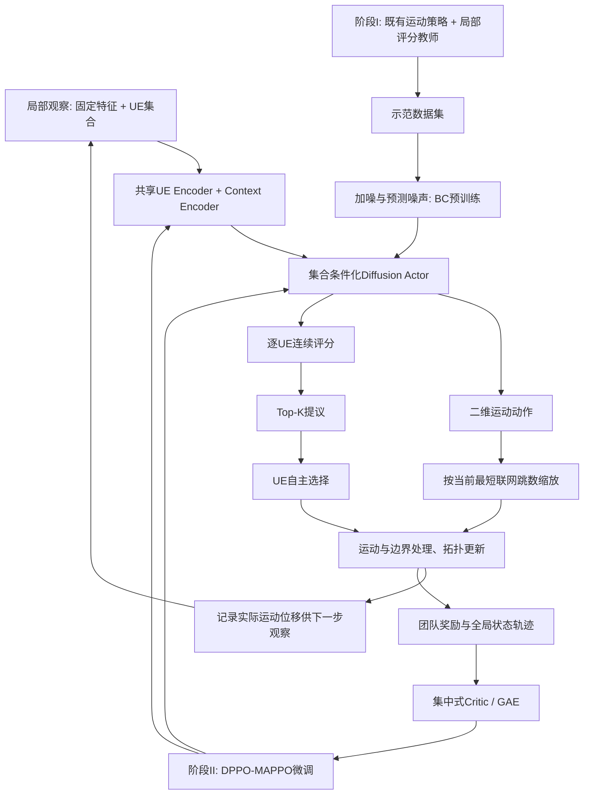
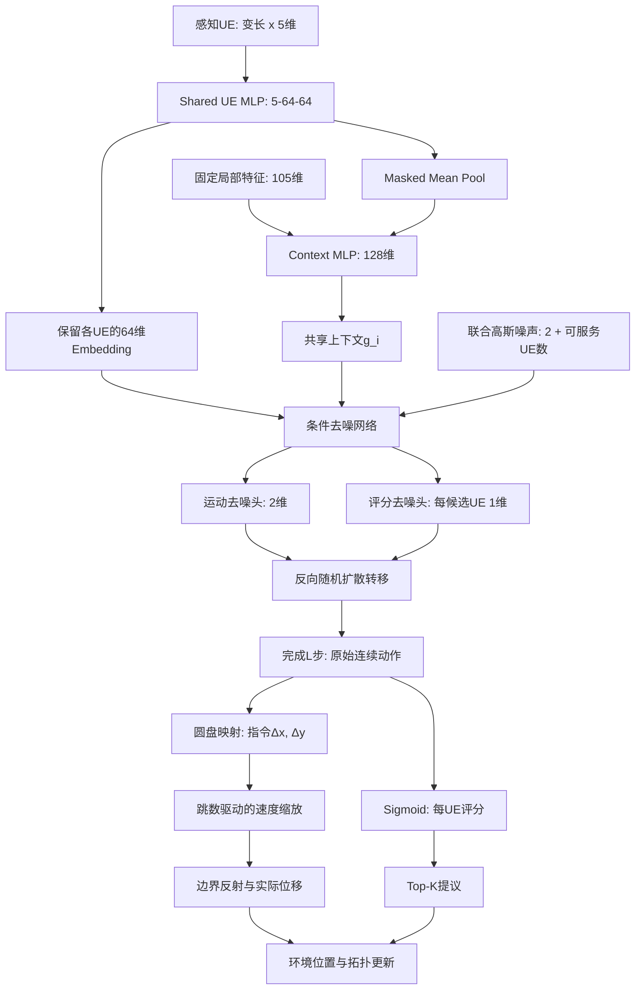
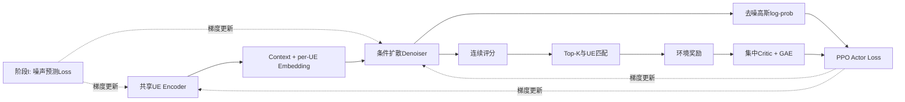

# ENVIRONMENT MODELING

## 一、场景

无人机（Unmanned Aerial Vehicles, UAVs），通常也称为 drones，正越来越广泛地被部署为**移动感知平台和通信平台**。

其中一个重要的应用场景，是在地面通信基础设施因自然灾害而受损，或者在大型人员密集活动中因负载过高而拥塞时，利用自主 UAV 作为能够**快速部署的空中中继节点**。

在森林火灾监测和战场监视等场景中，UAV 还可能工作在超出操作人员直接控制范围的区域，因此需要具备**机载自主决策能力（onboard autonomy）**以及 **UAV 之间的点对点协同能力（peer-to-peer coordination）**。

在这些场景中，UAV 集群必须自主决定各自应部署在什么位置，从而最大化对**动态目标区域**的感知覆盖或通信覆盖。

许多多 UAV 覆盖与部署任务都可以从最大覆盖选址问题**（Maximum Coverage Location Problem, MCLP）**的角度进行描述；然而，该问题属于 **NP-hard 问题**。

此外，真实部署环境还具有两个重要特征。

一方面是**部分可观性**，即 UAV 只能感知到其附近的实体（其余UAV，基站BS，地面用户UE）。

另一方面是**通信约束**，即两个实体（UAV-UAV, UAV-UE, UAV-BS）之间的通信链路质量SINR超过某个阈值时，它们才能通信交换信息。

为了解决该问题，多智能体强化学习**（Multi-Agent Reinforcement Learning, MARL）**提供了一套良好的方法


## 二、CTDE

本方案使用 **集中式训练、分布执行（CTDE）**架构。

在训练阶段，集中式 critic 可以访问全局信息，以提高训练过程的稳定性；在执行阶段，每架 UAV 运行一个**共享策略（参数共享的策略网络）**，其输入仅包括自身的局部观察（其中 BS 坐标为预先已知信息）。


## 三、系统模型

本文考虑应急通信场景，现有通信基站设施已经失效，此时需要使用多架无人机部署于空中形成多跳的无人机网络；可移动地面用户可连接无人机，并通过多跳无人机网络连接至基站。

### A. 网络模型

**实验实例约定：** 本版物理场景、初始化、运动与边界规则统一采用 `configs/mappo_coverage_throughput_capacity10_1m.yaml`。主实验区域为 \(3500\times3500\,\mathrm m\)，UAV 数量 \(U=18\)，UE 数量 \(M=150\)，可用应急网关数量 \(G=3\)，BS 分别位于 \((0,0,0)\)、\((0,3500,0)\)、\((3500,0,0)\)。三个 BS 均可接入核心网且不失效；区域原有接入设施失效。UAV 允许形成多个机间子网，只要各自可直接或多跳到达任一 BS。BS 仅作为路由终点，不增加 BS–BS 转发边。

UAV 高度固定为100 m，初始水平坐标在整个 \([0,3500]^2\) 区域内独立均匀采样。不按覆盖、回传可达性或连通性筛选，不要求初始接入 BS。静止部署使用相同的初始位置分布。UE 在中心2500×2500 m区域 \([500,3000]^2\) 内独立均匀初始化，对应 `user_initialization: uniform_interior`、`user_initial_margin_fraction: 1/7`。本版不采用四中心高斯混合。中心范围只限制初始化，后续 UE 可在整个场地内移动。

任务持续400步，每步1 s，UAV 最大速度30 m/s（Actor 指令位移的最大幅度）；新增按当前最短联网跳数缩放运动指令的确定性执行规则，实际速度不会超过该上界。UAV 和 UE 均采用逐坐标镜面反射边界；越界部分反向返回场地，不截断为停在边界。第400次动作完成后真正终止，不对终止之后 bootstrap。UE 每步独立采样高斯移动幅度（标准差1 m/s，截断至 \([-3,3]\)）及均匀方向。UU 通信距离650 m，UG 三维距离1500 m。

| 参数 | 与 baseline 一致的设置 |
|---|---|
| 载波、每 UAV 接入带宽 | 2.4 GHz、20 MHz |
| UAV 总功率、服务容量 | 30 dBm、10 UE；每子带2 MHz、功率20 dBm |
| 噪声功率谱密度、下行噪声系数 | −174 dBm/Hz、15 dB |
| LoS 参数、LoS/NLoS 额外损耗 | \(a=9.61,b=0.16\)；1/20 dB |
| 下行 SINR 门槛 | −3 dB；固定子带功率、满负载同频干扰 |
| UE 发现信标 | 26.0205999133 dBm（0.4 W）、180 kHz |
| UAV 信标接收噪声系数、感知门槛 | 15 dB、20 dB |
| 速率参考值 | 5 Mbps |
| 奖励权重 | \(w=0.1,\lambda=0,\mu=0\)；边界惩罚权重0 |

上行发现与下行使用正交资源，忽略信标间干扰；发现范围由链路预算计算，不硬编码感知距离。回传与接入正交，保留理想路由收敛及充分回传容量假设。本次对齐仅统一环境与固定观察约定；扩散 Actor、五维 UE 特征和 Top-K 关联仍属于新方法，不代表已与 baseline 使用相同算法。本版在线训练采用种子0、10M条联合转移；示范采集和预训练成本另计。

#### 1. 网络节点定义

令 \[ \mathcal{G}=\{1,2,\ldots,G\} \] ，表示所有可用基站构成的集合，各基站的坐标位置表示为：
$$
p_{g}=(x_{g},y_{g},0), \qquad \forall g=1,2,\ldots,G.
$$
令 \[ \mathcal{U}=\{1,2,\ldots,U\} \] ，表示所有 UAV 构成的集合，各 UAV 的坐标位置表示为：
$$
p_{u}=(x_{u},y_{u},h_{u}), \qquad \forall u=1,2,\ldots,U.
$$
由于已有大量研究对 UAV-BS 的最优飞行高度进行了研究，并且一旦最优高度确定，其变化相对于 UAV-BS 的最优二维水平位置来说通常较小。

因此本文假设所有 UAV 均在相同高度飞行，即 \[ h_{u}=h. \]

令 \[ \mathcal{M}=\{1,2,\ldots,M\} \] ，表示所有 地面用户UE 构成的集合，各 UE 的坐标位置表示为：
$$
p_{m}=(x_{m},y_{m},0), \qquad \forall m=1,2,\ldots,M.
$$

#### 2. 实体距离 

任意两实体之间的距离使用 **欧式距离**。

实体 \[e_1\] 与 \[e_2\] 之间的三维距离可以表示为：
$$
d_{{e_1},{e_2}} = \sqrt{(x_{e_1}-x_{e_2})^2 + (y_{e_1}-y_{e_2})^2+(h_{e_1}-h_{e_2})^2}.
$$

#### 3. 连接变量

令 \[a_{{u_i},{u_j}}\] 表示 UAV \[u_i\] 与 UAV \[u_j\] 的连接关系，因此，
$$
a_{{u_i},{u_j}} = \begin{cases} 1,&u_i\text{ 连接 }u_j\\ 0,&u_i\text{ 不连接 }u_j \end{cases}
$$
所有的 UAV 连接关系变量组合为 **UAV 连接矩阵**： \[\bold A\] ，其中 \[\bold A\]为 U * U 矩阵，每个元素代表具体两架 UAV 的连接关系，对角线元素为1.

令 \[b_{u,g}\] 表示 UAV \[u\] 与 基站 \[g\] 的最短连接路径跳数关系（直接或多跳间接），因此，
$$
b_{u,g} = \begin{cases} 
1, &u\text{ 可直接接入基站 }g\\
k, &u\text{ 可通过最短 }k\text{ 跳接入}g \\
U+1, &u\text{ 不可接入基站 }g 
\end{cases}
$$
所有 UAV-BS 连接关系变量组合为 **UAV 接入矩阵**：\[ \bold B \] ，其中 \[ \bold B \] 为 U * G 矩阵。

令 \[c_{m}^{u}\] 表示 UAV \[u\] 与 地面用户 \[m\] 的连接关系。因此，
$$
c_{u,m} = \begin{cases} 1,&m\text{ 接入 }u\\ 0,&m\text{ 不接入 }u \end{cases}
$$
所有的 UAV-UE 连接关系组成 **服务关联矩阵**：\[ \bold C \] ，其中 \[ \bold C \] 为 U * M 矩阵。

### B. 通信模型

#### 1. LoS 和 NLoS 

无线信号传播被划分为两类链路：一类是**视距（LoS）链路**，另一类是**非视距（NLoS）链路**。

LoS 和 NLoS 链路出现的概率可以分别表示为：
$$
P_{e_1,e_2}^{\mathrm{LoS}}
=
\frac{1}{
1+a\exp[-b(\theta_{e_1,e_2}-a)]
}
$$

$$
P_{e_1,e_2}^{\mathrm{NLoS}} = 1 - P_{e_1,e_2}^{\mathrm{LoS}}
$$

\[a\] 和 \[b\] 是与具体环境传播有关的参数，而 \[\theta\] 为 \[e_1\] 和 \[e_2\] 之间的仰角。

LoS 和 NLoS 情况下的路径损耗(dB)分别表示为：
$$
\zeta_{e_1,e_2}^{\mathrm{LoS}}
=
20\log d_{e_1,e_2}
+
20\log f
+
20\log\left(\frac{4\pi}{c}\right)
+
\eta_1,
$$

$$
\zeta_{e_1,e_2}^{\mathrm{NLoS}}
=
20\log d_{e_1,e_2}
+
20\log f
+
20\log\left(\frac{4\pi}{c}\right)
+
\eta_2.
\tag{4}
$$

其中，\[f\] 表示载波频率，\[c\] 表示光速，\[\eta_1\] 和 \[\eta_2\] 分别表示 LoS 和 NLoS 传播路径所产生的额外损耗。

#### 2. UAV-UE 通信

无人机 UAV 与 地面用户 UE 之间的**平均路径损耗**(dB)可以表示为：
$$
\zeta_{u,m} = 
P_{u,m}^{\mathrm{LoS}}\zeta_{u,m}^{\mathrm{LoS}} +
P_{u,m}^{\mathrm{NLoS}}\zeta_{u,m}^{\mathrm{NLoS}}
$$

#### 3. UAV-UAV 与 UAV-BS 通信

对于 UAV 与 UAV 或 UAV 与 BS 之间的信道，由于通常不存在障碍物遮挡，因此直接采用**自由空间传播损耗模型**：
$$
\zeta_{u_1,u_2}
=
20\log d_{u_1,u_2}
+
20\log f
+
20\log\left(\frac{4\pi}{c}\right)
$$

#### 4. 带宽分配

假设系统的总带宽为 \[B\] ，并采用**频分复用(FDM)**。

若一台 UAV 最多可以同时服务 \[N\] 个 UE，则 UAV 分配给每个 UE 的带宽为：
$$
B_m = \frac{B}{N},
\qquad
\forall m=1,2,\ldots,M.
$$

#### 5. SINR

**(1) UAV-UE 下行 SINR**

各 UAV 内部采用正交频分接入，不同 UAV 复用同一接入频段。采用固定子带功率和满负载干扰近似，候选链路的干扰不随实际关联人数及子带占用改变。

假设多台 UAV 使用相同频段为 UE 提供服务，因此不同 UAV 之间会产生**同频干扰**。

于是，UAV 与 UE 之间的 **SINR** 可以表示为：
$$
\gamma_{u,m} =
p_u - \zeta_{u,m} - 
10\log_{10}\left(\sigma^2 + \sum_{i \in \mathbf{U} \setminus u} I_{m,i}\right)
$$
其中，\[p_u\] 表示 UAV \[u\] 的在一个用户带宽 \[ B/N \] 内的发射功率，单位 dBm；\[\sigma^2\] 表示该用户带宽内的噪声功率，单位 mW。

\[I_{m,i}=10^{(p_i-\zeta_{i,m})/10}\] 表示 UAV \[i\] 对 UE \[m\] 造成的干扰。 

所有 \[\gamma_{i,j}\] 组合成 SINR 矩阵 \[ \bold Y \] ，其中 \[\gamma_{i,j}\] 代表具体 UAV \[i\] 与 UE \[j\] 之间的 SINR。

**(2) UAV-UE 上行 SINR**

记 UE \(m\) 到 UAV \(i\) 的上行功率增益为：
$$
g_{m,i}^{\mathrm{ul}} = 10^{-\zeta_{i,m}/10}
$$
假设信标足够稀疏，资源重叠干扰可忽略，那么上行 SINR ：
$$
\gamma_{i,m}^{ul}
=
10\log_{10}
\left(
\frac{P_m 10^{-\zeta_{i,m}/10}}
{\sigma_b^2}
\right)
$$
其中，\[P_m\] 是 UE 的发射功率，单位 mW，\[\sigma_b^2\] 是上行噪声功率，单位 mW。

#### 6. 连接条件

**(1) UAV-UE 连接**

对于 UAV-UE 连接，只有当 UAV 与 UE 之间的 SINR 超过某个给定阈值 \[\gamma_T\] 时，UAV 才能为 UE 提供服务。

也就是说，只有满足：
$$
\gamma_{u,m}\geq \gamma_T
$$
才允许：
$$
c_{u,m} = 1.
$$

**(2) UAV-UAV 连接**

假设所有 UAV 具有相同的最大机间通信距离 \(D_{\mathrm{UU}}\)，当两架 UAV 的距离不超过该范围时，认为二者可以建立直接通信链路。

设机间链路允许的最大路径损耗为 \(\zeta_{\mathrm{UU}}^{\max}\)，则由
$$
\zeta_{i,j}
=
20\log_{10}\!\left(\frac{4\pi f d_{i,j}}{c}\right)
\leq\zeta_{\mathrm{UU}}^{\max}
$$
可得：
$$
D_{\mathrm{UU}}
=
\frac{c}{4\pi f}\,
10^{\zeta_{\mathrm{UU}}^{\max}/20}.
$$
**(3) UAV-BS 连接**

假设所有 UAV 具有相同的最大机间通信距离 \(D_{\mathrm{UG}}\)，当 UAV与BS 的距离不超过该范围时，认为二者可以建立直接通信链路。

设机间链路允许的最大路径损耗为 \(\zeta_{\mathrm{UG}}^{\max}\)，可得：
$$
D_{\mathrm{UG}}
=
\frac{c}{4\pi f}\,
10^{\zeta_{\mathrm{UG}}^{\max}/20}.
$$


#### 7. 下行数据率

如果 UE \[m\] 与 UAV \[u\] 建立连接，则二者之间的下行数据率可以表示为：
$$
r_{u,m}=
B_n \log_2 \left(
1+10^{\gamma_{u,m}/10}
\right).
$$
UE \[m\] 每时刻只能与一架 UAV \[u\]，若 UE \[m\] 与 UAV \[u\] 已建立连接，则 \[m\] 与其余 UAV 的数据率为0：
$$
r_{i,m} = 0,
\qquad
\forall i \in \mathbf{U} \setminus u.
$$

所有数据率组成数据率矩阵 \[ \bold R \]。

#### 8. 感知条件

所有需要服务的 UE 能广播发现信标，信标携带用户标识和位置；当 UAV \[u\] 接收到的 UE \[m\] 上行信号 SINR 大于某一感知阈值，则可感知到该 UE：
$$
\gamma_{u,m}^{ul} \geq \gamma_{obs}
$$


## 四、RL 建模

### A. POMDP

POMDP 通常定义为如下元组：
$$
\mathcal M=
\langle
\mathcal N,\mathcal S,\mathcal A,\mathcal P,\Omega,\mathcal O,\mathcal R
\rangle
$$
其中：

- \[\mathcal N\] : 智能体集合
- \[\mathcal S\] : 状态空间
- \[\mathcal A\] : 动作空间
- \[\mathcal P\] : 状态转移概率
- \[\Omega\] : 观测空间
- \[\mathcal O\] : 观测概率函数
- \[\mathcal R\] : 奖励函数

在任意时间步 \[t \in T\] ，每个智能体 \[ i\in\mathcal N \] 根据当前观测 \[ o_i^t\in\Omega \] 选择动作 \[ a_i^t\in\mathcal A \] ，其中观测 \[ o_i^t \] 通常是系统真实状态 \[ s^t \in \mathcal S \] 的某种函数。

随后，整个系统获得一个联合奖励：
$$
r^t=R(s^t,a^t),
$$
并根据状态转移概率：
$$
s^{t+1}
\sim
P(\cdot|s^t,a^t)
$$
转移到新的状态。

每个智能体 \[i\] 根据观测概率函数：
$$
O_i(o_i^{t+1}\mid s^{t+1})
$$
获得下一时刻的原始局部观测。无历史基准采用确定性规则 \(o_i^{t+1}=g_i(s^{t+1})\)；本版固定启用的一步历史采用 \(o_i^{t+1}=g_i(s^{t+1},\Delta\mathbf p_i^{\mathrm{real},t},c_i^t,|\mathcal D_i^t|)\)，其中 \(\Delta\mathbf p_i^{\mathrm{real},t}=\mathbf p_{i,xy}^{t+1}-\mathbf p_{i,xy}^{t}\) 是执行速度缩放和镜面反射后的实际二维位移，而不是 Actor 的原始指令动作。历史只由本机已获得的信息更新。用户集合的神经网络编码属于 actor 内部计算，不属于环境观测函数。

#### 1. 状态空间 \[\mathcal S\]

状态空间包含全局环境信息，建模为：
$$
\mathcal S^t = [
p_{\mathcal U},p_{\mathcal G}, p_{\mathcal M},
\bold A, \bold B, \bold C ,\bold Y,
\frac{t}{T}
]
$$

\[ (p_{\mathcal U}, p_{\mathcal G}, p_{\mathcal M},) \] 分别是 所有UAV，基站，地面用户的坐标集合。

 \[\bold A\] 是 UAV 连接拓扑矩阵，维度是 \[ U \times U \]；\[ \bold B \] 是 UAV 接入跳数矩阵；\[ \bold C \] 是服务关联矩阵 ；\[ \bold Y \] 是 SINR 矩阵，维度是 \[ U \times M \]。

\[ t, T \] 分别是当前时间步和总时间步。

#### 2. 局部观察

根据实际可部署环境下 UAV 可获得的信息，局部观察可建模为：
$$
\mathbf o_i^t=[\mathbf o_i^{self}, \mathbf o_i^{BS}, \mathbf o_i^{neighbor}, \mathbf o_i^{ue}, \mathbf s_i^{t-1}]
$$
**(1) 自身状态 \[o_i^{self} \]** 

自身状态 \[o_i^{self} \] 为 UAV 自身的位置信息与连接信息，可表示为：
$$
\mathbf o_i^{self} = [
\frac{x_i}{L_x}, \frac{y_i}{L_y}, 1, c_i, \frac{n_i}{N}, \bold a_i
]
$$
固定高度槽位保留为1（与 baseline 代码一致）。其中，\[(x_i, y_i, h_i)\] 是 UAV 位置信息，为归一化坐标，\[ L_x, L_y \] 是场景大小；\[c_i\] 为该 UAV \[i\] 能接入核心网的最短跳数的归一化：
$$
c_i=
\frac {\min_{g\in\mathcal G}b_{i,g}} {U+1}
$$
\[n_i\] 为 UAV \[i\] 当前服务的 UE 数量；\[\bold a_i\] 为 U 维矢量，记录 UAV \[i\] 与各 UAV 的连接情况，可从全局UAV连接矩阵 \[\bold A\] 中 取出 第 \[i\] 列获得。

**(2) 基站状态 \[ o_i^{BS} \]**

基站状态 \[ o_i^{BS} \] 为基站位置的先验信息，坐标转化为以自身UAV为原点的相对归一化坐标：
$$
\mathbf o_i^{BS} = \{
\frac{x_j-x_i}{L_x}, \frac{y_j-y_i}{L_y}
\}_{j=1}^G
$$
**(3) 邻居状态 \[o_i^{neighbor}\]** 

邻居状态 \[o_i^{neighbor}\] 为 UAV \[i\] 可直接连接的3架**最近邻** UAV 邻居的信息的聚合，可表示为：
$$
\mathbf o_i^{neighbor} = \{
\frac{u_j}{U},\frac{x_j-x_i}{L_x},\frac{y_j-y_i}{L_y},1,c_j,\frac{n_j}{N}, \bold a_j
\}_{j=1}^3
$$
 其中，\[u_j\] 为该 UAV 的编号，若连接 UAV 不足 3，则多余的向量该位置0作掩码；\[(x_j,y_j,h_j,c_j,\bold a_j)\]  为 UAV \[j\] 的自身状态观察。

**(4) 用户状态 \[o_i^{ue}\]** 

定义本机感知集合：
$$
\mathcal D_i = \{m:\gamma_{i,m}^{ul,t}\geq\gamma_{\mathrm{obs}}\}, \qquad n_i^{obs}=|\mathcal D_i|
$$
UAV \[i\] 感知到的 UE \[j \in \mathcal D_i^t\] 信息为：
$$
e_{i,j} = 
\left[
\frac{x_j-x_i}{L_x}, \frac{y_j-y_i}{L_y},
\gamma_{i,j}^{ul}, \gamma_{i,j}^{DL}, c_{i,j} 
\right]
$$
其中，\[ (x_j, y_j) \] 表示 UE 坐标；\[\gamma_{i,j}^{ul}\] 表示 UAV 与 UE 之间的上行 SINR；\[c_{i,j}\] 表示该 UE \[j\] 是否正由 UAV \[i\] 服务。

环境提供的原始 UE 观察是可变长度集合：
$$
\mathbf o_i^{ue}
=\{\mathbf e_{i,j}:j\in\mathcal D_i\}.
$$
原始局部观察 \(o_i^t\) 由自身、基站、邻居信息、上述用户集合以及本版固定启用的一步历史组成，是结构化数据，而非已经编码的固定长度向量。下文扩散 Actor 部分定义可训练的集合编码器，将其转换为 actor 内部的固定长度特征。

**(5) 历史状态 \[ s_i^{t-1}\]**

历史状态记录 UAV \(i\) 在上一决策步 \(t-1\) 的**实际二维运动位移**、当时最短联网跳数和感知人数。与 Actor 指令位移不同，实际运动由跳数速度缩放和镜面反射共同决定。

定义 \(\mathbf p_{i,xy}^{t}=(x_i^t,y_i^t)\)，上一时刻的真实位移为：

$$
\Delta\mathbf p_i^{\mathrm{real},t-1}
=\mathbf p_{i,xy}^{t}-\mathbf p_{i,xy}^{t-1}.
$$

将其按最大指令位移 \(v_{\max}\Delta t\) 归一化：

$$
\widehat{\Delta x}_i^{\mathrm{real},t-1}
=\frac{x_i^t-x_i^{t-1}}{v_{\max}\Delta t},\qquad
\widehat{\Delta y}_i^{\mathrm{real},t-1}
=\frac{y_i^t-y_i^{t-1}}{v_{\max}\Delta t}.
$$

因此，历史观察固定为4维：

$$
\boxed{
\mathbf s_i^{t-1}=
\left[
\widehat{\Delta x}_i^{\mathrm{real},t-1},
\widehat{\Delta y}_i^{\mathrm{real},t-1},
 c_i^{t-1},\frac{|\mathcal D_i^{t-1}|}{K}
\right].
}
$$

其中 \(c_i^{t-1}=\min_g b_{i,g}^{t-1}/(U+1)\)，\(K=N=10\)。历史联网跳数和感知人数取**动作执行之前时刻 \(t-1\)** 的观测，不能错误地使用更新后的 \(c_i^{t}\) 或 \(|\mathcal D_i^{t}|\) 代替。若速度缩放后发生边界反射，真实位移取反射后坐标之差，而不是缩放后的边界前位移。

在 \(t=0\) 时，将上一时刻实际运动设为零，上一时刻跳数和感知人数初始化为 \(t=0\) 的对应观测值。

#### 3. 动作空间

动作空间为**二维连续运动矢量**与**服务连接评分**：
$$
a_i^t = \{ \Delta x_i^t, \Delta y_i^t, \bold q_i^t \}, \qquad \forall i=1,2,\ldots,U.
$$
其中，\(\Delta x_i^t\)、\(\Delta y_i^t\) 分别表示 UAV \(i\) 在 X、Y 轴方向上的**指令位移**（下文也记为 \(\Delta x_i^{\mathrm{cmd},t}\)、\(\Delta y_i^{\mathrm{cmd},t}\)），取值可以为正或负。Actor 输出的运动幅度不会直接等于环境中的实际位移；状态转移阶段将依据 UAV 当前最短联网跳数统一缩放 X、Y 两个分量。服务评分 \(\boldsymbol q_i^t\) 不缩放。

为满足 UAV 最大飞行速度约束：
$$
\sqrt{(\Delta x_i^t)^2+(\Delta y_i^t)^2}
\le v_{\max}\Delta t
$$
定义 UAV \[i\] 可服务 UE 的集合：
$$
\mathcal F_i^t=
\left\{
m\in\mathcal D_i^t
\;\middle|\;
\gamma_{i,m}^{\mathrm{DL},t}\ge\gamma_T,\quad
\min_{g\in\mathcal G}b_{i,g}^t\le U
\right\}
$$
\[ \bold q_i \] 是 UAV 与 可服务用户集合的资源分配评分：
$$
\mathbf q_i^t=
\{q_{i,m}^t\mid m\in\mathcal F_i^t\}
$$
因此完整动作输出的维度为 \[ \dim(a_i^t)=2+|\mathcal F_i^t| \].

#### 4. 状态转移

**(1) UAV 位置更新：最短联网跳数驱动的速度缩放**

UAV \(i\) 在时刻 \(t\) 先由共享 Actor 生成合法二维指令位移：

$$
\Delta\mathbf p_i^{\mathrm{cmd},t}=
[\Delta x_i^{\mathrm{cmd},t},\Delta y_i^{\mathrm{cmd},t}]^\top,
\qquad
\|\Delta\mathbf p_i^{\mathrm{cmd},t}\|_2\le v_{\max}\Delta t.
$$

定义 UAV 当前最短联网跳数：

$$
H_i^t=\min_{g\in\mathcal G} b_{i,g}^t,
\qquad H_i^t\in\{1,\ldots,U,U+1\}.
$$

其中 \(H_i^t=1\) 表示直接接入任一 BS，\(H_i^t=U+1\) 表示断联；在当前 \(U=18\) 的场景中断联标记为19。依据此时刻**动作执行前**的跳数，定义确定性的指数饱和缩放系数：

$$
\boxed{
\alpha_{\mathrm{vel}}(H)
=\alpha_{\min}+
(1-\alpha_{\min})
\frac{1-\exp[-k_h(H-1)]}{1-\exp(-k_h U)},
\qquad 0<\alpha_{\min}\le 1,\ k_h>0.
}
$$

实际执行缩放系数与位移为：

$$
\alpha_i^{\mathrm{vel},t}=\alpha_{\mathrm{vel}}(H_i^t),
\qquad
\boxed{\Delta\mathbf p_i^{\mathrm{exec},t}
=\alpha_i^{\mathrm{vel},t}\Delta\mathbf p_i^{\mathrm{cmd},t}.}
$$

该函数满足 \(\alpha_{\mathrm{vel}}(1)=\alpha_{\min}\)、\(\alpha_{\mathrm{vel}}(U+1)=1\)，在 \(0<\alpha_{\min}<1,k_h>0\) 时单调递增；因此跳数为1的 UAV 具有最小运动比例，断联 UAV 可以使用完整指令幅度。由于缩放比例不大于1，始终满足 \(\|\Delta\mathbf p_i^{\mathrm{exec},t}\|_2\le v_{\max}\Delta t\)。初始建议参数为 \(\alpha_{\min}=0.25,k_h=0.4\)，仅为实验起点。

如使用已有归一化局部观察 \(c_i^t=H_i^t/(U+1)\)，本机也可通过 \(H_i^t=(U+1)c_i^t\) 计算缩放系数，无需额外全局信息。所有 UAV 按各自当前已知跳数独立执行此规则，**不额外引入上游链路或下游链路的安全约束**。

先计算缩放后、边界处理前的位置：

$$
\widetilde x_i^{t+1}=x_i^t+\Delta x_i^{\mathrm{exec},t},\qquad
\widetilde y_i^{t+1}=y_i^t+\Delta y_i^{\mathrm{exec},t}.
$$

继续沿用原有逐坐标镜面反射规则：

$$
\operatorname{Reflect}_L(q)=L-|((q\bmod 2L)-L)|,
$$

$$
x_i^{t+1}=\operatorname{Reflect}_{L_x}(\widetilde x_i^{t+1}),\qquad
y_i^{t+1}=\operatorname{Reflect}_{L_y}(\widetilde y_i^{t+1}).
$$

最后计算用于下一时刻历史观察的**实际运动位移**：

$$
\boxed{
\Delta\mathbf p_i^{\mathrm{real},t}
=\begin{bmatrix}x_i^{t+1}-x_i^t\\y_i^{t+1}-y_i^t\end{bmatrix}.
}
$$

必须区分三种量：① Actor 输出的指令位移 \(\Delta\mathbf p_i^{\mathrm{cmd},t}\)；② 按跳数缩放后、反射前的执行位移 \(\Delta\mathbf p_i^{\mathrm{exec},t}\)；③ 反射后的实际运动位移 \(\Delta\mathbf p_i^{\mathrm{real},t}\)。下一时刻历史观察只保存③的归一化值，训练仍保存原始扩散动作用于计算策略概率。

本规则**不能保证**关键链路必然保持连通；位置与连接关系仍按更新后的真实坐标正常计算，不做额外的连通性投影或保护。

**(2) UE 位置更新** 

地面用户的位置更新使用 **随机游走模型(Random Walk)** 。

每次更新时，随机选择一个速度与方向：
$$
v_m(t)\sim \mathcal N(0,\sigma_v^2), \qquad \sigma_v=1 m/s \\
\theta_m(t)\sim U(0,2\pi).
$$
\(v_m(t)\)：移动速度；\(\theta_m(t)\)：移动方向；\(G(a,b)\)：高斯分布； \(U(a,b)\)：区间 \([a,b]\) 上的均匀分布。

位置更新：
$$
\begin{aligned}
x_m^{t+1}&=x_m^t+v_m(t)\cos\theta_m(t)\Delta t\\
y_m^{t+1}&=y_m^t+v_m(t)\sin\theta_m(t)\Delta t
\end{aligned}
$$
其中，\[ \Delta t \] 是时间步长。

注意，速度采样绝对值大于 3m/s 时需要截断；UE 更新后使用上述 Reflect 公式在完整3500×3500 m区域内反射，不限制其继续停留在初始化中心区域。

**(3) UAV 连接矩阵更新**

在完成位置更新后，根据更新后的 UAV 间距离重新确定直接连接关系。

令 \(\gamma_{i\rightarrow j}^{t+1}\) 表示位置更新后，UAV \(i\) 向 UAV \(j\) 发送信号时，在接收端 \(j\) 测得的 SINR，则直接连接矩阵更新为：
$$
a_{i,j}^{t+1}
=
\begin{cases}
1, & i=j,\\
1, & i\neq j,\ 
d_{i,j}^{t+1} \leq D_{UU},\\
0, & \text{else},
\end{cases}
$$
**(4) UAV-BS 连接更新**

在完成 UAV 位置及 UAV 间连接矩阵更新后，根据 UAV 与基站之间的距离，更新直接连接关系，并判断每架 UAV 是否能够通过直接或多跳链路接入核心网。

**① UAV–BS 直接连接更新**

由于基站位于地面，UAV \(i\) 与基站 \(g\) 在时间步 \(t+1\) 的三维距离为：
$$
d_{i,g}^{t+1}
=
\sqrt{
(x_i^{t+1}-x_g)^2+
(y_i^{t+1}-y_g)^2+
h^2
}.
$$
当 UAV-BS 之间的三维距离小于 \[ D_{UG} \] 时，UAV 可直接接入核心网。
$$
b_{i,g}^{t+1,(0)}
=
\begin{cases}
1, & d_{i,g}^{t+1} \leq D_{UG},\\
U+1, & \text{else},
\end{cases}
$$
**② 多跳可达状态传播**

当 UAV-BS 之间的距离大于 \[ D_{UG} \] 时，若其可连接的邻接 UAV 可接入核心网时，该 UAV 也可接入。

根据当前 UAV 连接矩阵 \(\boldsymbol A^{t+1}\)​ ，定义 UAV \(i\) 当前的直接邻居集合：
$$
\mathcal N_i^{t+1} = \{j\in\mathcal U\setminus\{i\}:a_{i,j}^{t+1}=1\}. 
$$
随后同步迭代：
$$
b_{i,g}^{t+1,(k+1)}
=
\min\left\{
b_{i,g}^{t+1,(k)},
\;
1+\min_{j\in\mathcal N_i^{t+1}}
b_{j,g}^{t+1,(k)}
\right\}.
$$
当 \(\mathcal N_i=\varnothing\) 时，保持该 UAV 的当前跳数估计不变。

当矩阵不再变化时停止迭代（最多迭代 U-1 轮）：
$$
\boldsymbol B^{t+1,(k+1)}
=
\boldsymbol B^{t+1,(k)}.
$$
**(5) SINR 矩阵更新**

完成 UAV 与 UE 位置更新后，根据新的三维距离和仰角，按照通信模型重新计算所有 UAV–UE 链路的平均路径损耗 \(\zeta_{u,m}^{t+1}\)。

在得到更新后的平均路径损耗 \(\zeta_{u,m}^{t+1}\) 后，重新计算各 UAV 在 UE 处产生的同频干扰功率：
$$
I_{m,i}^{t+1} = 10^{(p_i-\zeta_{i,m}^{t+1})/10}
$$
因此，UAV \(u\) 与 UE \(m\) 之间的 SINR 更新为：
$$
\gamma_{u,m}^{t+1}
=
p_u-\zeta_{u,m}^{t+1}
-
10\log_{10}\left(
\sigma^2+
\sum_{i\in\mathcal U\setminus\{u\}}
I_{m,i}^{t+1}
\right).
$$
**(6) 服务关联矩阵更新**

在完成 UAV 与 UE 的位置更新、UAV 回传网络拓扑更新以及下行 SINR 计算后，根据各 UAV 的 Actor 输出的服务评分，采用分布式关联机制确定 UAV 与 UE 的最终服务关系。

每架 UAV 独立根据自身局部观察，由共享 Diffusion Actor 为可服务 UE 集合中的全部 UE 生成服务评分。为满足 UAV 的最大服务容量限制，采用 **Top-K 服务提议与 UE 自主选择** 的关联方式。

**① UAV 生成服务提议集合**

设 UAV \[i\] 的最大服务容量为 \[N\]，在时刻 \[ t \] 的可服务 UE 集合为 \[\mathcal F_i^t\]，Actor 输出对应的服务评分：
$$
\mathbf q_i^t=
\{q_{i,m}^t\mid m\in\mathcal F_i^t\}
$$
为限制 UAV 的服务数量，首先计算：
$$
K_i^t=\min(N,|\mathcal F_i^t|)
$$
随后按照 Actor 输出评分从高到低排序，选择评分最高的 \[K_i^t\]个 UE（评分相同时优先选择 UE 编号较小者），形成服务提议集合：
$$
\mathcal P_i^t=
\operatorname{Top}{K_i^t}
\left(
{q_{i,m}^t\mid m\in\mathcal F_i^t}
\right)
$$
**② 更新服务提议的有效性**

由于 UAV 和 UE 在执行动作后均可能发生位置变化，时刻 (t) 满足通信条件的 UE 在时刻 \[t+1\] 不一定仍然可以被服务。

因此，在更新 UAV 回传拓扑及下行 SINR 后，重新计算时刻 \[t+1\] 的可服务 UE 集合：
$$
\mathcal F_i^{t+1}=
\left\{
m\in\mathcal D_i^{t+1}
\;\middle|\;
\gamma_{i,m}^{\mathrm{DL},t+1}\ge\gamma_T,\quad
\min_{g\in\mathcal G}b_{i,g}^{t+1}\le U
\right\}
$$
保留原服务提议中仍满足通信条件的 UE：
$$
\widetilde{\mathcal P}_i^{t+1}
=
\mathcal P_i^t\cap\mathcal F_i^{t+1}
$$
**③ UE 选择服务 UAV**

对于 UE \[m\]，定义其收到有效服务提议的 UAV 集合：
$$
\mathcal O_m^{t+1}
=
\left\{
i\in\mathcal U
\;\middle|\;
m\in\widetilde{\mathcal P}_i^{t+1}
\right\}
$$
若 \(\mathcal O_m^{t+1}\neq\varnothing\)，UE \(m\) 选择服务评分最高的 UAV：
$$
i_m^\star
=
\underset{i\in\mathcal O_m^{t+1}}{\arg\max}
\;q_{i,m}^{t}
$$
当多个 UAV 的评分相同时，选择编号最小的 UAV。

若 \(\mathcal O_m^{t+1}=\varnothing\)，则 UE \(m\) 在该时刻不建立服务连接。

**④ 更新服务关联矩阵**

首先初始化：
$$
\boldsymbol C^{t+1}=\boldsymbol 0
$$
根据每个 UE 的选择结果，更新关联变量：
$$
c_{i,m}^{t+1} = 
\begin{cases} 
1, & \mathcal O_m^{t+1}\neq\varnothing \;\land\; i=i_m^\star,\\ 
0, & \text{otherwise}. 
\end{cases}
$$

#### 5. 奖励函数

本版训练奖励仅包含**实际联网服务覆盖率和归一化数据率**。鲁棒性和断联率只作为诊断指标：
$$
r^t = \rho^{t+1} + 0.1 \tau^{t+1}
$$
本版采用容量10 baseline 的固定权重 \(w=0.1,\lambda=0,\mu=0\)，不增加边界惩罚。吞吐归一化采用 \(M v_{\mathrm{ref}}=150\times5\,\mathrm{Mbps}\)。下列鲁棒性和断联定义用于诊断，不贡献训练奖励。

**(1) 覆盖率 \[ \rho \]**
$$
\rho^{t+1}
=
\frac1M
\sum_{m\in\mathcal M}
\sum_{u\in\mathcal U}
c_{u,m}^{t+1}
$$
因为每个用户最多关联一架 UAV，且关联时已经检查核心网可达性，所以不会重复计数，也不会把无法接入核心网的用户算作已覆盖。

**(2) 数据率 \[ \tau \]**

假设回传容量足以承载全部接入业务；回传与接入使用正交资源，忽略回传拥塞、调度开销及路由收敛时延。

用户 \[m\] 的实际服务速率为：
$$
v_m^{t+1}
=
\sum_{u\in\mathcal U}
c_{u,m}^{t+1}
\frac BN
\log_2\left(1+10^{\gamma_{u,m}^{t+1}/10}\right).
$$
数据率项 \[ \tau \] :
$$
\tau^{t+1}
=
\frac{1}{M v_{\mathrm{ref}}}
\sum_{m\in\mathcal M}v_m^{t+1}
$$
其中，\[ v_{ref} \] 为速率归一参数。

**(3) 鲁棒性 \[ J \]**

依次假设 UAV \(f\in\mathcal U\) 失效，计算剩余 UAV 的可接入性：
$$
z_u^{(-f)}
=
\begin{cases}
1, & u\neq f\text{，且移除 }f\text{ 后仍能接入核心网},\\
0, & \text{else}.
\end{cases}
$$
使用当前的服务关联矩阵计算故障后的保留覆盖率：
$$
\rho^{(-f)}
=
\frac1M
\sum_{m\in\mathcal M}
\sum_{u\in\mathcal U}
c_{u,m}z_u^{(-f)}
$$
计算所有 UAV 的故障平均表现作为诊断指标：
$$
J_{\mathrm{rob}}
=
\frac1U\sum_{f\in\mathcal U}\rho^{(-f)}
$$

**(4) 断联惩罚**

定义在时刻 \[ t \] 的 UAV \[u\] 网络可达指标：
$$
z_u^t=
\begin{cases}
1,&\displaystyle\min_{g\in\mathcal G}b_{u,g}^t\leq U\\
0,&\displaystyle\min_{g\in\mathcal G}b_{u,g}^t=U+1
\end{cases}
$$
断联惩罚项定义为**断联UAV与总UAV数的比例**：
$$
D^{t+1} =
\frac1U\sum_{u\in\mathcal U}
(1-z_u^{t+1})
$$
其中，\(D^{t+1}\in[0,1]\)。当所有 UAV 均能接入至少一个 BS 时，\(D^{t+1}=0\)；当所有 UAV 均断联时，\(D^{t+1}=1\)。

---

### B. 网络结构与两阶段训练算法（Diffusion Pre-training + DPPO-MAPPO Fine-tuning）

本节在前述网络模型、局部观察、二维位移动作、可服务 UE 集合、Top-K 服务提议、UE 自主关联及覆盖与数据率两项团队奖励的基础上，定义共享 **集合条件化扩散 Actor（Set-Conditioned Diffusion Actor）** 与集中式 **MAPPO Critic**，采用“**示范数据去噪预训练 → 在线策略梯度微调**”的两阶段训练流程。

本节沿用前述已增加**最短联网跳数驱动的运动缩放**的状态转移规则，其他通信约束保持不变；暂不加入 Handover 迟滞机制，也不进一步建模下行 SINR 测量反馈、反馈延时或测量误差。下行 SINR 仍按现有环境规则提供给局部观察。需要注意：本文训练结构是在既有环境上的**设计方案**，网络规模、损失权重与训练参数属于建议初始配置，并非已完成实验的结果。

#### 1. 总体架构与符号约定

采用集中式训练、分布式执行（CTDE）。全部 UAV 共用同一个 Actor 参数集，单架 UAV 的 Actor 只依赖局部观察；集中式 Critic 仅在训练阶段访问全局状态。策略的物理执行结果由环境中的 Top-K 与 UE 选择协议确定，而不是由 Actor 直接输出关联矩阵。

为避免与已有符号冲突，增加如下约定：

| 符号 | 含义 |
|---|---|
| $t\in\{0,\ldots,T-1\}$ | 环境决策时刻；本文主场景 $T=400$ |
| $i\in\mathcal U$ | UAV 编号；本文主场景 $U=18$ |
| $\mathcal D_i^t$ | UAV $i$ 的感知 UE 集合 |
| $\mathcal F_i^t\subseteq\mathcal D_i^t$ | UAV $i$ 的可服务 UE 集合 |
| $n_i^t=|\mathcal F_i^t|$ | 本时刻可服务 UE 数量，区别于正文中代表“实际服务人数”的 $n_i$；在本训练章节仅对 $|\mathcal F_i^t|$ 使用显式写法以避免混淆 |
| $N$ | 单台 UAV 最大服务容量；当前配置为10 |
| $L$ | 扩散反向采样总步数 |
| $\ell\in\{L,L-1,\ldots,1\}$ | 扩散去噪步索引，与环境时刻 $t$ 不同 |
| $\phi$、$\psi$、$\theta$ | 分别表示 UE Encoder、上下文融合网络、去噪网络的参数 |
| $\omega$ | 集中式 Critic 参数 |
| $\gamma_{\rm RL}$、$\lambda_{\rm GAE}$ | 强化学习折扣因子和 GAE 参数，区别于物理层 SINR $\gamma_{i,m}$ |

**图 B-1：两阶段训练的总体流程**



图中“示范数据集”仅用于阶段 I；阶段 II 的策略更新使用新策略当前采集的 on-policy 环境轨迹，不把旧示范数据直接混入 PPO 的重要性采样计算。

#### 2. 共享 Actor 的输入编码结构

##### 2.1 固定局部特征

将局部观察中的自身状态、已知 BS 状态、最多3架直接邻居 UAV 的状态及历史状态拼接成固定特征向量：

$$
\mathbf f_i^t=\operatorname{Concat}\left(
\mathbf o_i^{\rm self,t},\mathbf o_i^{\rm BS,t},
\mathbf o_i^{\rm neighbor,t},\mathbf s_i^{t-1}
\right).
$$

按本文件当前主场景定义，自身特征 $3+1+1+18=23$ 维（包括常量高度槽位），BS 特征 $2G=6$ 维，3个邻居槽位各 $1+3+1+1+18=24$ 维（包括归一化编号和常量高度槽位），历史特征4维，故：

$$
\boxed{\mathbf f_i^t\in\mathbb R^{23+6+3\times24+4}=\mathbb R^{105}.}
$$

对坐标、跳数、服务人数及其他连续变量采用固定、可复现的归一化规则；缺少的邻居槽位用零填充并配合邻居有效性 Mask。此处仅整理正文已经提供的局部信息，不加入额外的全局状态。历史真实位移（缩放并完成边界反射后的坐标差）固定按 $v_{\max}\Delta t$ 归一化；两项无线质量除以30 dB，服务人数与历史感知人数除以容量10，跳数除以 $U+1$。邻居编号按从1开始的编号除以 $U$；邻居按距离、编号排序。

##### 2.2 变长 UE 特征与共享 UE Encoder

正文中每个已感知 UE 具有五维特征：

$$
\mathbf e_{im}^t=\left[
\frac{x_m^t-x_i^t}{L_x},\frac{y_m^t-y_i^t}{L_y},
\gamma_{im}^{\rm ul,t},\gamma_{im}^{\rm DL,t},c_{im}^t
\right],\qquad m\in\mathcal D_i^t.
$$

其中两项 SINR 在输入网络前使用**固定尺度**进行数值归一化；服务关系指标保持0/1。采用参数共享的逐元素 MLP 编码：

$$
\boxed{\mathbf h_{im}^t=f_\phi^{\rm UE}(\mathbf e_{im}^t)\in\mathbb R^{64}.}
$$

推荐初始结构为 $\operatorname{MLP}(5,64,64)$。该 MLP 由全部 UAV、全部 UE 共用，同一 UE 的身份仅用于将输出评分对回正确的候选 UE，**不将固定全局 UE 编号当作必须学习的输入维度**。

为兼顾运动决策和关联决策，保留两类表示：

1. **集合整体表示**：对感知集合做 Masked Mean Pooling，为运动及总体关联决策提供局部 UE 分布信息。
2. **逐 UE 表示**：保留每个可服务 UE 的 $\mathbf h_{im}^t$，用于生成与对应 UE 一一匹配的服务评分。

$$
\mathbf g_i^{\rm UE,t}=
\begin{cases}
\displaystyle\frac{1}{|\mathcal D_i^t|}\sum_{m\in\mathcal D_i^t}\mathbf h_{im}^t,
&|\mathcal D_i^t|>0,\\[6pt]
\mathbf0,&|\mathcal D_i^t|=0.
\end{cases}
$$

本版加入本机感知规模特征 $\nu_i^t=\log(1+|\mathcal D_i^t|)/\log(1+M_{\rm ref})$。$M_{\rm ref}=10$ 是固定的归一化常数，不代表 UAV 获知实时全局 UE 数量。整体上下文为：

$$
\boxed{
\mathbf g_i^t=f_\psi^{\rm ctx}
\left([\mathbf f_i^t,\mathbf g_i^{\rm UE,t},\nu_i^t]\right)
\in\mathbb R^{128}.
}
$$

在上述维度选择下，上下文网络输入为 $105+64+1=170$ 维，可使用 $\operatorname{MLP}(170,128,128)$。即使 $|\mathcal D_i^t|$ 改变，$\mathbf g_i^t$ 始终是128维；每个候选 UE 的64维 Embedding 则不会在聚合时丢失。

##### 2.3 感知 Mask、可服务 Mask 与 UE 身份映射

批量计算时，把一架 UAV 已感知的 UE 按确定规则（如 UE ID 升序）排列为长度 $D_{\max}$ 的张量，记录：

$$
m_{im}^{\rm obs}=\mathbf1\{m\in\mathcal D_i^t\},\qquad
m_{im}^{\rm srv}=\mathbf1\{m\in\mathcal F_i^t\}.
$$

实际张量索引采用批次内的 UE 槽位，而非要求所有 UAV 知道全局 UE 总量。**始终保存槽位与真实 UE ID 的映射**；$m^{\rm srv}=0$ 的槽位不生成有效服务提议，也不参与评分去噪损失或策略 log-prob 求和。若 $\mathcal F_i^t=\varnothing$，Actor 仍输出二维运动动作，评分部分为空。训练时不能通过截断候选列表无声丢弃 UE。

#### 3. 集合条件化联合 Diffusion Actor

##### 3.1 原始联合动作与约束映射

令 $d_i^t=|\mathcal F_i^t|$。在每个环境时刻，条件扩散策略生成原始连续动作：

$$
\mathbf z_i^{(0),t}=
\left[
\mathbf z_{i,\rm mov}^{(0),t},
\{z_{im,\rm score}^{(0),t}\}_{m\in\mathcal F_i^t}
\right]\in\mathbb R^{2+d_i^t}.
$$

运动部分通过固定圆盘映射转化为合法位移：

$$
\boxed{
\begin{bmatrix}\Delta x_i^t\\ \Delta y_i^t\end{bmatrix}
=v_{\max}\Delta t\,
\frac{\mathbf z_{i,\rm mov}^{(0),t}}
{\sqrt{1+\|\mathbf z_{i,\rm mov}^{(0),t}\|_2^2}}.
}
$$

该圆盘映射的结果是**运动指令** \(\Delta\mathbf p_i^{\mathrm{cmd},t}\)，而不是最终真实运动。执行环境读取当前局部可知的最短联网跳数 \(H_i^t\) 后，进一步执行

$$
\boxed{\Delta\mathbf p_i^{\mathrm{exec},t}=\alpha_{\mathrm{vel}}(H_i^t)\Delta\mathbf p_i^{\mathrm{cmd},t}.}
$$

随后进行镜面反射并由新旧坐标差计算 \(\Delta\mathbf p_i^{\mathrm{real},t}\)。速度缩放是策略外的**确定性动作变换**，不增加扩散潜变量、运动头输出或网络输入的维度。

评分部分采用公共的单调变换，以便不同 UAV 的输出可比较：

$$
\boxed{q_{im}^t=\operatorname{sigmoid}(z_{im,\rm score}^{(0),t})\in(0,1),
\quad m\in\mathcal F_i^t.}
$$

Actor 动作依然是正文定义的 $a_i^t=(\Delta x_i^t,\Delta y_i^t,\mathbf q_i^t)$，其中二维运动是**缩放前指令**；环境先缩放运动分量，再执行位置/拓扑更新、Top-K 服务提议的运动后可行性检查和 UE 自主选择。训练时保留的是**变换前的扩散原始动作与去噪轨迹**，而不是缩放后的动作或最终二值关联矩阵；实际位移用于历史观察和环境转移。

##### 3.2 噪声初始化与反向转移

对每架 UAV 独立从有效动作维度采样初始噪声：

$$
\mathbf z_i^{(L),t}\sim\mathcal N(\mathbf0,\mathbf I_{2+d_i^t}).
$$

每一步反向去噪表示为：

$$
\boxed{
 p_\theta\!\left(\mathbf z_i^{(\ell-1),t}\mid
\mathbf z_i^{(\ell),t},o_i^t\right)
=\mathcal N\!\left(
\boldsymbol\mu_{\theta,\ell},\sigma_\ell^2\mathbf I
\right),\quad \ell=L,\ldots,1.
}
$$

$\boldsymbol\mu_{\theta,\ell}$ 由条件去噪网络给出；$\sigma_\ell>0$ 是在所选择的 PPO 训练去噪步骤上用于计算高斯密度的采样标准差。实际可设置最小方差下界，并让预训练采样和微调采样采用一致的噪声调度；若末步为确定性映射，则不可直接对该步使用上述高斯 log-prob，需要将其排除在概率比计算之外，或者改为有正方差的随机转移。

##### 3.3 运动与服务评分的联合去噪

设 $\mathbf b_i^{(\ell),t}$ 表示当前各可服务 UE 的“Embedding + 去噪中评分”的聚合：

$$
\mathbf b_i^{(\ell),t}=
\operatorname{MaskedMean}_{m\in\mathcal F_i^t}
 f_{\rm pair}\!\left(
\mathbf h_{im}^t,z_{im,\rm score}^{(\ell),t}
\right).
$$

候选集合为空时将其定义为零向量。令 $\mathbf e_\ell$ 表示扩散步编码，则对当前噪声的预测分为两个共享子模块：

$$
\widehat{\boldsymbol\epsilon}_{i,\rm mov}^{(\ell),t}
=f_{\theta}^{\rm mov}\!\left(
\mathbf z_{i,\rm mov}^{(\ell),t},\mathbf g_i^t,
\mathbf b_i^{(\ell),t},\mathbf e_\ell
\right)\in\mathbb R^2,
$$

$$
\widehat\epsilon_{im,\rm score}^{(\ell),t}
=f_{\theta}^{\rm score}\!\left(
 z_{im,\rm score}^{(\ell),t},\mathbf h_{im}^t,
\mathbf g_i^t,\mathbf z_{i,\rm mov}^{(\ell),t},
\mathbf b_i^{(\ell),t},\mathbf e_\ell
\right)\in\mathbb R.
$$

两个去噪子模块属于同一个联合 Actor，并共享整体上下文。每个候选 UE 都使用**同一套**评分去噪网络参数；集合重新排序只会相应重排评分输出（置换等变），不会改变运动结果（置换不变）。第一版可采用 MLP + Masked Pooling；若需要更强的 UE 间竞争建模，再加入 Set Attention。

根据所选 DDPM/DDIM 采样参数化，噪声预测 $\widehat{\boldsymbol\epsilon}$ 经相应调度公式得到 $\boldsymbol\mu_{\theta,\ell}$。**预训练与微调必须使用相互兼容的噪声调度及原始动作定义**，不能把去噪预测误差当作 PPO 策略概率比。

**图 B-2：单架 UAV 的逐 UE 编码与扩散去噪结构**



#### 4. 阶段 I：构造示范数据并进行扩散去噪预训练

##### 4.1 示范数据的来源与可执行性

离线示范数据集记作：

$$
\boxed{
\mathcal B_{\rm demo}=
\{(o_i^t,\mathbf z_i^{*,t},\mathcal I_i^t,
\mathbf m_i^{\rm obs,t},\mathbf m_i^{\rm srv,t})\}.
}
$$

其中 $\mathcal I_i^t$ 保存本地 UE 槽位到 UE ID 的映射；$\mathbf z_i^{*,t}$ 是在**原始、未约束动作空间**表示的示范动作。推荐以下**两种分别定义、联合组成**的教师信号：

- **运动教师** $\Delta\mathbf p_i^{*,t}$：优先使用你已有的连续二维运动 MAPPO 策略产生**缩放前的指令动作**；也可使用静态/局部移动启发式。数据标签应当是缩放前运动指令的 latent，而不能把已经乘过 \(\alpha_{\mathrm{vel}}\) 的实际运动直接作为教师标签，否则环境执行时会发生重复缩放。若该已有策略是在集中式贪婪关联环境下训练，则它只能作为运动初始化，不能视为新分布式关联机制下的最优示范。
- **服务评分教师** $q_{im}^{*,t}$：使用 **UAV 本地可计算** 的评分函数，为每一个 $m\in\mathcal F_i^t$ 输出连续评分，而不是直接拷贝集中式全局贪婪算法最终的关联矩阵。所有 UAV 使用同一组教师规则，使评分具有可比较的初始尺度。

例如可采用：

$$
s_{im}^{*,t}=
\alpha_s\operatorname{clip}\!\left(
\frac{\gamma_{im}^{\rm DL,t}-\gamma_T}{g_{\rm ref}},
0,1\right)
-\beta_s\frac{\min_g b_{i,g}^t}{U+1}
+\chi_s c_{im}^t,
$$

$$
\boxed{q_{im}^{*,t}=\operatorname{sigmoid}(s_{im}^{*,t}).}
$$

其中 $g_{\rm ref}>0$ 为固定 SINR 差值尺度，$\alpha_s,\beta_s,\chi_s$ 是**教师的可调启发式系数**，不对应环境奖励权重；均需由训练配置记录。第一版可令 $\chi_s=0$，避免在当前不考虑切换迟滞时引入额外历史偏好。上述规则只使用本地观测和已有联网跳数，不会向执行 Actor 注入全局 UE 分布。

由于教师分数经过 Sigmoid，而最终 Top-K 仅依赖排序，可在扩散的原始评分空间直接用 $s_{im}^{*,t}$ 作为教师目标。对运动教师，先做合法性裁剪使 $\|\Delta\mathbf p_i^{*,t}\|<v_{\max}\Delta t$，定义 $\mathbf u_i^*=\Delta\mathbf p_i^{*,t}/(v_{\max}\Delta t)$，再使用圆盘映射的逆映射：

$$
\boxed{
\mathbf z_{i,\rm mov}^{*,t}
=\frac{\mathbf u_i^*}{\sqrt{1-\|\mathbf u_i^*\|_2^2}}
\quad (\|\mathbf u_i^*\|_2<1).
}
$$

对接近最大运动边界的示范值，应先按径向裁剪至 $\|\mathbf u_i^*\|_2\le1-\varepsilon_{\rm inv}$，避免逆映射数值发散。最终：

$$
\mathbf z_i^{*,t}=
\left[\mathbf z_{i,\rm mov}^{*,t},
\{s_{im}^{*,t}\}_{m\in\mathcal F_i^t}\right].
$$

**必须强调**：演示动作并非标签意义上的全局最优动作，只用于提供合理的动作分布初始化。收集示范轨迹时应使用**新环境的跳数速度缩放 + Top-K + UE 自主关联规则**记录执行后坐标、实际运动历史和关联状态，并加入多种初始拓扑、负载和 UE 数量，减少预训练/微调分布失配。教师可以同时驱动运动和关联执行，但执行后的 $c_{im}^t$ 应来自当前真实模拟协议。

##### 4.2 前向扩散加噪

设预训练采用 $L$ 步噪声调度 $\{\beta_\ell\}_{\ell=1}^L$，其中：

$$
\alpha_\ell=1-\beta_\ell,\qquad
\bar\alpha_\ell=\prod_{k=1}^{\ell}\alpha_k.
$$

对随机抽取的示范原始动作 $\mathbf z_i^{*,t}$ 采样标准高斯噪声 $\boldsymbol\epsilon$，形成：

$$
\boxed{
\mathbf z_i^{(\ell),t}
=\sqrt{\bar\alpha_\ell}\,\mathbf z_i^{*,t}
+\sqrt{1-\bar\alpha_\ell}\,\boldsymbol\epsilon,
\qquad\boldsymbol\epsilon\sim\mathcal N(\mathbf0,\mathbf I).
}
$$

仅对两个运动维度与 $|\mathcal F_i^t|$ 个有效评分维度加噪；无效 Padding 槽位应使用 Mask 排除，不能污染 UE 汇聚或引入额外的噪声预测损失。

##### 4.3 去噪损失和 UE Encoder 的联合训练

去噪网络对每个有效分量预测前向扩散注入的噪声。为了避免 UE 数量增加导致评分误差完全淹没两个运动变量，分别归一化两类损失：

$$
\mathcal L_{\rm mov}^{\rm BC}
=\mathbb E\!\left[
\frac12\|\boldsymbol\epsilon_{\rm mov}
-\widehat{\boldsymbol\epsilon}_{\rm mov}\|_2^2
\right],
$$

$$
\mathcal L_{\rm score}^{\rm BC}
=\mathbb E\!\left[
\frac{\sum_{m}\mathbf1\{m\in\mathcal F_i^t\}
(\epsilon_{im}-\widehat\epsilon_{im})^2}
{\max(1,|\mathcal F_i^t|)}
\right].
$$

当可服务集合为空时，评分损失为0。预训练总目标为：

$$
\boxed{
\mathcal L_{\rm pre}
=w_{\rm mov}\mathcal L_{\rm mov}^{\rm BC}
+w_{\rm score}\mathcal L_{\rm score}^{\rm BC}.
}
$$

梯度**同时更新** $\phi$（共享 UE Encoder）、$\psi$（Context Encoder）与 $\theta$（扩散去噪网络），因为它们共同影响噪声预测：

$$
\boxed{
(\phi,\psi,\theta)
\leftarrow(\phi,\psi,\theta)
-\eta_{\rm pre}\nabla_{\phi,\psi,\theta}\mathcal L_{\rm pre}.
}
$$

因此 UE Encoder **不需要单独的监督标签或独立 Loss**。其 Embedding 在运动去噪和逐 UE 评分去噪目标的反向传播中自动学习。训练完成后保存全部 Actor 参数、观测归一化统计量、UE 槽位/Mask 约定及扩散调度配置。

##### 4.4 预训练完成的验收条件

除去噪 MSE 外，应在新环境（跳数速度缩放 + Top-K + UE 选择）上使用预训练 Actor 实际执行并记录：覆盖率、数据率、UAV 联网比例、运动指令幅度、缩放后执行幅度、反射后实际运动幅度、跳数与速度比例、有效候选数、Top-K 提议数、UE 接受率、容量闲置和输出评分分布。只有当推理采样、集合映射和协议均正常时，再开始在线微调。去噪 MSE 低不等于环境奖励一定高。

#### 5. 阶段 II：基于 MAPPO 的扩散策略微调

##### 5.1 集中式 Critic 与团队优势

从预训练 Actor 加载参数 $\Theta=(\phi,\psi,\theta)$；采用单独的集中式 Critic $V_\omega(s_t)$，训练阶段可获取正文中的全局状态 $\mathcal S^t$，执行阶段不调用 Critic。第一版可以采用 $\operatorname{MLP}(d_{\rm global},256,256,1)$。

本版固定保留此前 baseline 采用的时间因子化价值结构：

$$
\widehat V_\omega(s_t)=H_t\widehat\mu_\omega(s_t),
\qquad H_t=\frac{1-\gamma_{\rm RL}^{T-t}}{1-\gamma_{\rm RL}},
$$

$\gamma_{\rm RL}=1$ 时取极限 $H_t=T-t$。该 Critic 参数化不改变下面的 GAE 定义；使用它时需确保 Critic 输入或计算中已知 $t/T$。

环境中18架 UAV 获得同一团队奖励 $r^t$。设终止标记 $d_t$ 为时刻 $t$ 后是否终止，则：

$$
\delta_t=r^t+\gamma_{\rm RL}(1-d_t)V_\omega(s_{t+1})
-V_\omega(s_t),
$$

$$
\boxed{
\widehat A_t=\sum_{j=0}^{H_t^{\rm rollout}-1}
(\gamma_{\rm RL}\lambda_{\rm GAE})^j
\left[\prod_{k=0}^{j-1}(1-d_{t+k})\right]\delta_{t+j},
}
$$

其中 $H_t^{\rm rollout}$ 为从当前时刻起在 rollout 内实际可用的 GAE 展开步数，不应与前述价值时间因子 $H_t$ 混用；在截断 rollout 末端使用 $V_\omega(s)$ 进行 bootstrap。回报目标为：

$$
\widehat R_t=\widehat A_t+V_{\omega_{\rm old}}(s_t).
$$

$\widehat A_t$ 可按训练批次进行标准化。对于参数共享、团队奖励设定，最简单做法是**同一个环境优势 $\widehat A_t$ 分配给该时刻所有 UAV，并分配给其被优化的扩散去噪步骤**；在不同 UAV 间取样时避免重复计算同一个 Critic 回归目标。

##### 5.2 为什么不能直接套用普通高斯 MAPPO

普通 MAPPO 直接对最终动作 $a_i^t$ 计算 $\pi_\Theta(a_i^t\mid o_i^t)$。但扩散 Actor 是多次去噪生成最终动作，经过运动圆盘映射、跳数依赖的确定性速度缩放、Sigmoid 和 Top-K 后的动作分布不具有简洁的普通高斯密度。

因此，本方案采用 **DPPO 风格的扩散去噪转移 PPO 目标**：把每个可计算概率的反向去噪步骤当作扩展决策过程中的内部策略转移；在其上计算重要性比与 PPO Clip。该方法是针对多 UAV 共享参数的设计性扩展，而不是标准 MAPPO 代码的直接替换。

##### 5.3 Rollout 中保存去噪轨迹和旧策略概率

在每个环境时刻 $t$，使用固定的旧策略参数 $\Theta_{\rm old}$，对每架 UAV 执行 $L$ 次去噪，保存：

$$
\mathcal Z_i^t=
\left(\mathbf z_i^{(L),t},\ldots,\mathbf z_i^{(0),t}\right).
$$

对要参与 PPO 微调的去噪步骤 $\ell\in\mathcal L_{\rm ft}\subseteq\{1,\ldots,L\}$，保存：

$$
\log p_{\Theta_{\rm old}}\!\left(
\mathbf z_i^{(\ell-1),t}\mid\mathbf z_i^{(\ell),t},o_i^t
\right).
$$

此外必须保存 $o_i^t$、UE ID 排序、感知/可服务 Mask、扩散原始动作及去噪轨迹、运动指令 \(\Delta\mathbf p_i^{\mathrm{cmd},t}\)、当前跳数 \(H_i^t\)、速度缩放系数 \(\alpha_i^{\mathrm{vel},t}\)、缩放后动作 \(\Delta\mathbf p_i^{\mathrm{exec},t}\)、边界处理后的实际位移 \(\Delta\mathbf p_i^{\mathrm{real},t}\)、$s_t$、$r^t$、$d_t$ 和旧 Critic 预测值。这些动作诊断量不改变 PPO 的概率计算对象：**旧/新策略 log-prob 始终对同一条扩散去噪轨迹求值，不能把缩放后位移当作潜变量重算 log-prob。**策略更新时不可根据训练后或 $t+1$ 时刻的候选集合重新生成 Mask；否则概率评估所对应的动作维度会变化。

初期建议只微调**最后 $L_{\rm ft}$ 个去噪步骤**，早期步骤可保持预训练参数产生的转移不变，以减少在线更新成本。实现时要明确哪些模块被冻结：即便仅在后几步计 PPO Loss，如果共享 UE Encoder 仍更新，全部去噪步骤的条件分布也可能受到影响；为严格保持早期步骤不变，需冻结它们依赖的条件分支，或者监控并约束早期转移的变化。第一版若易于实现，可直接对全部随机去噪步骤计算 PPO Loss，避免这种额外的冻结复杂度。

##### 5.4 去噪转移的 log-prob 和 PPO 比率

设当前状态 $\mathbf z_i^{(\ell),t}$ 对应的高斯均值为 $\boldsymbol\mu_{\Theta,\ell}^{t,i}$，令 $A_i^t$ 为当时的**有效动作坐标索引集合**（包含2维运动与 $|\mathcal F_i^t|$ 个有效评分），则：

$$
\begin{aligned}
\log p_\Theta^{t,i,\ell}
&=-\frac12\sum_{j\in A_i^t}
\left[
\frac{(z_{i,j}^{(\ell-1),t}-\mu_{\Theta,\ell,j}^{t,i})^2}
{\sigma_\ell^2}
+\log(2\pi\sigma_\ell^2)
\right].
\end{aligned}
$$

**这里对有效维度求和，不对 UE 数量求平均**，以保持它对应真实联合高斯转移的 log-density；Padding 坐标不参与求和。策略比率为：

$$
\boxed{
r_{t,i,\ell}(\Theta)=
\exp\!\left[
\log p_\Theta^{t,i,\ell}
-\log p_{\Theta_{\rm old}}^{t,i,\ell}
\right].
}
$$

定义共享环境优势 $\widehat A_t$，并给去噪步骤指定非负权重 $w_\ell$（第一版可取均匀权重），则剪切 Actor 目标为：

$$
\boxed{
\begin{aligned}
\mathcal L_{\rm actor}^{\rm DPPO\text{-}MAPPO}
=-\mathbb E_{t,i,\ell\in\mathcal L_{\rm ft}}
\Big[ w_\ell\min\big(&
 r_{t,i,\ell}(\Theta)\widehat A_t,\\
&\operatorname{clip}\!\left(r_{t,i,\ell}(\Theta),
1-\epsilon_{\rm PPO},1+\epsilon_{\rm PPO}\right)\widehat A_t
\big)\Big].
\end{aligned}
}
$$

此处采用**单 UAV、单去噪转移的 Clip 代理目标**，适用于参数共享的合作式多智能体训练；它不是18架 UAV 全部去噪路径联合概率比的精确 PPO 裁剪，也不直接等于最终物理动作分布的 PPO 裁剪。实际训练需用 KL、Clip Fraction、评分维度/候选规模分组统计等指标监控策略变化，必要时减少 PPO epochs、学习率或可训练去噪步数。

##### 5.5 Critic 损失与总优化目标

集中式 Critic 独立使用环境时间上的回报目标。其原始回归目标为：

$$
\boxed{
\mathcal L_{\rm critic}=\mathbb E_t
\left[\left(V_\omega(s_t)-\widehat R_t\right)^2\right].
}
$$

本版实际采用 baseline 的固定归一化、Huber（δ=10）和 Value Clipping（0.2），具体累计价值空间损失见下方实现约定；上式MSE仅说明价值回归目标，不是本版运行损失。

将选定的 PPO 训练目标与可选的轻量行为克隆正则项组合：

$$
\mathcal L_{\rm Actor,total}
=\mathcal L_{\rm actor}^{\rm DPPO\text{-}MAPPO}
+\lambda_{\rm BC,ft}\mathcal L_{\rm BC,ft},
$$

其中第一版建议先设 $\lambda_{\rm BC,ft}=0$；若在线微调导致预训练运动能力明显退化，可在策略更新之外或结合当前同分布示范样本保留小权重去噪正则项。**PPO 比率始终只能使用当前 on-policy rollout 的旧/新转移概率**，不能把离线示范数据混入其分母。

Actor 的 UE Encoder、上下文网络和去噪网络通过 $\mathcal L_{\rm Actor,total}$ 联合训练；Critic 单独通过 $\mathcal L_{\rm critic}$ 更新，不共享全局状态信息给执行 Actor：

$$
\boxed{
\nabla_{\phi,\psi,\theta}\mathcal L_{\rm Actor,total}
\quad\text{与}\quad
\nabla_\omega\mathcal L_{\rm critic}
\ \text{分别优化}.
}
$$

##### 5.6 Top-K 不可微时 UE Encoder 如何得到学习信号

服务评分先由扩散随机策略生成，再由环境执行不可微的 Top-K 和 UE 自主选择。策略梯度的训练对象是**原始随机去噪转移的概率**，不要求直接对 Top-K 求导。梯度链路为：

$$
\boxed{
\frac{\partial\mathcal L_{\rm actor}}{\partial\phi}
=\frac{\partial\mathcal L_{\rm actor}}{\partial\log p_\Theta}
\frac{\partial\log p_\Theta}{\partial\boldsymbol\mu_\Theta}
\frac{\partial\boldsymbol\mu_\Theta}{\partial\mathbf h}
\frac{\partial\mathbf h}{\partial\phi},
}
$$

这里是主依赖路径的链式关系示意：实际上 $\phi$ 还可通过池化后的上下文 $\mathbf g_i$ 影响去噪均值，因此自动微分将累加全部路径。团队奖励通过 $\widehat A_t$ 调整生成各类候选评分的**概率倾向**，进而端到端训练 UE 特征提取层。

**图 B-3：预训练与在线 PPO 时的梯度路径**



#### 6. 训练数据张量与有效性 Mask

设 $B$ 为训练批次中的环境时刻数，$D_{\max}$ 为该批次的感知 UE 最大槽位数。以下维度均属于**工程存储表示**，不是策略必须知道所有 UE 的全局编号：

| 数据项 | 形状 | 说明 |
|---|---|---|
| 固定局部观察 | `[B, U, 105]` | 本场景 $U=18$ |
| UE 特征 | `[B, U, Dmax, 5]` | 5维局部 UE 输入 |
| 感知有效 Mask | `[B, U, Dmax]` | UE 是否在本机感知集合内 |
| 可服务 Mask | `[B, U, Dmax]` | UE 是否满足本机可服务条件 |
| UE ID 映射 | `[B, U, Dmax]` | 每个槽位的实际 UE ID |
| UE Embedding | `[B, U, Dmax, 64]` | 共享 UE Encoder 的输出 |
| Context | `[B, U, 128]` | 局部固定维度上下文 |
| 扩散原始动作 | `[B, U, 2+Dmax]` | 2维运动+候选 UE 分数槽位 |
| 当前最短联网跳数 | `[B, U]` | 缩放依据，断联为 $U+1$ |
| 运动速度缩放系数 | `[B, U]` | $\alpha_{\mathrm{vel}}(H_i^t)$ |
| 指令/缩放后位移 | 各 `[B, U, 2]` | 分别为圆盘映射后、边界处理前的运动分量 |
| 边界处理后的真实位移 | `[B, U, 2]` | 用于下一步历史观察的真实坐标差 |
| 去噪轨迹 | `[B, U, L+1, 2+Dmax]` | 每一个 $\ell$ 的原始样本 |
| 旧去噪 log-prob | `[B, U, L]` | 每个去噪步骤一个标量，已按有效维度求和 |
| 全局状态 | `[B, d_global]` | 集中式 Critic 的输入 |
| 团队奖励/价值/优势 | `[B]` | 环境时刻粒度，而非 UE 粒度 |

实际可使用“先整理本机感知 UE 排序，再由 $m^{\rm srv}$ 筛选评分槽位”的实现；如果使用感知集全部槽位储存扩散评分，则所有不可服务槽位必须 Mask 掉，不能影响评分去噪、策略 log-prob 或 Top-K。`Dmax` 可按一个 mini-batch 动态确定，也可以按显存预算分桶，但分桶不应改变真实候选集合。

#### 7. 完整两阶段训练流程（伪代码）

```python
# 伪代码：表示模块之间的调用关系；不保证可直接运行。

# ===== 阶段 I：构造示范轨迹与扩散去噪预训练 =====
D_demo = []
for episode in range(num_demo_episodes):
    env.reset()                   # 使用新的 Top-K + UE选择协议
    while not env.done:
        obs = env.local_obs_all()  # [UAV] 局部观察+UE ID+两个Mask
        teacher_motion = motion_teacher(obs)
        teacher_scores = local_score_teacher(obs)
        teacher_actions = inverse_action_maps(
            teacher_motion, teacher_scores, obs.masks
        )
        D_demo.append((obs, teacher_actions))
        env.step_with_joint_teacher(teacher_motion, teacher_scores)  # 环境内部缩放运动并记录真实位移

actor = SetConditionedDiffusionActor()
for step in range(pretrain_steps):
    obs, clean_latents = sample_demo_batch(D_demo)
    noisy_latents, noise, ell = forward_diffusion_noise(
        clean_latents, obs.service_mask
    )
    predicted_noise = actor.predict_noise(
        obs, noisy_latents, ell
    )
    loss = masked_motion_score_denoising_loss(
        predicted_noise, noise, obs.service_mask
    )
    actor_optimizer.zero_grad()
    loss.backward()               # 同时训练UE Encoder和扩散网络
    actor_optimizer.step()

# ===== 阶段 II：DPPO-MAPPO on-policy 微调 =====
critic = CentralizedCritic()
for iteration in range(num_iterations):
    rollout = []
    old_actor = snapshot(actor)
    for t in range(rollout_horizon):
        obs = env.local_obs_all()
        state = env.global_state()
        latent, paths, old_logps = old_actor.sample_with_paths(obs)
        joint_action = map_motion_and_scores(latent, obs.service_mask)
        # env.step 内部使用t时刻的最短联网跳数缩放运动；不要在外部重复缩放
        next_state, reward, done = env.step(joint_action)
        rollout.append((obs, state, latent, paths, old_logps,
                        reward, done, obs.service_mask, obs.ue_ids))

    advantages, returns = compute_team_gae(rollout, critic)
    for epoch in range(ppo_epochs):
        batch = sample_minibatch(rollout, advantages, returns)
        # 基于采样时保存的去噪路径、候选集Mask和UE ID
        new_logps = actor.evaluate_path_logps(
            batch.obs, batch.paths, batch.service_mask,
            batch.ue_ids
        )
        actor_loss = denoising_step_clipped_ppo(
            new_logps, batch.old_logps, batch.team_advantages
        )
        critic_loss = value_regression(critic(batch.global_state),
                                       batch.returns)
        actor_optimizer.zero_grad()
        actor_loss.backward()      # 联合更新Encoder/Context/Denoiser
        actor_optimizer.step()
        critic_optimizer.zero_grad()
        critic_loss.backward()
        critic_optimizer.step()
```

*伪代码注意*：`env.step` 应遵循正文“时刻 $t$ 生成 Top-K 提议、按 $H_i^t$ 缩放运动、边界反射后重新检验、$t+1$ 完成 UE 选择”的时序；`local_obs_all()` 的历史二维位移来自上次实际新旧坐标差，而不是旧的运动指令；单次 `rollout_horizon` 未达到 episode 结束时，需保留环境并使用 Critic bootstrap。旧策略快照在本轮采样期间保持不变。所有 PPO 更新均使用该轮旧策略生成的去噪轨迹，不通过新 Actor 重采样代替旧轨迹的概率评估。

#### 8. 初始配置、实验指标及必要消融

以下是**建议起点**，而不是已经验证的最佳参数：

| 训练模块 | 建议初始配置 | 需要验证的问题 |
|---|---|---|
| UE Encoder | `5→64→64` 共享 MLP | UE 维度变化时是否稳定 |
| 集合聚合 | Masked Mean + 本机感知人数 | 是否丢失密集竞争信息 |
| Context Encoder | `170→128→128` | 是否足够表达局部拓扑 |
| 联合扩散采样步数 | $L=8$（可比较4、8、16） | 回报与推理开销权衡 |
| 评分输出 | 每可服务 UE 一个 logit，经 Sigmoid | UAV 间分数是否可比 |
| 预训练损失 | 运动/评分分支分别归一化，默认等权 | 是否过度拟合教师 |
| Critic | 全局 MLP `256→256→1` | 价值估计偏差与时间依赖 |
| GAE | 可从 $\gamma_{\rm RL}=0.995,\lambda_{\rm GAE}=0.95$ 试起 | 长回合优势估计稳定性 |
| PPO Clip | 可从 $\epsilon_{\rm PPO}=0.1$ 试起 | 变长动作维度下的Clip比例 |
| 去噪 PPO | 先优化全部随机步，再测试只优化末几步 | KL/性能/计算量 |
| 速度缩放 | $\alpha_{\min}=0.25,k_h=0.4$（建议初值） | 连通稳定性与覆盖率权衡；训练和验证保持一致 |
| 历史运动 | 真实坐标差除以 $v_{\max}\Delta t$ | 含速度缩放和边界反射，不更改4维历史结构 |

**应持续记录的指标**：环境总奖励、覆盖率 $\rho$、归一化吞吐 $\tau$、鲁棒性 $J_{\rm rob}$、断联比例 $D$、UE 平均候选 UAV 数、$|\mathcal F_i^t|$ 分布、Top-K 提议数、提议接受率、UAV 未用容量、原始运动与评分分布、最短跳数与速度比例、缩放前/后运动幅度、真实历史位移、覆盖率5%分位与最大单步跌幅、突发联网 UAV 数量下降事件、预训练去噪 MSE、Critic explained variance、GAE 优势分布、去噪步骤的近似 KL、PPO Clip Fraction、采样耗时。虽然本版不优化 Handover，仍建议**只作为评估指标**记录切换次数，不在当前奖励中加入切换惩罚。

建议用相同的环境和观察条件比较：

| 组别 | 运动策略 | UE 关联 | 用途 |
|---|---|---|---|
| Baseline A | Gaussian MAPPO | 原集中式贪婪 | 沿用已有参考结果，注意关联信息结构不同 |
| Baseline B | Gaussian MAPPO | 学习评分 + Top-K + UE 选择 | 单独评估学习型分布式关联 |
| Proposed | 预训练 Diffusion + DPPO-MAPPO | 同 Baseline B | 单独评估扩散策略分布的增益 |
| Ablation | 不预训练的 Diffusion + DPPO-MAPPO | 同 Baseline B | 验证示范预训练的贡献 |
| 速度缩放消融 | 同一 Diffusion + DPPO-MAPPO，关闭速度缩放 | 同 Proposed | 隔离速度缩放的贡献；历史观察仍统一采用真实位移 |

公平对比时，应固定 UAV/UE 初始分布、随机种子、场景参数、局部观察和奖励定义。Baseline A 的集中式关联机制更强，不能将其与 Proposed 的收益差异完全归因于 Actor 架构；**B 与 Proposed 的比较**更适合隔离扩散 Actor 的作用。训练使用多随机种子，不能仅报告单次最佳轨迹。

#### 9. 本方案的实现边界与风险

1. **评分分支未必总能获得充分训练信号。** 当 $|\mathcal F_i^t|\le N$ 且某 UE 只有一架 UAV 发出提议时，评分变化不改变关联结果；应统计超过容量阈值及跨 UAV 竞争的比例。必要时先增加 UE 密度或局部拥挤场景，但不能更改主场景后直接与旧结果混算。
2. **预训练教师不是最优策略。** 原运动教师若依赖全局贪婪关联，只能作为初始化；通过在线微调决定是否超越教师分布。
3. **变长动作改变 PPO 比率的尺度。** 不同有效候选数下，联合高斯 log-prob 的维度不同。不可直接把各维 log-prob 平均后仍视作真实联合概率密度；需监测分组 KL 并调节方差、更新步长或步数。
4. **去噪计算增加环境交互成本。** 18架 UAV 每个环境步都要执行 $L$ 次去噪，应尽量批量并行 UAV 与 UE 编码，实际报告策略推理延迟。
5. **原建模的几个简化保持不变。** 当前使用满负载同频干扰、固定每 UE 子带、距离门槛回传和一轮 Top-K；这些是可复现实验假设，不应误称为已学习功率/带宽/RB 分配。
6. **值函数与执行观察不同是允许的。** Critic 训练可访问全局状态；Actor 的输入与实际服务评分判断始终限制在正文定义的局部观察和 Mask 中，不将 Critic 的全局 Embedding 输入 Actor。
7. **跳数缩放不构成链路安全保证。** 缩放函数只限制移动幅度，不检查移动方向、链路剩余距离或下游节点依赖，仍可能发生突发断联；应以覆盖率时间曲线、最大单步跌幅和断联事件评估其作用。

容量10、覆盖与数据率 baseline 的固定布局诊断已完成，见 [容量10诊断](docs/topk_capacity10_coverage_throughput_diagnostic.md)。SINR教师评分下，Top-K覆盖55.1844%、补位55.2444%、同信息最大覆盖55.3197%、动作后最大覆盖58.6329%；评分对吞吐的作用比对覆盖更明显。这些结果只适用于冻结教师访问的布局分布，本版仍保留原一轮Top-K时序，不据影子诊断自动增加补位。

#### 10. 相关算法依据与实现参考

下列文献用于训练结构的算法依据；本章“变长 UE 集合上的共享联合扩散 Actor + MAPPO”属于针对当前场景提出的组合设计，并非这些论文已经验证的现成算法。

- Zaheer et al., **Deep Sets**, NeurIPS 2017. 集合特征聚合与置换不变/等变建模。<https://papers.neurips.cc/paper_files/paper/2017/hash/f22e4747da1aa27e363d86d40ff442fe-Abstract.html>
- Yu et al., **The Surprising Effectiveness of PPO in Cooperative Multi-Agent Games**, NeurIPS 2022. MAPPO、共享策略及集中式价值估计。<https://proceedings.neurips.cc/paper_files/paper/2022/hash/9c1535a02f0ce079433344e14d910597-Abstract.html>
- Ren et al., **Diffusion Policy Policy Optimization**, ICLR 2025. 将扩散去噪轨迹组织成可做 PPO 微调的内部随机策略。<https://proceedings.iclr.cc/paper_files/paper/2025/hash/c0749c39aaff9e9e4c91f7118bf21b1e-Abstract-Conference.html>
- DPPO 官方实现：<https://github.com/irom-princeton/dppo>；MAPPO 参考实现：<https://github.com/marlbenchmark/on-policy>。现有实现对固定动作维度的假设需要自行适配为 Masked 变长评分动作，不能直接原样复用。


## 五、首版实现约定（2026-11-05）

**版本说明：** 本节 A–D 记录此前首版已采用的训练配置和实现约定。上文新增的最短联网跳数速度缩放与真实运动历史已通过可选配置接入正式训练；历史检查点和旧实验继续按旧执行语义解释。新增规则见本节 E。

历史首版配置为 `configs/diffusion_dppo_capacity10_coverage_throughput_1m.yaml`，观察版本 `service-set5-history-v1`。当前跳数缩放双组10M配置见F节，观察版本为 `service-set5-executed-history-v2`；已授权上传服务器并进行短验收，正式示范、预训练与在线训练由用户启动。历史两阶段命令保留于[首版说明](docs/diffusion_dppo_experiment.md)。

### A. 执行与状态

Reset沿用容量10 baseline 的初始贪婪关联，第一步起全部采用本文件Top-K协议。运动前生成提议，运动后只过滤，不补位；读观察、刷新和恢复不重复关联。快照保存实际关联、历史及UE运动随机状态。邻居空槽保持零；UE编号只作为消息路由元数据。

Critic保留6292维当前物理状态，时间字段最后；actor的一步历史不额外加入critic，这一状态充分性限制通过MC诊断观察，本轮不同时改变critic输入。

### B. 扩散、示范和优化的固定值

首版使用MLP＋Masked Pooling。配对网络65→128→64；去噪步正弦编码32维；运动/评分去噪头均为两层256单元ReLU。8步DDPM，余弦日程偏移0.008、最大β0.999；用预测噪声恢复标准DDPM后验均值。反向标准差取后验标准差与0.05的较大值，最后一步也随机。不截断高斯采样、原始latent或输出预测。

本轮评分教师固定为前面启发式示例的独立简化：
\[
s_{im}^{*}=(\gamma_{im}^{DL}-\gamma_T)/10,\qquad q_{im}^{*}=\sigma(s_{im}^{*}).
\]
不裁剪SINR差值，不加入跳数或已有连接偏好，与已执行的固定布局诊断一致。运动教师为容量10、覆盖与数据率baseline的冻结best（671744步），只提供运动。在新Top-K环境采集128个拟合回合（300000–300127）和32个独立选模回合（301000–301031），每回合400步。直接保留教师运动latent；非高斯教师适配时才使用带1e-6边界余量的圆盘逆映射。

预训练50轮、batch1024、Adam学习率3e-4、eps1e-5、梯度裁剪0.5；分支损失等权。拟合数据按场景块及块内样本洗牌，每轮完整遍历。选模噪声固定、扩散步由样本序号模8均匀指定，按独立集去噪损失选择best，含epoch0。

在线加载预训练best，critic与在线Adam从头初始化。Actor学习率1e-4、critic5e-4，Adam eps1e-5，γ0.995、GAE0.95；actor clip0.1、value clip0.2，10 epochs、4 minibatches、梯度裁剪0.5。熵和在线BC权重均为0。所有8个随机去噪转移均参与PPO，权重均为1；有效坐标log密度求和，损失对样本、UAV、去噪步求平均。不可采用坐标均值、log概率截断或整链联合ratio替代本定义。该设计是DPPO风格多智能体扩展，不宣称逐行复现官方实现。

### C. 实际价值损失

设 \(R^{GAE}\) 为累计价值目标，\(N_G\) 为累计目标归一化，\(\hat V=H_t\hat m\)。平均奖励归一化器用 \(R^{GAE}/H_t\) 更新，通过PopArt同时重标定输出层和Adam状态；累计归一化器只更新统计，不再次重标定输出。
\[
L_V=\operatorname{mean}\max\left[
\operatorname{Huber}_{10}(N_G(\hat V),N_G(R^{GAE})),
\operatorname{Huber}_{10}\left(N_G(V_{old})+
\operatorname{clip}(N_G(\hat V)-N_G(V_{old}),-0.2,0.2),N_G(R^{GAE})\right)
\right].
\]
GAE和bootstrap始终读取累计价值，不能将平均奖励直接代入。GAE目标和预测不裁剪到[0,1]；\(H_{399}=1\)，\(H_{400}=0\)。Critic标签只包含覆盖和数据率环境奖励。

### D. 预算和结论边界

新双组实验各在线10M联合转移、种子0、16环境×128步，共4883轮PPO，末轮104个向量步/1664条转移；每个优化器195320次更新。历史首版1M配置继续保留。示范与预训练成本单列，三类数据随机流隔离。主结论使用同预算last，best含在线step0，按32场景采样验证的全回合两项奖励选取。

本轮正式实验为两阶段扩散主方法及从零训练的Gaussian服务评分MAPPO，各10M；不自动追加额外消融、多种子或改变Top-K协议。实现正确性、受控内存和可复现诊断是本轮验收目标；短训不作为性能优势证据。


### E. 跳数速度缩放与真实运动历史：10M双组对照实现

本次改动限于以下两项，不添加任何上游/下游链路安全约束，也不修改团队奖励、Top-K 服务关联、网络输入/输出维度或 DPPO-MAPPO 损失：

1. **执行时缩放：** 每个环境步根据动作前的 \(H_i^t=\min_g b_{i,g}^t\) 计算 \(\alpha_{\mathrm{vel}}(H_i^t)\)，将 Actor 的二维指令位移乘以该系数，然后进行原有镜面反射和拓扑更新；对服务评分完全不缩放。可先用 \(\alpha_{\min}=0.25,k_h=0.4\) 做对照实验，参数须记录在配置中。
2. **下一步历史：** 用缩放并反射后的真实坐标差 \(\Delta\mathbf p_i^{\mathrm{real},t}=\mathbf p_{i,xy}^{t+1}-\mathbf p_{i,xy}^{t}\) 更新归一化二维历史；同时保留动作前的 \(c_i^t\) 和 \(|\mathcal D_i^t|/K\) 进入下一时刻历史槽位。Reset 的运动历史置零。

示范轨迹应在新规则下重新采集：教师的运动监督仍是**原始 latent/缩放前指令**，不能拿真实运动位移逆映射作为预训练目标。在线 DPPO 仍按原始去噪轨迹与旧/新高斯转移概率进行 PPO 更新。建议在实验配置中显式增加 `motion_scaling.enabled`、`motion_scaling.min_ratio`、`motion_scaling.hop_growth` 和 `history_motion_source: post_reflection_displacement`，并为观察协议标记新版本（例如 `service-set5-executed-history-v2`）。这些字段已在新的双组配置中显式记录；旧配置缺省关闭缩放并使用原指令历史。

作为同预算对照，至少验证开启/关闭速度缩放的400步平均覆盖率、5%分位覆盖率、最大单步覆盖跌幅、联网 UAV 比例及断联事件数。为了只检验缩放效果，两组都应使用真实运动历史、相同奖励和相同 Top-K 协议，并分别在各自环境上采集 on-policy 数据进行微调。

### F. Gaussian联合评分baseline与服务器启动（2026-11-08）

本次仅新增两组10M实验：扩散DPPO和Gaussian服务评分MAPPO。两组均采用上述跳数缩放、实际位移历史、相同5维UE观察和一轮Top-K；不使用基线表中Baseline A的集中式运行关联。Gaussian编码器5→64→64、上下文170→128→128；候选embedding均值64维，运动头192→256→256→4、共享评分头256→256→256→2，输出条件对角高斯均值与log标准差（范围[-5,2]）。PPO按每UAV原始运动及全部有效评分latent的联合概率比更新；不对有效坐标平均，不乘成全队概率比。无候选时仅有运动动作。

两组actor学习率1e-4、critic5e-4、actor clip .1、value clip .2、熵和在线BC权重0；其余PPO/GAE、时间因子critic与上文一致。Gaussian从零初始化；扩散重新采集缩放环境示范及预训练，在线critic/Adam重新初始化。扩散额外数据与预训练成本单列，因而本轮并非仅改变分布类型的严格消融。旧运动教师由适配器读取其原指令历史；新示范保存真实位移历史，运动监督仍为缩放前latent。

配置、测试、准备、并行单卡启动及恢复命令见[双组实验说明](docs/hop_scaling_joint_service_comparison.md)。两组均使用覆盖+.1数据率奖励，其余奖励权重0；不引入链路安全约束。正式训练由用户启动。
