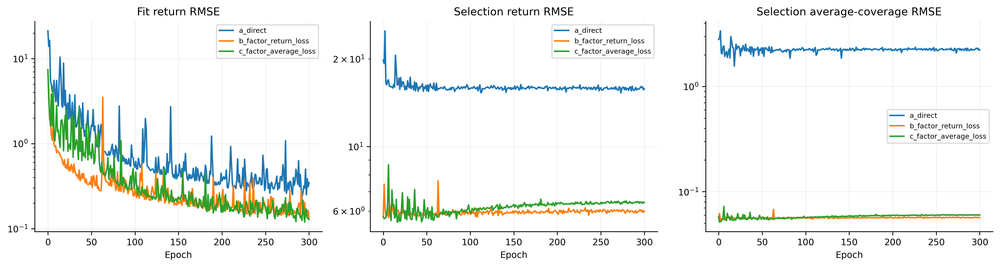
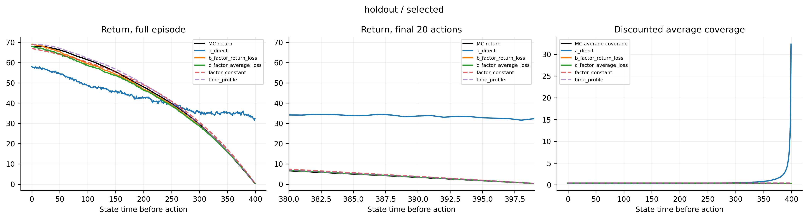
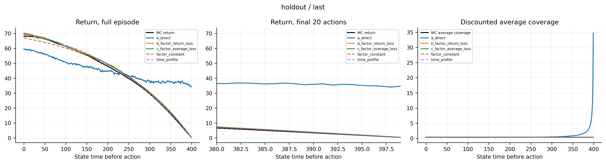
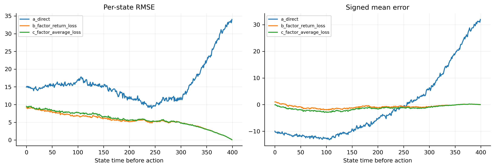
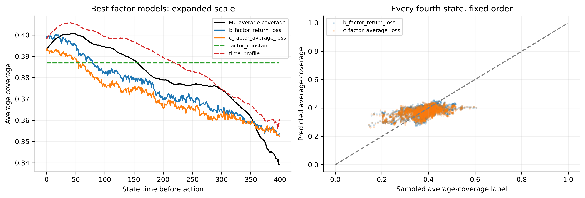
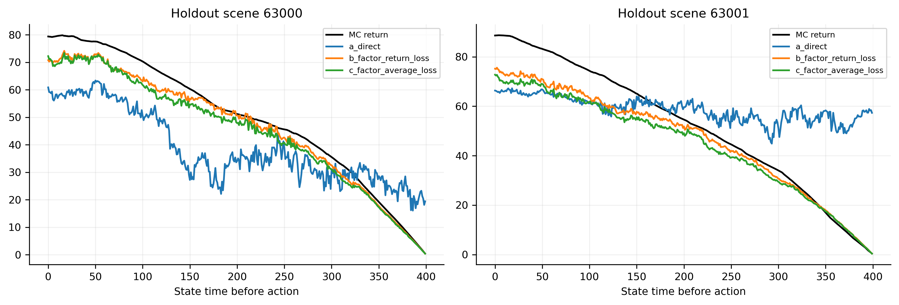

# 原C组：时间因子与平均覆盖率critic校准

原C组250k last、6292→256→256→1，冻结actor。三组继承同一主干，输出层权重/偏置归零、Adam重置。复用原64/16/32个MC场景，不重新采样。累计价值G与平均覆盖标签G/H由同一回报解析转换。

A直接预测累计价值；B预测平均覆盖、按恢复的累计价值计算损失；C预测平均覆盖、按平均覆盖计算损失。固定拟合集总体均值/标准差，Huber δ=10；无sigmoid、预测裁剪、GAE或bootstrap。

三组300轮、batch512，每轮50次更新，LR5e−4、Adam eps1e−5、梯度裁剪0.5。逐轮样本排列完全一致。best按选模集累计价值RMSE选出（含epoch0）；检查集仅最终评估。

| 模型 | 选中轮数 | 拟合RMSE | 检查RMSE | 检查平均覆盖RMSE | 检查末20步RMSE | 末步预测 | 末步MC | 时间去均值相关性 |
|---|---:|---:|---:|---:|---:|---:|---:|---:|
| a_direct initial | 0 | 21.179 | 20.852 | 2.8118 | 41.317 | 44.766 | 0.339 | 未定义 |
| a_direct selected | 273 | 1.079 | 16.891 | 2.1537 | 32.310 | 32.321 | 0.339 | 0.304 |
| a_direct last | 300 | 0.346 | 16.888 | 2.3014 | 34.517 | 34.744 | 0.339 | 0.315 |
| b_factor_return_loss initial | 0 | 7.395 | 7.186 | 0.0639 | 1.128 | 0.387 | 0.339 | 未定义 |
| b_factor_return_loss selected | 6 | 1.762 | 5.903 | 0.0545 | 0.929 | 0.354 | 0.339 | 0.573 |
| b_factor_return_loss last | 300 | 0.135 | 6.243 | 0.0586 | 1.079 | 0.380 | 0.339 | 0.508 |
| c_factor_average_loss initial | 0 | 7.395 | 7.186 | 0.0639 | 1.128 | 0.387 | 0.339 | 未定义 |
| c_factor_average_loss selected | 16 | 1.904 | 6.249 | 0.0560 | 0.934 | 0.352 | 0.339 | 0.520 |
| c_factor_average_loss last | 300 | 0.128 | 6.533 | 0.0606 | 1.100 | 0.379 | 0.339 | 0.410 |

两个固定参考只使用拟合集统计；它们没有学习场景信息：

- factor_constant：检查集累计价值RMSE 7.186，平均覆盖RMSE 0.0639。
- time_profile：检查集累计价值RMSE 7.130，平均覆盖RMSE 0.0621。

## 配对误差与解释边界

配对区间按32个检查场景重采样2000次，种子950001；不是训练种子置信区间。差值为右组减左组，负值表示右组误差较小。

| 检查点 | 比较 | 全程累计价值RMSE差 | 95%场景bootstrap区间 |
|---|---|---:|---:|
| selected | b_factor_return_loss − a_direct | -10.988 | [-12.858, -9.040] |
| selected | c_factor_average_loss − a_direct | -10.642 | [-12.362, -8.857] |
| selected | c_factor_average_loss − b_factor_return_loss | +0.346 | [-0.015, +0.729] |
| last | b_factor_return_loss − a_direct | -10.644 | [-12.690, -8.504] |
| last | c_factor_average_loss − a_direct | -10.355 | [-12.654, -7.860] |
| last | c_factor_average_loss − b_factor_return_loss | +0.289 | [-0.258, +0.831] |

## 本次证据如何定位问题

A能将拟合集误差降得很低，检查集仍有明显末端高估；B保留同一个累计价值损失后显著改善，因此结果不支持“必须改变Huber损失或改成平均覆盖损失才能修复”的解释。更符合证据的解释是：现有高维输入MLP未能自行学出可泛化的剩余时长作用，解析参数化提供了有效的结构约束。B与A还存在输出尺度、初始函数和优化条件差异，不能将其进一步分解为唯一机制。

固定H×平均覆盖的零训练参考已经具有正确的大部分时间形状。因此需要把这部分解析收益与网络训练增益分开。B的场景去时间均值相关性高于A，说明它并非只会输出一条公共时间曲线；但相对于更强的每时刻均值参考，32场景bootstrap区间仍需保守解读。

下表补充比较参考模型的区间；差值为右组减左组，正值表示左组误差较小。

| 比较（best） | 累计价值RMSE差 | 95%场景区间 |
|---|---:|---:|
| factor_constant − b_factor_return_loss | +1.283 | [+0.304, +2.271] |
| time_profile − b_factor_return_loss | +1.227 | [-0.009, +2.470] |
| factor_constant − c_factor_average_loss | +0.937 | [-0.226, +2.111] |
| time_profile − c_factor_average_loss | +0.882 | [-0.581, +2.291] |

C相对B没有显示额外改善；其点估计较差，但检查场景区间包含零，不能声称两者存在稳定差异。两种时间因子组的拟合集误差随训练下降，检查误差却从早期best回升，说明仍有过拟合或泛化余量，不能把后续优化方向简单归结为增加训练轮数。

全部分阶段RMSE/MAE/偏差见metrics.csv；范围违规、相关性和来源哈希见summary.json、experiment.json。同一时刻减去检查集跨场景均值只用于诊断，不用于拟合；参考模型在这个诊断中是常量，相关性未定义。

B/C的epoch0相同且已经具有时间形状；仅后期回报自然缩小不能证明网络学会了场景价值。必须同时比较epoch0、两个固定时间参考、拟合与检查差距，以及场景残差相关性。C还改变了跨时刻损失权重，在Huber二次区间对应累计误差权重约1/H²，另有固定标准差因子。

MC标签是采样实现值而非精确条件期望；三组比较始终使用同一批标签。独立校准不更新actor，所以不能从critic指标直接声称覆盖会改善，也不能单独证明GAE是唯一根因。

在线MAPPO、原C配置和源权重保持原样；这些离线检查点不能用于在线续训。没有自动追加轮数、超参数扫描或多种子。

重建图表：`.venv/bin/python scripts/calibrate_time_factor_critic.py --report-only`。
