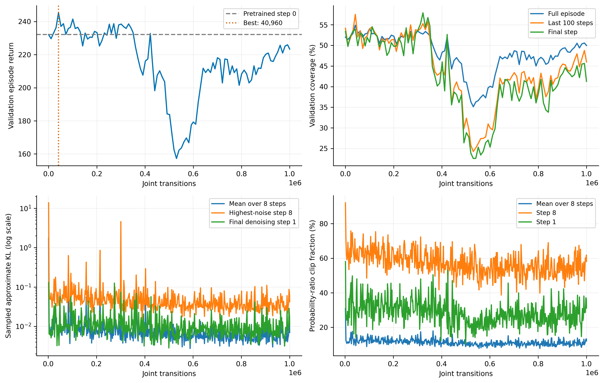
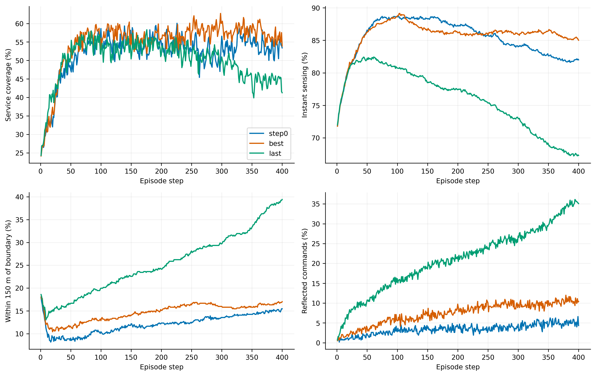

# 扩散DPPO 1M：验证与退化诊断

**结论：在线早期有增益，但没有保持到1M。主要可见退化是感知与部署范围收缩、贴边及聚集增加；相同布局下的评分误差只解释极小的即时服务损失。**

运行完整结束：1,000,000条联合转移、489轮PPO、19,560次优化。best实际为40,960步。step0已经完成示范预训练，使用第46轮预训练best，不是随机初始化网络。

## 1. 验证口径与下载

32个验证场景10000–10031，400步，批次16，动作采样种子880001，CUDA FP32；每20步独立采样64次估计动作矩。step0/best/last复测与训练验证日志四项关键指标误差均为0。没有使用保留测试集，没有训练或修改任何网络。

完整运行已下载至 `runs/diffusion_dppo_capacity10_coverage_throughput_1m_seed0/`，包括示范、预训练、TensorBoard、best/last/step0和完整恢复检查点。1626个文件、1,263,638,667字节，逐文件SHA256已验证。清单见 `1m_download_manifest.json` 和 `download_verified.json`。

本次所有参考策略统一在GPU采样验证。旧baseline历史CPU验证的58.63125%与这里的GPU结果不是同一随机轨迹；相同种子不保证CPU/CUDA随机数相同。下表使用此次统一复测值。

| 策略 | 全程覆盖 | 后100步覆盖 | 终态覆盖 | 吞吐Mbps | 回合回报 |
|---|---:|---:|---:|---:|---:|
| 原MAPPO best（671744步） | 56.44% | 58.11% | 58.56% | 466.25 | 250.620 |
| 原MAPPO last（1M） | 56.71% | 59.93% | 58.17% | 471.22 | 251.965 |
| 冻结运动教师＋SINR评分＋Top-K | 52.89% | 55.92% | 48.71% | 465.38 | 236.380 |
| 扩散预训练后 step0 | 52.00% | 54.15% | 53.40% | 452.70 | 232.138 |
| 扩散在线best（40960步） | 54.89% | 57.51% | 53.92% | 482.83 | 245.297 |
| 扩散在线last（1M） | 49.97% | 45.98% | 41.27% | 440.23 | 223.373 |

best相对step0覆盖提高2.888个百分点、回报提高13.159；last相对best覆盖下降4.913个百分点，终态下降12.646个百分点。不能说“从未学到任何东西”，但此次1M在线微调确实没有得到持续增益。

场景配对bootstrap的last−step0全程覆盖差为−2.025个百分点，95%区间[−5.407,+1.072]，包含0；后100步差为−8.175个百分点，区间[−14.175,−2.436]，终态差为−12.125个百分点，区间[−20.188,−3.748]。后期维持退化的证据比全程均值下降更清楚。best在同一验证集挑选，不能把best的区间当成独立泛化证明；这些都不是训练种子置信区间。



曲线也存在明显的中期下跌与后期恢复：验证覆盖率在530,432步为35.12%，到1M恢复为49.97%。因此不能把1M称为已经稳定收敛。后续按用户决定从完整1M检查点续训到累计3M，保持学习设置不变；能否超过早期best需由新增数据检验。

## 2. 具体退化了什么

| 指标（全回合均值） | step0 | best | last |
|---|---:|---:|---:|
| 距边界150m内比例 | 12.058% | 14.648% | 25.364% |
| 反射比例 | 3.399% | 7.378% | 20.992% |
| 有近邻的UAV比例 | 9.958% | 11.033% | 16.864% |
| 断联UAV比例 | 11.955% | 10.139% | 7.447% |
| 实际速度m/s | 15.345 | 14.342 | 14.376 |
| 位移小于1m的比例 | 0.613% | 0.659% | 0.668% |

last并不是主要因为更多UAV断网：其平均断联比例反而更低。后100步感知率从best的85.93%降到last的69.36%，边界150m内比例从16.08%升至34.34%；说明可发现UE的空间范围本身在缩小。

条件动作统计（各模型自身访问状态，每20步64次采样）：

| 模型 | 条件平均指令位移模长m | 位移协方差迹m² |
|---|---:|---:|
| step0 | 8.519 | 246.762 |
| best | 9.857 | 194.789 |
| last | 13.631 | 123.056 |

因此“采样越来越随机”不符合这次观察。last的随机分量更小、方向偏置更强，却没有形成稳定保持动作。这里比较的是各自on-policy状态上的统计，不是同一组观察上的策略函数对照。



固定场景10000：last在150步覆盖84.0%，400步65.3%；场景10001：150步76.0%，400步64.7%。这两场景高于整体终态41.27%，不能仅凭它们代表全部场景。完整32场景中last的终态覆盖中位数41.0%，7场低于30%，1场为0。

[last场景10000拓扑](figures/last_trace_10000.png) · [last场景10001拓扑](figures/last_trace_10001.png) · [best场景10001拓扑](figures/best_trace_10001.png)

## 3. 服务评分是不是主要原因

补做了固定转移影子诊断：冻结best/last，在同一真实动作、位置、无线、回传与候选图上，把网络评分替换成动作前SINR教师评分；仍执行原Top-K、移动后过滤和UE选择。影子关联不写回环境，不改变之后的动作或历史。实际轨迹指标与主评估一致，源模型哈希保持不变。

| 模型 | 学习评分覆盖 | SINR影子评分覆盖 | 覆盖增量（百分点） | 吞吐增量Mbps |
|---|---:|---:|---:|---:|
| best | 54.88661% | 54.90552% | 0.01891 | 0.1437 |
| last | 49.97344% | 49.99078% | 0.01734 | 0.1558 |

这一恢复量远小于best到last约4.91个百分点的覆盖损失；评分没有饱和（极端sigmoid评分比例为0），step0/best/last评分latent标准差约0.76–0.77。预训练评分分支选模MSE约3.29e-5，也不支持“评分网络根本没学会教师规则”。

这个实验只能说明：在已经访问的布局上，换回SINR教师评分几乎不能立即恢复服务；不能证明评分梯度对运动头没有影响，也不能证明闭环更换评分后会有同样结果，更不是全局最优关联上界。

另一个独立限制来自协议：同一冻结高斯运动教师从旧集中式关联切换到Top-K闭环，覆盖由56.44%变为52.89%。这包含协议改变后的观察与动作反馈，不能当作同一布局上的纯Top-K损失。预训练扩散step0为52.00%，距离新协议教师不大；在线last的进一步退化是另一个问题。

## 4. Loss很小，为什么策略还会变差

PPO actor loss使用中心化团队优势，采样策略与更新策略接近时其均值本来就接近0；每轮又换了轨迹和优势，它不是应当持续下降的固定监督损失。critic loss拟合归一化GAE目标，也不等于原始尺度MC误差。

训练日志最后一条覆盖61.97%，不能直接和完整验证49.97%比较：最后一轮仅36个向量步，对应各环境当前回合的第65–100步，偏向展开阶段。最后50条训练记录的覆盖均值约52.14%，也仍混合不同场景和回合片段，不能作为同模型完整回合泛化检查。

| Critic（各自on-policy轨迹） | 累计回报RMSE | 除以标签std的RMSE | 按时刻去均值后的场景相关性 |
|---|---:|---:|---:|
| best | 12.921 | 0.394 | 0.599 |
| last | 11.744 | 0.357 | 0.713 |

last的平均价值精度略好，策略仍退化。这不支持再次把全部问题归为“critic完全不会预测”，也不能由整体MC误差排除critic/GAE：本报告没有检验同一起点不同动作或保持干预之间的小价值差。

[Loss与策略诊断](figures/metrics.png) · [Critic与MC](figures/critic_mc.png) · [预训练MSE](figures/pretraining.png)

## 5. 在线更新的具体风险证据

第一轮PPO平均近似KL=1.739，最高噪声第8步KL=13.754，该步clip比例=92.1%。最后50轮总体clip均值约10.9%，但第8步仍约54.8%，第1步约27.8%；总体平均掩盖了去噪步骤的不均衡。

代码中反向均值对噪声预测的导数为 `−coef_x0[k] * sqrt(1−abar[k]) / sqrt(abar[k])`。再除以该步固定反向std，得到以下单坐标敏感度：

| 扩散步k | 1 | 2 | 3 | 4 | 5 | 6 | 7 | 8 |
|---|---:|---:|---:|---:|---:|---:|---:|---:|
| 标准化均值敏感度 | 4.20 | 1.76 | 1.25 | 1.10 | 1.11 | 1.26 | 1.83 | 32.22 |

第8步位于最大β=0.999处，噪声头变化会被明显放大。固定方差高斯的解析KL为均值变化平方和除以2σ²，因此相同噪声预测扰动在该步更容易引起大的策略分布变化。当前代码的经验KL包含采样噪声及所有有效评分坐标，不能把表中的导数直接当成实际KL；但它解释了为什么需要分步检查。PPO clip也不是硬KL约束，没有自动保证更新仍留在近邻策略。

actor梯度裁剪前范数中位数约9.40，阈值为0.5；最后50轮评分头与运动头裁剪后梯度范数均值约0.375/0.216。评分坐标较多、两头共享编码并一起裁剪，可能影响运动学习的有效步长，但这不是已经证实的因果结论。

预训练后在线critic从头初始化，step0累计MC RMSE约75.74；actor同时开始更新。早期优势可能受尚未校准的critic影响。随后仍出现best增益，所以不能仅凭这个初始误差解释全部后期退化。在线BC权重为0，也没有约束策略维持预训练分布；这些都是后续需分别控制的候选因素。

## 6. 建议下一步

1. 保留本轮全部结果。用户已决定在独立目录从1M续训到累计3M，以检查后期回升能否持续；仅延长预算，不同时调整学习率、奖励或协议。进一步的机制诊断可审计逐minibatch、逐去噪步、按候选数分组的KL与更新后的回报方向。
2. 优先做一个独立更新幅度对照，例如只降低actor学习率，或单独加入逐步KL早停；每次只改一项，critic、协议和奖励保持原配置。不要用裁剪log概率或坐标平均去伪装更小KL。
3. 若要隔离联合评分训练的影响，固定SINR评分，只让扩散策略学习运动，和本轮联合策略比较。影子审计说明这项对照有价值，但目前并未执行正式训练。
4. critic预热作为另一项独立对照：同一个预训练actor先冻结，用其新协议轨迹校准critic后再开始在线更新。不要与学习率、扩散日程同时修改。

当前最有依据的结论是：**预训练与早期微调有效；后续在线优化未能保持部署质量，评分的即时选择错误不是主要解释。** 最高噪声步骤更新敏感、critic初期失配和联合梯度分配值得查，但尚不能认定其中任何一项是唯一根因。

## 7. 成本与复现

在线耗时3.46小时，其中验证约1.53小时；预训练约30.0分钟，示范采集约5.4分钟。

报告、PDF/SVG/PNG图、逐步指标、MC标签、条件动作矩和固定拓扑均在本目录。`scripts/analyze_dppo_training.py` 只读取保存数据重建本诊断；`scripts/audit_dppo_service_scores.py` 是独立冻结策略影子审计入口，不修改生产环境或训练算法。

```bash
.venv-dppo-compat/bin/python scripts/analyze_dppo_training.py \
  --run runs/diffusion_dppo_capacity10_coverage_throughput_1m_seed0 \
  --output analysis/diffusion_dppo_capacity10_coverage_throughput_1m_seed0
```
