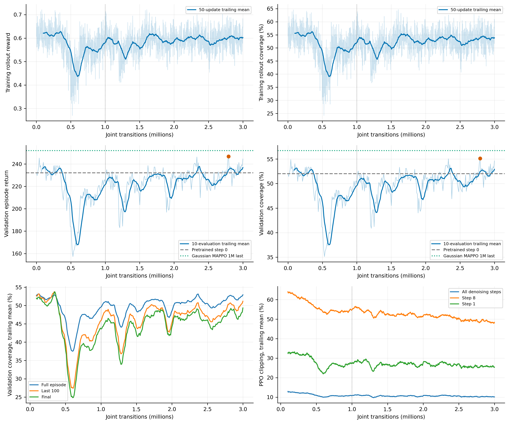
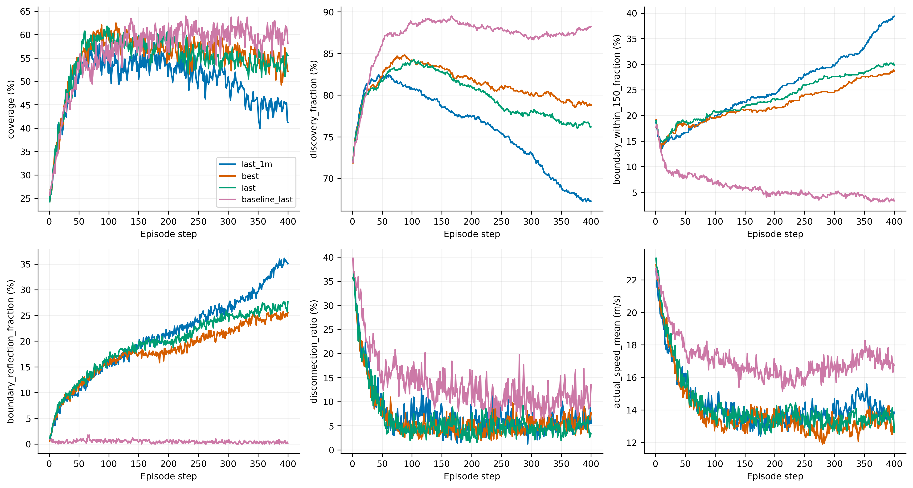
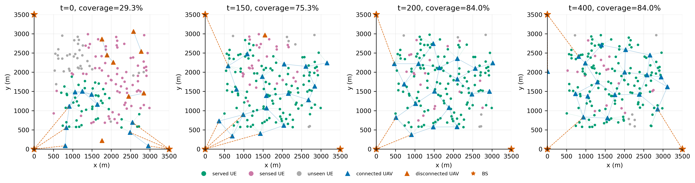

# 扩散DPPO 3M续训：验证与收敛分析

**结论：从1M继续训练有效，last的全程和后期覆盖均改善；当前仍有上升迹象，但尚未稳定。新best只是小幅超过早期best，不能把“best出现在2.79M”直接解释为还会持续大幅提升。**

训练完整结束于3,000,000条联合转移，累计1,466轮PPO、58,640次优化；best实际为2,792,000步。从原1M完整状态恢复，未重置actor、critic、Adam或归一化，未重新示范/预训练。物理、奖励和学习设置保持原实验；本次实际采用单GPU、微批16384。

## 1. 下载与验证口径

完整运行保存于 `runs/diffusion_dppo_capacity10_coverage_throughput_3m_seed0/`：15个文件、168,163,701字节，含完整恢复检查点、best/last/step0、CSV和TensorBoard。逐文件SHA256已验证，原1M结果保留。best/last重新验证的数据也逐文件校验。

32个固定验证场景10000–10031，400步，批次16，动作采样种子880001，CUDA FP32；每20步独立采样64次统计动作矩。新best/last与训练验证的覆盖、后100步、终态、吞吐及回报一致。旧1M和baseline复用此前同口径GPU验证，来源哈希保留；没有重训或使用保留测试集。

## 2. 增加训练是否有效

| 模型 | 全程覆盖 | 后100步覆盖 | 终态覆盖 | 吞吐Mbps | 回合回报 |
|---|---:|---:|---:|---:|---:|
| 预训练后step0 | 51.999% | 54.151% | 53.396% | 452.70 | 232.138 |
| 1M运行best（40,960） | 54.887% | 57.513% | 53.917% | 482.83 | 245.297 |
| 1M last | 49.973% | 45.976% | 41.271% | 440.23 | 223.373 |
| 3M运行best（2,792,000） | 55.125% | 54.828% | 52.188% | 491.41 | 246.707 |
| 3M last | 54.622% | 53.971% | 55.500% | 488.26 | 244.530 |
| 原Gaussian MAPPO 1M last | 56.708% | 59.933% | 58.167% | 471.22 | 251.965 |

3M last相对1M last：全程覆盖差为+4.649，95%场景区间[+2.055, +7.212]个百分点；后100步为+7.995，95%场景区间[+2.815, +13.262]个百分点；终态为+14.229，95%场景区间[+7.583, +21.418]个百分点。此次续训带来的恢复有配对场景支持，不能继续说在线训练完全没有作用。

但3M best相对原早期best的全程覆盖差仅+0.238，95%场景区间[-2.577, +3.231]个百分点；后100步反而由57.51%降至54.83%。best按覆盖＋数据率的全回合回报选取，不按后期覆盖选取。换言之，主要证据是从中期退化恢复，尚不是明确突破早期性能上限。

区间为2000次配对验证场景bootstrap，不是训练种子区间。best在同一验证集反复选取，其区间未校正选模偏差，不能当成独立泛化证明。各方法采用各自on-policy轨迹；3M与baseline 1M预算及关联协议不同，表格用于定位，不是严格同预算算法优劣证明。

## 3. 是否还没收敛



以下为各500k阶段内验证记录的平均值，不是每个阶段末尾单个模型的指标：

| 在线区间 | 验证次数 | 平均回报 | 全程覆盖 | 后100步覆盖 | 终态覆盖 |
|---|---:|---:|---:|---:|---:|
| 0–0.5M | 49 | 227.741 | 50.963% | 49.398% | 48.544% |
| 0.5–1M | 51 | 202.928 | 45.368% | 38.953% | 36.553% |
| 1–1.5M | 49 | 217.821 | 48.716% | 44.625% | 42.389% |
| 1.5–2M | 50 | 224.342 | 50.152% | 47.489% | 46.123% |
| 2–2.5M | 50 | 228.783 | 51.130% | 48.190% | 46.780% |
| 2.5–3M | 51 | 230.466 | 51.464% | 48.803% | 46.979% |

最近窗口仍向上：2.5M之后最初10次验证的平均覆盖为49.52%，最后10次为52.91%。但这段起点靠近一次低谷，窗口选择影响很大。

| 趋势窗口 | 全程覆盖斜率（百分点/M） | 描述性95%时间块区间 |
|---|---:|---:|
| 2–3M | +1.56 | [-0.11, +3.22] |
| 2.5–3M | +7.76 | [+4.81, +10.68] |
| 2.8–3M | +8.71 | [+2.00, +15.19] |

斜率由当前单条训练轨迹的验证记录作OLS拟合；去趋势残差按连续5次验证成块重抽样2000次。其区间依赖局部线性和残差块近似假设，只是描述相关时间序列，不是训练种子置信区间，更不是未来收益预测。最后500k呈上升，但最后1M的趋势区间包含0；因此合理表述是“仍在波动恢复，尚未稳定”，不能外推再训1M一定提高若干百分点。

训练rollout覆盖在1.5M后主要在相近水平摆动；固定完整回合验证的改善也不是持续单调上升。actor loss接近0并不意味着性能收敛：PPO使用中心化优势和每轮变化的目标；小的归一化critic loss也不等于部署维持已经正确。

## 4. 展开和贴边是否改善



| 指标 | 1M last | 3M best | 3M last | 原MAPPO 1M last |
|---|---:|---:|---:|---:|
| 全程瞬时感知 | 76.036% | 81.277% | 79.928% | 86.963% |
| 全程距边界150m内 | 25.364% | 22.235% | 23.530% | 5.862% |
| 后100步距边界150m内 | 34.342% | 27.101% | 28.700% | 4.042% |
| 全程反射 | 20.992% | 18.017% | 19.564% | 0.461% |
| 全程断联UAV | 7.447% | 6.534% | 6.353% | 13.662% |
| 全程近邻聚集 | 16.864% | 14.909% | 14.739% | 4.998% |
| 位移小于1m | 0.668% | 0.807% | 0.760% | 0.428% |
| 平均实际速度m/s | 14.376 | 13.862 | 14.218 | 17.100 |
| 后100步−第51至150步覆盖（百分点） | -8.018 | -3.970 | -4.502 | 3.435 |

3M确实改善了感知、后期服务和部分聚集，但仍大量持续移动、向边界反射。部署维持差值虽比1M改善，仍为负，且该差值改善的场景区间包含0，不能宣布保持问题已解决。原高斯baseline的边界与反射比例明显更低，后期覆盖也更高。

32场景平均覆盖曲线中，3M last约在第97步达到61.81%，终态为55.50%，仍有展开后回落。1M last的均值曲线峰值则在第176步，峰值时刻并不是所有模型都固定在同一步；不能仅凭它认定某种时钟机制是根因。

固定场景10000的3M last在150步为75.33%，200步为84.00%，400步仍84.00%，说明某些布局中已经能展开并维持较高覆盖；场景10001对应75.33%、65.33%、65.33%，仍存在回落。两者终态均高于32场景均值55.50%，不能只看这两张图判断整体。



[last场景10001](figures/last_trace_10001.png) · [best场景10000](figures/best_trace_10000.png) · [best场景10001](figures/best_trace_10001.png)

条件动作方差按各模型自身访问状态计算：1M last位移协方差迹为123.06m²，3M best为110.36m²，3M last为116.03m²；3M last条件平均指令位移模长约13.81m。随机分量没有明显扩大，也没有学成大面积悬停；这些不是同一固定观察上的策略分布比较。

## 5. Critic和策略更新

| 模型 | 累计MC RMSE | RMSE/标签std | 按时刻去均值后的场景相关性 |
|---|---:|---:|---:|
| 1M运行best（40,960） | 12.921 | 0.394 | 0.599 |
| 1M last | 11.744 | 0.357 | 0.713 |
| 3M运行best（2,792,000） | 9.811 | 0.291 | 0.713 |
| 3M last | 12.626 | 0.364 | 0.697 |

best的价值预测优于1M，但3M last并没有随覆盖提高而同步降低全程MC误差。各模型轨迹与回报分布不同，这不是同一状态上的网络精度对照；也没有检查同一部署下移动/保持之间的反事实价值差。不能据此说critic已完全无问题，或把全部改善归因于critic。

最后500k总体PPO clip均值为10.22%，最高噪声第8步仍为48.90%，第1步为25.55%；actor裁剪前梯度范数均值7.58，阈值0.5。网络仍在更新，更新尺度的不均衡仍存在，不能把后期曲线形状只归结为参数太多或训练次数不足。

[Loss曲线](figures/metrics.png) · [逐去噪步KL/clip](figures/per_denoising_step.png) · [Critic与MC](figures/critic_mc.png)

## 6. 下一步建议

可以继续做一个预先限定预算的同设置续训段，例如再增加1M，并持续观察完整验证回报、后100步覆盖和维持差值；这应当作为“额外预算能否持续带来收益”的实验，而不是预设只要训练更久就能解决贴边。当前没有自动追加训练，也没有修改正式训练配置。

重点看多次验证的滚动表现能否持续超越原早期best、后期覆盖是否同步改善、反射是否下降。若只是反复回到约52%–55%的区域而维持差值仍为负，优先回到更新稳定性和保持动作的价值差诊断；不要只以某次新best出现的步数决定无限延长。若之后改变学习率或KL约束，应另开分支并保留当前3M作为对照。

本轮没有重做新模型的评分影子审计，不能把续训增益单独归因于运动、评分或Top-K协议。一个训练种子的结果用于定位问题，尚不能支持算法普遍优于baseline。

## 7. 成本与重建

累计在线耗时10.13小时，其中新增2M约6.67小时；累计验证约4.53小时。示范和预训练成本另计。

JSON、逐场景CSV、逐步物理指标、MC标签、条件动作矩、固定拓扑及PDF/SVG/PNG均已保存。`3m_download_manifest.json`、`evaluation_download_manifest.json`和校验记录保存下载依据；`report_sources.json`保存新旧评估来源。

```bash
.venv-dppo-compat/bin/python scripts/analyze_dppo_continuation.py \
  --run runs/diffusion_dppo_capacity10_coverage_throughput_3m_seed0 \
  --output analysis/diffusion_dppo_capacity10_coverage_throughput_3m_seed0
```

