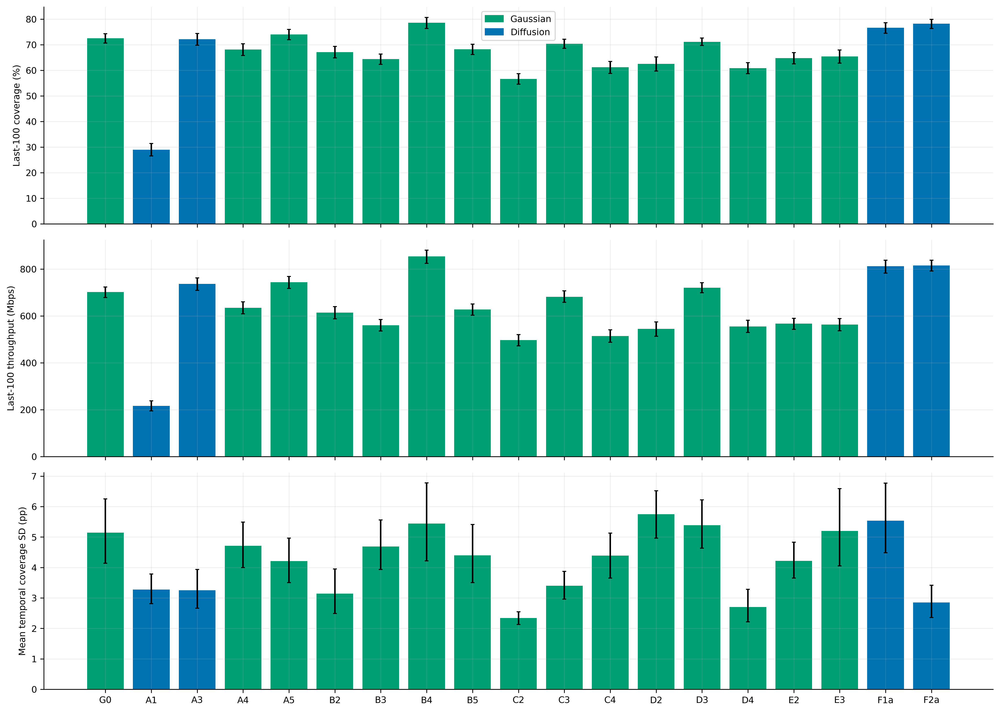

# 1M系统消融完整验证：结果与问题定位

2026-11-13。19个独立运行（18个必做＋可选C4）均完成1,000,000条在线联合转移，并已完成冻结验证、下载与A–F分组对比。没有追加训练或更新权重。

## 评估口径

- 每组step 0、best、last；每个检查点验证32个场景10000–10031，动作采样种子880001、880002、880003。共171次完整评估、5,472个400步回合。
- 先对每个场景平均3次动作采样，再平均32场景。后100步为301–400，后50步为351–400；终态为动作执行后的第400步。
- 标准差先逐轨迹、逐时间窗口计算，再平均。骤降为单步覆盖下降至少10个百分点，包括进入该窗口的第一条转移。
- 主要比较同预算last。best继续使用训练时的固定选模结果：按880001下后100步覆盖选取，覆盖数值平局时比较吞吐；不会根据本次三种子复评重新选best。因此三种子均值中，部分last优于best是正常的。
- 95%区间为2,000次配对场景bootstrap，种子950001。每组只有一个训练种子；这些区间不是训练种子置信区间，多重探索性比较也未作显著性校正。
- 保留测试集没有使用。这里的32个场景也参与过训练期选模，不能称为未接触的最终测试集。

完整数值表见[分组数据报告](comparison_analysis.md)，全部指标和区间见[汇总CSV](metrics/unified_best_last.csv)。

## 全部组的主要结果

以下均为三动作种子复评。覆盖单位为%，吞吐为Mbps，σ单位为覆盖率百分点。骤降单位为次/回合，只统计后100步。

|组|含义|best后100覆盖|last后100覆盖|last终态覆盖|last后100吞吐|last后100σ|last骤降|
|---|---|---:|---:|---:|---:|---:|---:|
|G0|Gaussian联合控制、指数缩放|74.07|72.47|71.33|702.3|5.14|2.16|
|A1|随机扩散、无BC|29.12|28.93|29.23|216.3|3.27|0.83|
|A3|扩散BC＋在线联合控制|75.30|72.10|72.59|736.6|3.25|1.03|
|A4|加载G0 best actor的新训练阶段|73.28|68.14|65.43|635.1|4.71|1.91|
|A5|同示范Gaussian BC＋在线控制|75.98|74.02|74.13|744.0|4.21|1.99|
|B2|线性跳数缩放|67.07|67.07|67.17|614.1|3.14|0.78|
|B3|历史记录缩放前指令|65.75|64.31|63.94|560.2|4.69|2.08|
|B4|不缩放|79.68|78.56|79.07|854.3|5.44|2.35|
|B5|恒定0.5缩放|70.16|68.20|66.83|627.9|4.40|1.36|
|C2|前10 UE展平MLP|65.54|56.56|55.28|496.6|2.34|0.17|
|C3|前10 UE集合编码|70.35|70.35|69.26|682.4|3.40|1.00|
|C4|全集合统计编码|62.18|61.14|61.49|514.2|4.39|1.51|
|D2|仅运动、移动后集中式贪婪|61.49|62.52|61.44|544.9|5.75|5.58|
|D3|联合动作、执行SINR规则评分|71.09|71.09|70.33|720.2|5.39|2.75|
|D4|仅运动、执行SINR规则评分|60.46|60.78|60.16|555.5|2.70|0.43|
|E2|全局信息、局部Top-K|63.73|64.75|64.06|567.3|4.22|1.52|
|E3|全局信息、移动后集中式贪婪|65.00|65.41|63.92|563.2|5.20|2.80|
|F1a|扩散BC、在线关闭缩放|77.05|76.63|75.82|812.4|5.53|2.14|
|F2a|扩散仅运动、执行SINR规则评分|77.69|78.17|78.59|816.0|2.85|0.72|



## A：问题不只是“扩散训练得慢”，还包含初始分布与在线增益

### A1从零训练几乎没有获得覆盖增益

A1的step 0后100步覆盖为28.74%，last为28.93%，只提高约0.19个百分点；G0从31.85%提高到72.47%。这不是两组起点相同、只差一点收敛速度的结果。

同时，A1未训练时的运动latent平均模长约204.77，圆盘指令平均模长约0.9999，评分饱和比例约95.05%。G0未训练时运动latent平均模长约1.33，评分没有相同的饱和问题。

当前8步余弦日程的最后一个`√ᾱ`约为0.006121。如果噪声预测近似为零，反向均值链近似反复乘`1/√α`，累计放大约为：

\[
1/\sqrt{\bar\alpha_K}\approx163.36.
\]

这是解释随机初始化为何容易产生巨大latent的机制线索，不是说已训练网络严格等于零噪声预测。巨大运动latent经圆盘映射后接近最大幅度，评分经sigmoid后也更容易饱和；在这种初始执行分布上，小幅策略更新不容易产生有用的物理动作差异。

因此，A1同时考察了策略族、反向过程参数化及随机初始化的影响，不能把它的失败直接解释为“扩散表示能力不够”。下一轮若要严格比较从零样本效率，应先控制初始动作分布。

### BC让扩散具备了可执行能力，但A3的在线收益没有稳定保留

|组|step 0后100覆盖%|best后100覆盖%|last后100覆盖%|last相对step 0增益pp|
|---|---:|---:|---:|---:|
|G0|31.85|74.07|72.47|+40.61|
|A3|73.02|75.30|72.10|−0.92|
|A4|74.07|73.28|68.14|−5.93|
|A5|73.43|75.98|74.02|+0.59|

A3并不是不会执行高覆盖策略：BC后的step 0已达到73.02%。它在251,904步选出的best提高到75.30%，但last回落到72.10%。A5的在线增益也很小。因此本轮首先说明，BC初始化解决了很大一部分可执行性问题，后续在线优化与增益保持仍不足。

last覆盖差：A3−G0为−0.36个百分点，95%场景区间[−2.42, +1.53]；不能说A3覆盖明确优于或劣于G0。A3−A5为−1.91个百分点，区间[−3.90, −0.04]，只是这一训练种子下略差，且边界非常接近零，不宜作强泛化结论。

但A3的后期稳定性优于G0的点估计：σ从5.14降到3.25个百分点，骤降从2.16降到1.03次/回合，覆盖水平相近。扩散在本实验中不是所有指标都更差。

A4只继承actor，重置critic、归一化和Adam；其退化不能等同于“完整检查点正常续训也无效”。A3/A4/A5的在线step 0 critic都重新初始化，初期价值误差也应作为后续诊断因素保留，但本轮不能据此认定critic是唯一原因。

## B：真实位移历史有明确收益，跳数缩放则存在覆盖—稳定性取舍

- G0−B3：后100覆盖提高8.16个百分点，区间[6.13, 10.13]。在该设置下，真实执行位移历史优于只记录缩放前指令。
- G0优于线性缩放B2约5.39个百分点，优于常数缩放B5约4.26个百分点。
- 但是，B4不缩放优于G0约6.10个百分点，区间[4.47, 7.83]；吞吐也从702.3提高到854.3 Mbps。
- B4的σ为5.44个百分点、骤降2.35次/回合，略高于G0的5.14和2.16；线性与常数减速组的波动更低，但覆盖也较低。

因此，不能根据当前数据继续宣称指数跳数缩放提高了最大后期覆盖。更准确的说法是：它改变运动权限与稳定性取舍；在当前1M预算下，没有取得最好的覆盖均值。B4同时放宽了速度限制，不能把收益进一步只归因于某一条数学曲线。

## C：集合编码的证据比“观察全部UE”的证据更强

- C3−C2：相同前10 UE条件下，集合编码提高13.78个百分点，区间[11.80, 15.73]。
- G0−C3：完整集合再提高2.12个百分点，区间[0.28, 4.03]，收益存在但比编码方式的差异小得多。
- G0−C4：完整的学习型集合编码优于简单统计编码11.33个百分点，区间[9.17, 13.49]。

这些结果支持集合结构和学习型特征提取的价值。C2/C3参数量不同，且前10UE以外的评分候选始终保留，因此不能表述为完全匹配参数量的纯结构证明，也不能把C组误写成“只允许服务10个可见UE”。

C2从best的65.54%下降到last的56.56%，是明显的训练稳定性问题；它的较低σ和骤降次数，不能补偿较低的覆盖水平。

## D：学习评分的直接执行收益尚不强，不能用删除评分分支的结果替代证明

最接近“只更改执行评分规则”的对照是G0与D3：两者都保留联合运动与评分网络及概率项，D3执行SINR规则评分。

G0−D3的覆盖差为+1.38个百分点，区间[−0.02, +2.78]，并没有给出清晰的覆盖优势；D3后期吞吐反而略高（720.2对702.3 Mbps）。本场景下，学习评分相对该SINR规则的直接收益需要进一步证实。

D4删除评分随机变量后只有60.78%，明显低于D3的71.09%。这说明“删掉评分维度一定更容易训练”在Gaussian组不成立。两者也改变了共享梯度、有效网络和训练随机流，不应直接把10.31个百分点差异全部算作服务评分的资源分配收益。

D2的集中式贪婪是移动后的闭环参考，不是最大匹配或最优上界。D2本次训练较差、骤降多，不能证明Top-K在相同固定布局上一定优于集中式关联；固定布局关联诊断回答的是另一类问题。

## E：更全的信息没有自动变成更好的已训练策略

E2为64.75%，比G0低7.72个百分点，区间[−10.23, −5.25]；E3为65.41%，相对E2只增加0.66个百分点，区间[−2.09, +3.33]。

这不能证明全局信息没有价值。E组增加了输入维度、参数量和优化难度，其网络不是求解到了全局信息条件下的最优策略。只能说“本轮具体的全局编码与1M训练方式没有取得收益”，不能将E2/E3当作性能理论上界。

## F：最值得继续定位的是扩散中的评分与运动耦合

### 关闭缩放有益，但没有发现它对扩散更强的负面交互

F1a的last覆盖76.63%，相对A3提高4.53个百分点，区间[2.55, 6.60]；同时σ从3.25上升到5.53个百分点。它重新体现了覆盖与稳定性的取舍。

按预定义公式，跳数缩放交互`I_Hop`为+1.57个百分点，区间[−0.52, +3.58]。因此没有证据认为跳数缩放对扩散造成了比Gaussian更强的负面交互。它损失覆盖的现象在两种策略中都存在。

### F2a在覆盖与稳定性上同时表现较好

F2a只学习运动，执行SINR评分规则：last后100覆盖78.17%，吞吐816.0 Mbps，σ2.85个百分点，骤降0.72次/回合。相对A3，覆盖提高6.06个百分点，区间[3.86, 8.36]。

不过F2a的step 0覆盖已经是75.57%，比A3的73.02%高2.54个百分点；它的在线增益为+2.60个百分点，而A3为−0.92个百分点。最终差异既包含初始化差异，也包含后续在线收益差异，不能全部归于PPO优化。

评分交互`I_score`为−17.75个百分点，区间[−20.66, −14.90]，表明在这套实现中，联合评分相对规则评分的效果，在Gaussian与Diffusion之间明显不同。

F2a同时删除了评分头、评分随机坐标及运动头的noisy-score聚合耦合；它并非只从概率密度里减去几个坐标。当前证据支持优先排查这些耦合，却不能唯一定位为“高维概率比导致裁剪”。例如A3训练末50次rollout更新中，运动条件KL约0.00232、评分条件KL约0.00133，并非评分一项压倒所有变化；跨策略条件KL也不能直接当作最终动作KL比较。

## 下一步建议

1. 保留集合编码与真实位移历史，这两项已有较清楚的同场景对照支持。
2. 将F2a作为“高覆盖且较稳定”的诊断参考，但若研究目标仍是联合服务关联，不能通过删除学习评分后宣称完整联合方法已有效。
3. 在扩散侧补一个与D3对应的严格桥接：保留A3全部结构、去噪坐标及概率，只将执行评分改为SINR规则。这样先区分“学到的评分是否有效”和“评分分支/概率/噪声耦合是否妨碍运动”。本轮尚未运行这项新实验。
4. 对随机扩散的初始latent尺度单独控制，再讨论从零学习的公平性；不要只增加A1训练步数就认为已经排除了初始化问题。
5. 对G0/B4、C2/C3、A3/A5、A3/F2a这些关键对照补独立训练种子，再做保留测试集确认。本轮没有自动启动这些训练。

不能笼统解释为“所有实验都训练不够”：G0、C3、D3等确实获得了明显增益，A3、A4、C2则有不同程度的best到last回退。是否继续训练应逐组判断，不能仅凭某条上升曲线宣称已经或尚未收敛。

这套1M消融采用了新G0联合控制教师及相同latent示范，预训练来源与旧10M研究流程不同。它能定位当前模块作用，不能不加条件地替代或反推旧10M结果。

## 文件与复现

- [全部step 0／best／last指标与区间](metrics/unified_best_last.csv)
- [易读的last完整指标表](metrics/last_late_metrics.csv)、[best完整指标表](metrics/best_late_metrics.csv)
- [逐场景、逐动作种子数据](metrics/per_scene_action.csv)
- [配对差值与F组交互](metrics/paired_differences.csv)
- [在线相对初始化增益](metrics/online_gains.csv)
- [训练末50次rollout更新诊断](metrics/final50_updates_diagnostics.csv)
- [本地检查点SHA256校验](metrics/downloaded_checkpoint_audit.csv)
- `figures/A_actor_type`至`figures/F_interactions`：分组学习曲线、best／last回合曲线。
- `figures/组名/trace_10000_best.png`等：固定场景10000、10001在0／150／200／400步的拓扑；绿色UE为已服务，灰色为未服务；蓝色三角为联网UAV，黑叉为断联UAV。
- `figures/组名/best_critic_mc.png`、`last_critic_mc.png`：冻结策略的价值与完整回合MC。
- 图表保留PDF／SVG／PNG。绿色、蓝色为主要配色，多个对照再配合橙色、灰色和线型。

服务器结果位于`/mnt/disk2/dym/uav_sac/analysis/diffusion_gaussian_ablation_1m/`；本地同名目录保存完整验证结果。19组的step 0、best、last模型已下载到本地`runs/system_ablation_1m/`，完整训练恢复目录继续留在服务器。

只重建数值、图表，不重新采样：

```bash
OPENBLAS_NUM_THREADS=1 MPLBACKEND=Agg .venv/bin/python scripts/report_system_ablation.py --rebuild
OPENBLAS_NUM_THREADS=1 MPLBACKEND=Agg .venv/bin/python scripts/summarize_system_ablation.py
```
