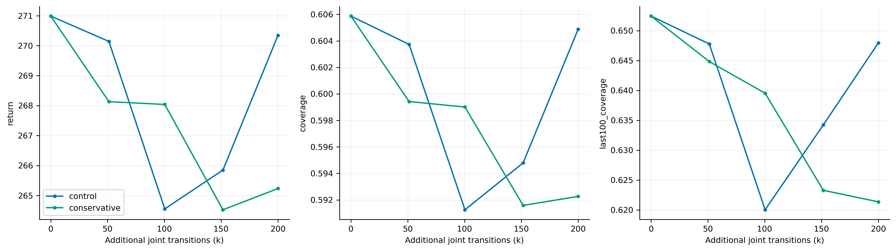

### 20万步A/B微调结果

两组从同一个Diffusion best的actor、critic和两套归一化开始，均重置Adam，使用相同新环境与RNG种子。源轻量best没有完整环境/RNG，故这是新的配对微调，不是无缝续训。初始32场景回报270.986891、覆盖60.58724%，两组完全相同。
原设置：actorLR1e-4、10 epochs、clip0.1；保守设置：3e-5、4 epochs、clip0.05。其余条件相同。每组200,000条额外转移、98轮PPO；优化次数分别3920和1568。

| 组别 | 模型 | 额外步数 | 覆盖 | 后100步覆盖 | 回报 | MC价值RMSE |
|---|---|---:|---:|---:|---:|---:|
| control | best | 0 | 60.587% | 65.243% | 270.987 | 7.750 |
| control | last | 200,000 | 60.488% | 64.795% | 270.345 | 6.681 |
| conservative | best | 0 | 60.587% | 65.243% | 270.987 | 7.750 |
| conservative | last | 200,000 | 59.227% | 62.136% | 265.235 | 8.216 |

last覆盖差（保守−原设置）为-1.262个百分点，场景95%区间[-2.880, +0.317]。
两组best均停留在本次微调step0，即已训练的源best，并非初始随机网络；20万步筛查没有超过共同起点。保守设置也未带来任务收益，不能把局部更新失衡直接称为已证实根因。
两个方案同时改变了三个优化参数，且仅筛查20万步、单训练种子。局部KL/clip改善不自动等于部署收益；不能以此宣称某个单参数或历史优化失衡是唯一根因。

微调中denoise8的平均KL由原设置0.02157降为保守设置0.00217，约降低90%，但覆盖没有改善。两组clip阈值不同，clip比例不能直接当成同阈值下的比较。原设置critic MC RMSE从起点7.750降到6.681，覆盖仍几乎不变；保守组RMSE为8.216。MC采用各自on-policy轨迹，不能把RMSE变化当成同一状态分布上的纯网络比较。

