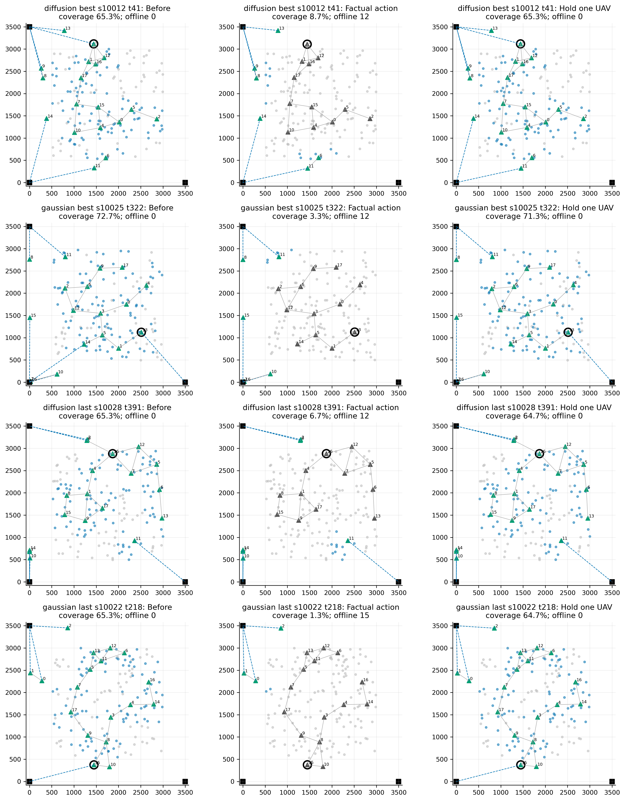
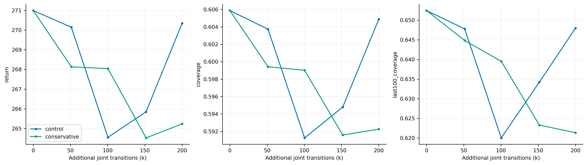

# Diffusion 与 Gaussian 10M 定位实验：结论与证据

本轮完成冻结策略干预、条件分布审计、历史更新审计和两组各20万步微调筛查。原10M代码行为、模型和评估结果保持不变。详表见 [逐项统计](detailed_statistics.md)。

## 1. 先区分平均性能差距与突发崩溃

**平均覆盖差距主要指向运动与空间部署；突发大幅下降主要由回传链路失效引发。两者不能混为一个原因。**

原best：Gaussian覆盖69.211%，Diffusion覆盖60.587%，相差8.624个百分点。按固定顺序的服务漏斗统计，Diffusion比Gaussian多因感知淘汰7.961个UE（5.307个百分点）、下行淘汰6.164个（4.109个百分点）、回传淘汰2.001个（1.334个百分点），而可服务之后的剩余淘汰少3.189个（−2.126个百分点）。四项合计为覆盖差距。
这比较的是各自访问的布局分布，不是因果分解。capacity_rejected_users这一历史字段包含可服务之后的容量、协议及时序影响，不能全部称为Top-K容量浪费。

## 2. 评分没有成为主要瓶颈，长期运动值得优先研究

同一完整状态、相同UE随机流，分别交换运动和评分。主队列为两组各32场景的25/100/200/300/375步状态，每个状态16次配对动作；严重事件前状态另列，不混入主队列。
单步比较：best状态池中，固定Diffusion运动，把评分换成Gaussian反而降低覆盖0.457个百分点，95%场景区间[−0.510,−0.406]；仅把运动换成Gaussian，单步差值为−0.101个百分点，区间跨零。**不能仅凭单步结果说Gaussian运动更好。**

随后从相同t100/t200状态继续执行50步（128个起点，每个组合一条随机分支）：

| 权重 | Gaussian运动＋Diffusion评分，相对Diffusion/ Diffusion的50步平均覆盖增益 | 场景95%区间 |
|---|---:|---:|
| best | +2.559个百分点 | [+1.858, +3.224] |
| last | +1.608个百分点 | [+0.736, +2.455] |

这支持把注意力放在多步运动、布局演化及其学习信号；交换后策略存在分布外输入，不能把混合分支当成正式的新算法，也不能据此唯一归因于运动头结构。

## 3. 骤降的直接机制：关键中继或BS锚点越过阈值

四个模型的≥10个百分点相邻步骤降分别为：Diffusion best 430次、Gaussian best 169次、Diffusion last 414次、Gaussian last 258次；每类事件都伴随新增断联。按回传→无线→候选时序→Top-K的固定顺序分类，真正失去的原服务UE中，回传失效分别占96.78%、86.36%、97.13%、90.72%。分类顺序有交互限制，不表示各原因独立。
**可复现干预：Diffusion best，场景10012，第41步，UAV编号3（从0编号）移动7.251米，最近BS三维距离1497.185→1500.209米，跨过1500米阈值。覆盖65.33%→8.67%，12架断联；仅让这架UAV本步悬停，其他指令、评分及UE移动不变，覆盖保持65.33%、无人断联。**
Diffusion last的另一个事件（场景10028，第391步），UAV16与其直连BS上游UAV0的距离649.902→654.921米，越过650米UU阈值。只保持UAV16即可将覆盖6.67%恢复到64.67%，表明危险不限于UG锚点。
Gaussian best也存在同机制：场景10025，第322步，UAV13移动3.905米，最近BS距离1497.555→1501.016米。事实覆盖3.33%，单机悬停后71.33%。这不是Diffusion独有缺陷；α=0.25只是减速，仍然可以切断支撑整个分量的回传链路。

## 4. 不能归因为Diffusion采样更随机

同状态64次条件采样：best状态池中，Diffusion best的缩放位移条件方差迹35.20 m²，小于Gaussian best的45.47 m²；饱和候选的Top-K Jaccard为0.921，对比Gaussian的0.648。Diffusion评分更稳定，但稳定不等于收益一定更高。
Diffusion best→last：条件位移均值模长4.79→5.38米，方差迹35.20→34.73 m²。更符合均值/方向或角色漂移的候选解释，而不是噪声越来越大。Gaussian last虽然更接近悬停，也比自身best退化，不能把减速本身当成成功标准。
冻结模型，将Diffusion反向转移标准差或Gaussian条件标准差乘0.8，再跑32个完整回合（无训练）：

| 模型 | 覆盖变化，百分点 | 场景95%区间 |
|---|---:|---:|
| diffusion best | -0.594 | [-1.527, +0.288] |
| gaussian best | -0.120 | [-0.901, +0.534] |
| diffusion last | +0.693 | [-0.334, +1.810] |
| gaussian last | +0.520 | [+0.033, +1.077] |

这是改变执行分布的干预，不是重新训练的算法对照。Diffusion初始z8仍为标准高斯；因此它不等价于把最终动作方差统一缩放0.64。

## 5. 更新失衡存在，但保守更新是否有效必须看实际筛查

最后2.5M，第一次反向转移denoise8的KL均值0.01835、clip 45.05%；其KL为中间2–7步的49.7倍。整体均值掩盖了分步差异。评分头裁剪后梯度约为运动头的2.56倍，但这并没有转化为较差的单步评分效果。
同状态几何采样也未支持Diffusion更危险：best池中D best任一新增断联概率8.584%，G best10.400%。原轨迹事件频率更高，仍需结合长期访问的布局分布解释。
概率审计未发现坐标平均冒充联合概率、UE编号串位或更新前10%比例裁剪：运动与评分log密度之和严格对应总和，新采样链重算最大log概率差小于0.0004、更新前超clip比例为0。批量FP32运算存在小舍入差。历史缺少的逐minibatch优势、原始ratio分位数和裁剪前分支梯度已明确列出，未补造。

### 20万步A/B微调结果

两组从同一个Diffusion best的actor、critic和两套归一化开始，均重置Adam，使用相同新环境与RNG种子。源轻量best没有完整环境/RNG，故这是新的配对微调，不是无缝续训。初始32场景回报270.986891、覆盖60.58724%，两组完全相同。
原设置：actorLR1e-4、10 epochs、clip0.1；保守设置：3e-5、4 epochs、clip0.05。其余条件相同。每组200,000条额外转移、98轮PPO；优化次数分别3920和1568。

| 组别 | 模型 | 额外步数 | 覆盖 | 后100步覆盖 | 回报 | MC价值RMSE |
|---|---|---:|---:|---:|---:|---:|
| control | best | 0 | 60.587% | 65.243% | 270.987 | 7.750 |
| control | last | 200,000 | 60.488% | 64.795% | 270.345 | 6.681 |
| conservative | best | 0 | 60.587% | 65.243% | 270.987 | 7.750 |
| conservative | last | 200,000 | 59.227% | 62.136% | 265.235 | 8.216 |

last覆盖差（保守−原设置）为-1.262个百分点，场景95%区间[-2.880, +0.317]。
两组best均停留在本次微调step0，即已训练的源best，并非初始随机网络；20万步筛查没有超过共同起点。保守设置也未带来任务收益，不能把局部更新失衡直接称为已证实根因。
两个方案同时改变了三个优化参数，且仅筛查20万步、单训练种子。局部KL/clip改善不自动等于部署收益；不能以此宣称某个单参数或历史优化失衡是唯一根因。

微调中denoise8的平均KL由原设置0.02157降为保守设置0.00217，约降低90%，但覆盖没有改善。两组clip阈值不同，clip比例不能直接当成同阈值下的比较。原设置critic MC RMSE从起点7.750降到6.681，覆盖仍几乎不变；保守组RMSE为8.216。MC采用各自on-policy轨迹，不能把RMSE变化当成同一状态分布上的纯网络比较。

## 下一步决定

1. 优先把“回传安全”和“空间部署质量”拆开：在两种冻结策略上加入同一套可审计的链路安全执行约束，并单独处理直连BS锚点及中继双方同时移动，报告覆盖、断联骤降和探索损失。当前仅减速不能保证安全。
2. 若研究学习信号，优先在同起点上检查多步运动/保持的回报排序及critic对分支价值差的预测；全局MC曲线接近并不保证能辨别关键动作。已有50步混合结果支持这个方向，但尚未直接证明critic排序错误。
3. 暂不扩大评分网络或无依据降低全部采样噪声；评分交换和0.8噪声干预未支持它们为主要解决方向。
4. 保守微调仅作筛查，不自动延长训练。若收益不明确，应进一步检查去噪步的更新分配与运动/评分的信用分配，使用单变量对照；不能笼统宣称DPPO无法学习。

## 完整性与结论边界

所有源模型冻结、原67个输入文件逐项哈希核验；4条32×400步轨迹精确复现原覆盖序列（最大差0）。同一步干预共用完整快照、历史、关联和UE随机流；评分通过UE编号和偏移对齐。原物理环境与训练代码未改写。
场景区间由2000次配对场景bootstrap得到，先平均动作重复和状态；不是训练种子置信区间。本轮使用开发验证场景，不使用保留测试集。混合策略、选出的严重事件、单条分叉及小预算微调各有限制；结论是缩小问题范围，而非已经找到唯一根因。

新诊断测试4项通过。扩展回归32通过、1个旧测试失败：终止后再次提交过期动作，旧环境先报候选ID错误而非测试期望的ended异常；本轮正常400步执行不触发它，生产代码未改。详见[回归记录](regression_notes.md)。
原始数组、逐场景CSV、模型来源、输入哈希、代码快照和重建命令见[运行说明](README.md)。
