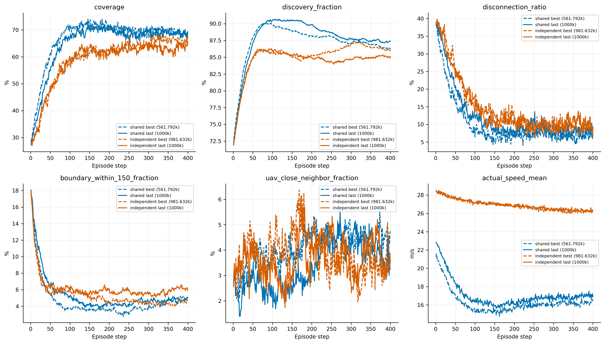
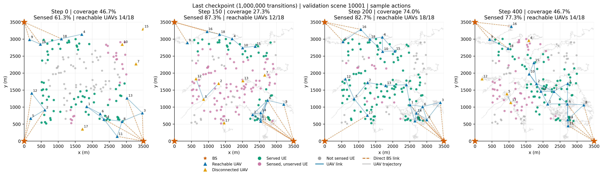
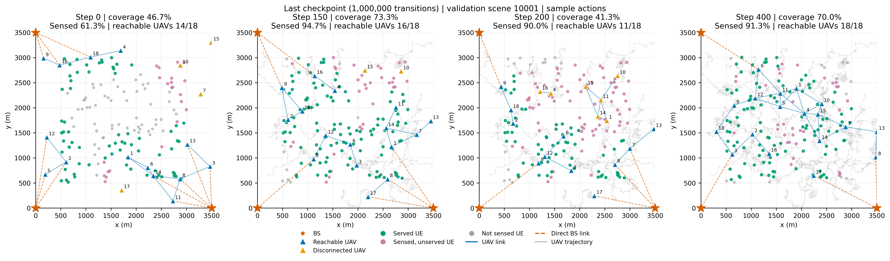

# 1M训练后的结果解读

本次只冻结模型验证，没有追加训练。两组均完成1,000,000条联合转移、489轮PPO，每个actor及团队critic均更新19,560次。仍为中心UE、一步历史、连续动作、时间因子critic、纯覆盖奖励，独立组仍使用集中式团队优势，不是标准IPPO。

验证使用10000–10031的32个原验证场景，动作采样种子880001/880002/880003。各场景先平均三次采样，再进行2000次配对场景bootstrap（950001）。这些是单训练种子的验证诊断，不是独立测试集或训练种子置信区间。

## 同预算last比较

|指标|共享|独立|
|---|---:|---:|
|100k全回合覆盖|46.64%|38.95%|
|400k全回合覆盖|62.56%|48.89%|
|1M全回合覆盖|64.94%|58.44%|
|1M前期51–150步覆盖|65.89%|57.58%|
|1M后100步覆盖|68.77%|63.31%|
|1M终态覆盖|69.21%|64.67%|
|1M全程断联|12.07%|14.46%|
|1M距边界150m内比例|5.38%|6.24%|

400k→1M，共享全程覆盖提高2.39个百分点，95%区间[0.16,4.27]；后100步提高7.43个百分点，区间[5.02,9.84]。独立全程提高9.54个百分点，区间[7.82,11.30]；后100步提高11.33个百分点，区间[8.83,14.18]。独立组继续获得明显收益，共享组的额外平均收益已较小，但后期服务改善仍明显。

1M共享−独立的全程覆盖差6.51个百分点，区间[3.95,8.97]，比400k时13.66个百分点缩小。当前共享仍较好，不能据此认定独立策略最终必然较差，也不能预设继续训练一定会追平。

## 收敛与best/last必须分开

共享best在561,792步，三套采样平均覆盖66.97%，后100步69.54%；1M last平均64.94%，后100步68.77%。last−best全程覆盖为−2.03个百分点，区间[−3.56,−0.61]；后100步为−0.78个百分点，区间跨零。差异主要体现在更早、更快获得服务，并非后期全面坍塌。best由原动作种子880001选出，其68.16%不能与三套采样均值混用。

共享原选模采样下，600k–800k验证均值66.06%，800k–1M均值65.88%；与训练曲线一起支持其进入平台并有波动，不能再仅凭预算增大预测明显收益。仍不是数学上的收敛证明。

独立best在981,632步，平均覆盖59.03%、后100步66.14%。last平均58.44%、后100步63.31%。其600k–800k与800k–1M的原验证均值为53.58%和58.39%，说明后段仍有学习进展，最后一个点回落不足以证明其已经收敛。所有跨预算旧值来自保存的审计，不重新读取已经被续训覆盖的旧权重。

## 部署维持改善，但平均曲线掩盖了单场景失稳

共享last跨场景平均曲线的20步平滑峰值为70.74%，后100步68.77%，差1.97个百分点；400k对应差8.09个百分点。因此之前典型的平均曲线后期衰退明显减轻。独立last平滑峰值64.15%，后100步63.31%，差0.84个百分点。

这不等于每个场景都能稳定保持：固定场景10001、动作种子880001，共享last在t150覆盖27.3%、12架联网，t200恢复到74.0%、18架联网，t400降至46.7%、14架联网。独立last在同场景t150为73.3%、16架联网，t200跌到41.3%、11架联网，终态又恢复70.0%、18架联网。这是形成、断链、恢复过程，单看平均或终态会掩盖它。

补充逐轨迹20步平滑最大回落统计：1M共享last平均25.06个百分点，独立28.99个百分点；超过20个百分点的轨迹比例分别为62.5%和75.0%。该统计包含回合内任意先前峰值到后续低点，即使后来恢复也计入；阈值为探索性描述，不能直接当作后期失败率。详见trajectory_stability_summary.csv。

固定场景10000也有成功保持：共享last t150/t200/t400覆盖76.7%/76.7%/78.0%，终态17架联网、15架多跳、最大跳数5。两种场景都要保留，不能只挑成功或失败案例。

## 动作与critic仍有哪些限制

共享last实际速度17.11m/s、条件位移方差332.32m²、近悬停概率0.496%；独立分别26.92m/s、637.83m²、0.0259%。独立虽能提高后期服务，仍没有学成静态部署；共享也仍在持续调整。服务覆盖保持与UAV位置不动应分开，不以悬停增多单独认定成功。

critic全程MC RMSE共享7.93、独立8.42，400k分别7.80、9.44；共享几乎不变，独立有所改善。去时间均值的跨场景相关性为0.517、0.323，不能仅看平均预测贴合就宣布价值差判断已解决。两组各使用自己的on-policy轨迹，没有进行同状态、不同动作的反事实价值审计。

最后10个日志点的近似KL均值共享0.0857、独立0.2457，400k最后5点分别约0.0326、0.0330；两套窗口长度不同，仅用于提示需要查看完整诊断。PPO clipping比例约17.8%和22.1%，连续策略的更新幅度仍需关注，不能把较低critic loss等同于策略收敛。当前证据不足以认定高KL是上述波动的唯一原因。

下一步较有价值的是保留共享best作为当前较强模型，在冻结actor下检验持续均值运动和采样噪声的作用，并对失败轨迹的断链时刻检查动作价值差。独立组若继续，应先明确是增加预算还是控制更新幅度，避免同时改变奖励和环境。此次结果支持训练预算曾是重要因素，但不是已找到唯一根因，也不支持自动扩展训练。

[完整指标与配对区间](interpretation.md) · [基础验证报告](report.md) · [400k→1M图](figures/extension_400k_vs_1m.png)
