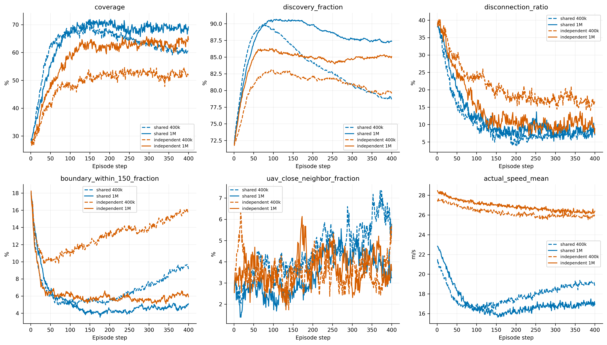
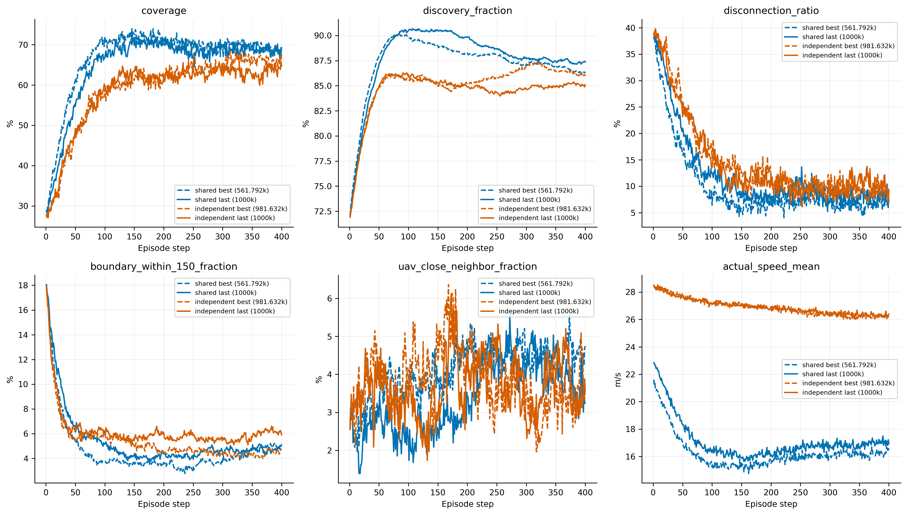
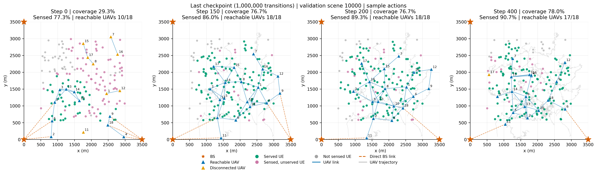
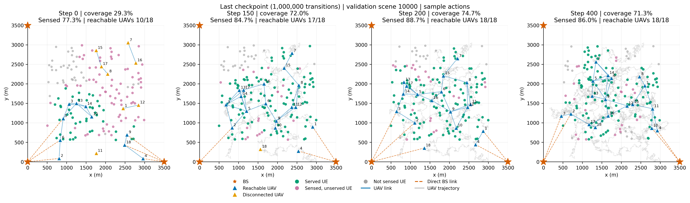
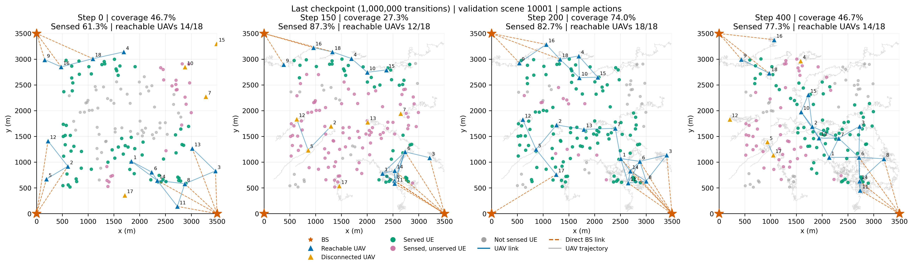
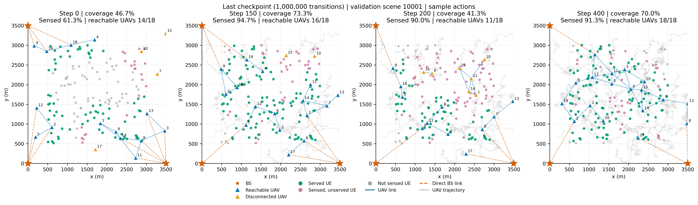

# 1M共享／独立Actor验证与续训分析

两组均累计完成1,000,000条联合转移、489轮PPO，模型冻结后按32个相同验证场景和三套动作采样种子（880001–880003）评估。保留测试集未使用，没有新增训练。
共享组在147,104步从完整检查点恢复到新目录；曲线只继承该恢复点之前的原日志，再拼接新分支，排除已经回退的后续记录。
400k结果读取此前保存的审计数据，没有使用已被续训覆盖的旧模型文件。

|组别|预算|全回合覆盖|51–150步|后100步|终态|维持差|
|---|---:|---:|---:|---:|---:|---:|
|shared|400k|62.56%|66.90%|61.33%|60.70%|-5.57 pp|
|shared|1M|64.94%|65.89%|68.77%|69.21%|+2.87 pp|
|independent|400k|48.89%|48.05%|51.99%|51.48%|+3.94 pp|
|independent|1M|58.44%|57.58%|63.31%|64.67%|+5.74 pp|

|同组1M−400k|全回合覆盖变化及95%区间|后100步变化及95%区间|
|---|---:|---:|
|shared|+2.39 pp [+0.16, +4.27]|+7.43 pp [+5.02, +9.84]|
|independent|+9.54 pp [+7.82, +11.30]|+11.33 pp [+8.83, +14.18]|

区间为先平均动作采样重复、再进行2000次配对场景bootstrap（种子950001）的结果，不是训练种子置信区间。
维持差必须结合早期和后期绝对覆盖解读；单独变平、移动减少或终态改善，不能证明同一有效部署保持不变。

|当前预算模型|20步平滑峰值|峰值窗口结束步|后100步|峰值减后100步|
|---|---:|---:|---:|---:|
|shared best|72.41%|161|69.54%|2.87 pp|
|shared last|70.74%|167|68.77%|1.97 pp|
|independent best|66.57%|340|66.14%|0.43 pp|
|independent last|64.15%|390|63.31%|0.84 pp|

平滑峰值基于跨场景、跨动作重复的平均曲线；窗口宽20步。它补充早期−后期指标，避免早期仍在展开掩盖真正的峰值后下降。

|单条轨迹稳定性（last）|平均最大回落|回落超过10pp的比例|回落超过20pp的比例|
|---|---:|---:|---:|
|shared 400k|28.02 pp|98.96%|68.75%|
|independent 400k|31.60 pp|100.00%|91.67%|
|shared 1M|25.06 pp|93.75%|62.50%|
|independent 1M|28.99 pp|100.00%|75.00%|

最大回落先对每条400步轨迹作20步均值，再计算任一先前峰值到其后低点的最大差值；后续恢复也仍计入回落。
10/20个百分点阈值仅作探索性描述，比例单位是32场景×3动作重复的轨迹，不是96个独立训练样本。平均曲线变平不等于每条轨迹都保持稳定。

|当前预算last−best|全回合覆盖变化及95%区间|后100步变化及95%区间|
|---|---:|---:|
|shared|-2.03 pp [-3.56, -0.61]|-0.78 pp [-2.83, +1.21]|
|independent|-0.60 pp [-1.57, +0.40]|-2.83 pp [-4.92, -0.78]|

best由选模验证集选择；这些区间是同一验证集的诊断，不能视为独立测试集上的无偏选模检验。

|1M last物理诊断|共享|独立|
|---|---:|---:|
|感知率|87.874%|84.428%|
|断联率|12.074%|14.463%|
|150m内靠边比例|5.384%|6.241%|
|100m内近邻比例|3.362%|3.678%|
|实际速度m/s|17.113|26.919|
|下行淘汰人数|18.397|21.099|
|回传淘汰人数|15.961|17.855|
|容量淘汰人数|0.040|0.033|

服务人数严格等于：感知人数−下行淘汰−回传淘汰−容量淘汰。这是当前判定次序下的核算，不是独立改变通信参数的因果实验。

|动作随机性（1M last）|共享|独立|
|---|---:|---:|
|条件位移总方差m²|332.319370|637.832298|
|近悬停概率|0.004959|0.000259|
|每机微分熵nats|-1.169360|-1.298672|

条件方差是在同一局部输入上反复采样的二维指令位移方差之和，每20步64次隔离采样；不是不同UAV的位置方差。连续微分熵不能直接等同物理动作方差。

|1M last critic|全程RMSE|末20步RMSE|末步RMSE|全程归一化RMSE|去时间均值相关性|
|---|---:|---:|---:|---:|---:|
|shared|7.931|1.038|0.114|0.236|0.517|
|independent|8.417|1.112|0.115|0.280|0.323|

critic标签使用完整纯覆盖MC，不含actor熵。两组各自在自己的on-policy状态分布上评估；平均预测曲线贴近不能证明动作价值差已经正确。本轮没有追加反事实动作价值实验。

## 本轮结论

下述结论按同预算last和保存的旧预算last比较，不用best替代last；best的完整结果见report.md。

shared从400k到1M平均覆盖变化+2.39个百分点，配对场景区间[+0.16, +4.27]个百分点。
independent从400k到1M平均覆盖变化+9.54个百分点，配对场景区间[+7.82, +11.30]个百分点。
本预算独立−共享的平均覆盖差为-6.51个百分点。

shared：早期覆盖65.89%→后100步68.77%，感知90.00%→87.50%，断联12.79%→7.90%，150m内靠边5.12%→4.69%，100m内近邻2.48%→4.07%。
其t150既有链路后续平均保留率为64.15%，既有联网节点后续联网保留率为93.36%。前者要求同一条边继续存在，后者允许路由改变；二者都不能代替UE服务覆盖。

independent：早期覆盖57.58%→后100步63.31%，感知85.79%→84.99%，断联16.25%→10.12%，150m内靠边5.97%→5.81%，100m内近邻3.16%→3.63%。
其t150既有链路后续平均保留率为45.04%，既有联网节点后续联网保留率为91.81%。前者要求同一条边继续存在，后者允许路由改变；二者都不能代替UE服务覆盖。

部署维持应同时检查早期和后期绝对覆盖、感知、断联及靠边变化。既有链路替换也可能保持服务，不能将拓扑完全静止作为唯一成功标准。

|最后5次训练日志均值|共享|独立|
|---|---:|---:|
|value_loss|0.001154|0.001552|
|actor_loss|0.002221|-0.017579|
|joint_entropy|-20.507275|-22.798479|
|ppo_approx_kl|0.090913|0.243967|
|ppo_clip_fraction|0.177129|0.219554|

低且平稳的归一化critic loss不等于策略已收敛；其监督目标与归一化尺度会随策略变化。训练coverage日志是最后采集步快照，应以完整验证回合曲线判断任务表现。
best步数分别为：shared 561,792，independent 981,632；last均为1,000,000。收敛与持续退化需要结合完整验证曲线，不能只看最后两个点。
本轮没有改变采样温度、训练参数或追加训练；后续诊断应区分运动均值、采样标准差与价值差估计。

固定场景10000、10001的初始／150／200／400步图：

全部best/last、逐场景差值、拓扑统计与来源哈希见report.md、paired_differences.csv、extension_paired_differences.csv、topology_diagnosis.csv和extension_sources.json。
