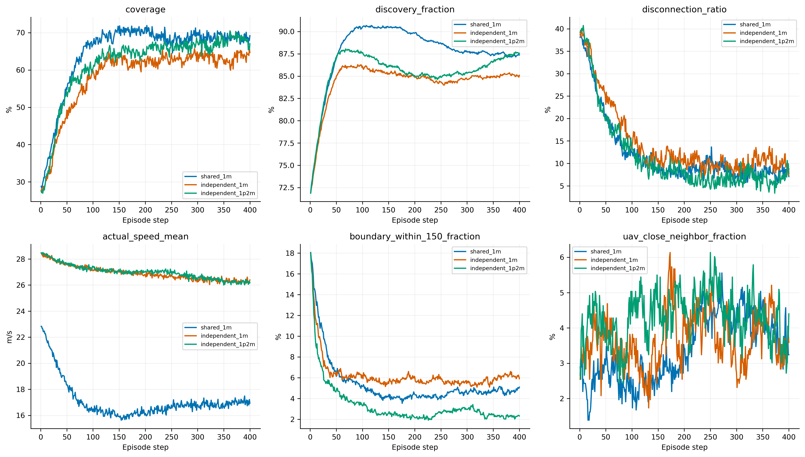
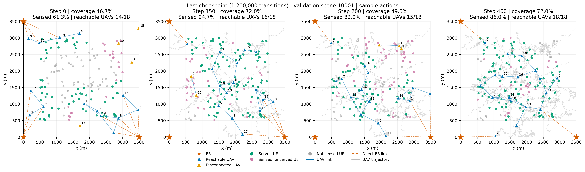

# 独立1.2M与共享1M：结果解读

独立组累计完成1,200,000条联合转移、587轮PPO；18个actor和团队critic各完成23,480次优化。best恰好为1.2M，完整learner状态与last一致，所以三套动作采样只验证一次并同时用于best/last。共享组与独立1M基准复用上轮保存的审计，没有重读已被续训覆盖的独立1M权重。

本轮使用原32个验证场景、动作种子880001/880002/880003，先平均同场景动作重复，再做2000次配对场景bootstrap（950001）。未使用保留测试集，没有新增训练或改变生产算法。

## 主要结果

|last模型|全回合覆盖|51–150步|后100步|终态|断联率|
|---|---:|---:|---:|---:|---:|
|共享1M|64.94%|65.89%|68.77%|69.21%|12.07%|
|独立1M|58.44%|57.58%|63.31%|64.67%|14.46%|
|独立1.2M|61.79%|60.91%|67.55%|67.03%|11.38%|

独立1M→1.2M，全回合覆盖提高3.36个百分点，95%场景区间[1.69,5.00]；后100步提高4.24个百分点，区间[1.97,6.61]。这支持额外200k训练仍有学习收益。终态提高2.36个百分点，但区间[−2.37,6.88]跨零，不能单凭终态点宣布确定改善。

与共享1M相比，独立1.2M全回合覆盖低3.15个百分点，区间[−4.91,−1.28]；后100步低1.22个百分点，区间[−3.56,1.32]；终态低2.17个百分点，区间[−6.74,2.23]。后两项未检出明确差异，并不构成等效性证明。独立多用了20%的环境样本，本比较不能当作同预算算法优劣证明；单训练种子也不能支持最终性能上限结论。

共享在回合较早阶段建立更高覆盖仍有优势。独立组后期服务接近共享组，说明此前差距不能完全归于表达能力不足，但也不能简单由参数量推算还需多少训练。

## 提升来自哪里

独立组全程断联率由14.46%降至11.38%，因回传不可达淘汰的UE均值由17.86降至14.61；感知率由84.43%提高到85.55%。按现有顺序判据核算，覆盖提升约由感知+1.12个百分点、回传损失减少+2.17个百分点以及其余小项组成。它没有大幅增加可感知范围，主要把更多已发现UE转化为联网服务。这是诊断核算，不是独立控制通信条件的因果实验。

独立1.2M的感知率仍低于共享1M的87.87%，下行淘汰人数约21.00，比共享18.40更多；其回传损失14.61则略低于共享15.96。不能继续用“独立组就是更断网”作为两组当前覆盖差距的完整解释。

## 部署仍不等于静态保持

独立组距边界150m内比例从6.24%下降到3.35%，比共享1M的5.38%更低，贴边问题继续减轻。但实际速度仍约27.01m/s，条件位移方差636.45m²，近悬停概率仅0.025%。对应独立1M为26.92m/s、637.83m²、0.026%，说明覆盖提高并非来自明显减速或减少采样随机性。

固定场景10001、动作种子880001，独立1.2M在t150/t200/t400覆盖为72.0%/49.3%/72.0%，联网UAV为16/15/18架。终态形成了多跳网络，但过程中仍有覆盖回落和网络重组。单轨迹20步平滑最大回落均值为28.77个百分点，与独立1M的28.99接近；平均曲线后期向上不能解释成每条轨迹都稳定保持。

## critic与收敛

独立critic全程MC RMSE由8.42降至7.32，但去时间均值的跨场景相关性由0.323到0.300，末步RMSE由0.115到0.146。原始总体误差改善不代表所有时段与场景区分都改善；模型各在自己的on-policy状态分布上评估，也没有重新验证反事实动作价值差。

原选模种子下，1M–1.1M的验证均值约59.86%，1.1M–1.2M约60.98%，最后best为1.2M；三套采样也确认相对1M存在平均收益，因此当前尚不能确认独立组已收敛。另一方面，最后10次日志近似KL均值约0.448，PPO clipping约22.2%；更新幅度仍值得检查，不能把所有不稳定性都归结为预算不足。

共享1M运行内选出的best位于561,792步，平均覆盖66.97%，高于其1M last的64.94%。如果比较各自best，独立1.2M的61.79%仍低于共享运行best；主要结论依然按用户指定的1.2M独立last与1M共享last进行。

当前结论是：独立组仍有学习收益，后期平均服务已接近共享，但完整回合服务效率、单场景保持与样本效率尚未全面追平。此结果不支持自动继续追加训练，也不能用未检出后期差异宣布两种策略等效。

[完整统计](interpretation.md) · [训练/验证/loss/拓扑基础报告](report.md)
