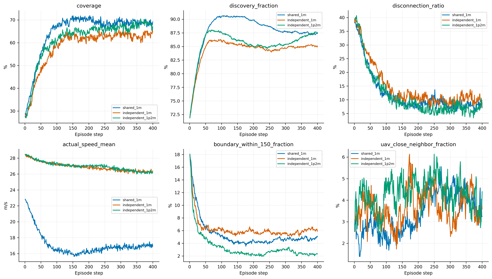

# 独立1.2M验证：与独立1M、共享1M比较

物理环境、奖励、观测、优化参数和验证协议不变。本次只重新验证独立1.2M，复用已保存的共享/独立1M审计。
跨组比较的预算为独立1.2M、共享1M，独立多使用20%环境样本，不能作为同预算优劣证明。
仍为32个场景、三套动作种子，先平均每场景动作重复，再作2000次配对场景bootstrap（950001）；不是训练种子区间。保留测试集未使用。

|last模型|全回合覆盖|51–150步|后100步|终态|维持差|
|---|---:|---:|---:|---:|---:|
|shared_1m|64.94%|65.89%|68.77%|69.21%|+2.87 pp|
|independent_1m|58.44%|57.58%|63.31%|64.67%|+5.74 pp|
|independent_1p2m|61.79%|60.91%|67.55%|67.03%|+6.65 pp|

|差值|指标|均值及95%场景区间（百分点）|
|---|---|---:|
|independent_1p2m-independent_1m|coverage|+3.36 [+1.69, +5.00]|
|independent_1p2m-independent_1m|last100_coverage|+4.24 [+1.97, +6.61]|
|independent_1p2m-independent_1m|final_coverage|+2.36 [-2.37, +6.88]|
|independent_1p2m-independent_1m|maintenance|+0.91 [-2.38, +4.37]|
|independent_1p2m-shared_1m|coverage|-3.15 [-4.91, -1.28]|
|independent_1p2m-shared_1m|last100_coverage|-1.22 [-3.56, +1.32]|
|independent_1p2m-shared_1m|final_coverage|-2.17 [-6.74, +2.23]|
|independent_1p2m-shared_1m|maintenance|+3.77 [+0.12, +7.45]|

独立1.2M的best与last是否完全相同见verification.json；相同时只采集一套三次重复，两个检查点引用同一份数据。共享best属于共享1M运行内选出的历史最优模型，并不要求best本身恰好位于1M。

|last模型|速度m/s|条件位移方差m²|近悬停概率|150m内靠边|
|---|---:|---:|---:|---:|
|shared_1m|17.113|332.319|0.496%|5.38%|
|independent_1m|26.919|637.832|0.026%|6.24%|
|independent_1p2m|27.005|636.452|0.025%|3.35%|

|last模型|20步平滑平均曲线峰值|峰值减后100步|单轨迹平均最大回落|
|---|---:|---:|---:|
|shared_1m|70.74%|1.97 pp|25.06 pp|
|independent_1m|64.15%|0.84 pp|28.99 pp|
|independent_1p2m|69.07%|1.52 pp|28.77 pp|

最大回落是在单条轨迹的20步平滑曲线上，计算任意先前峰值到后续低点的最大差值，即使后来恢复也计入。平均曲线变平不等于逐场景部署稳定。

|last critic|全程MC RMSE|后100步RMSE|末步RMSE|去时间均值相关性|
|---|---:|---:|---:|---:|
|shared_1m|7.931|3.689|0.114|0.517|
|independent_1m|8.417|3.688|0.115|0.323|
|independent_1p2m|7.320|3.744|0.146|0.300|

critic标签为完整纯覆盖MC，不含actor熵；各模型使用自己的on-policy轨迹，不能替代同状态动作价值差诊断。
训练/验证奖励、loss、每UAV诊断、best/last拓扑及原始数据索引见report.md与comparison.json。
图表可通过本脚本--rebuild重建，不重新采样。
