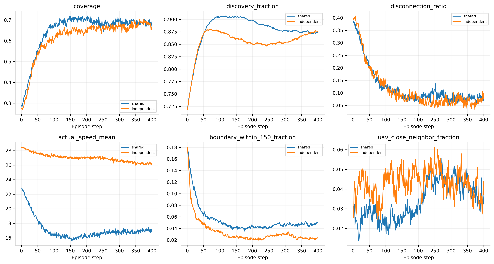
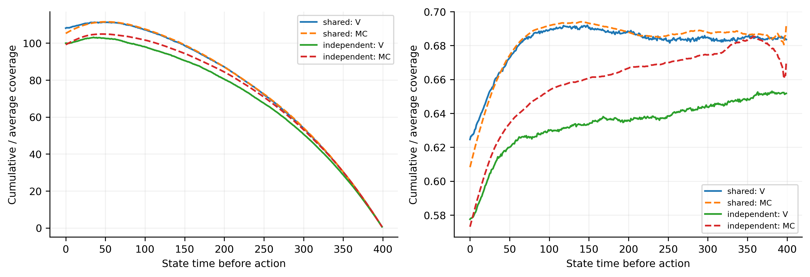

# 共享／独立actor纯覆盖PPO对照

两组使用团队覆盖奖励、团队GAE和单输出集中式时间因子critic。独立组不是标准IPPO；每个UAV拥有独立编码器/策略/Adam，编号固定。
本报告比较共享1M与独立1.2M的last，独立组多用20%环境样本，不是同预算对照；best作为补充。best按全回合覆盖回报选择，包含step0。initial只使用原选模动作种子，best/last先平均动作重复，再按场景配对bootstrap。

|组别|检查点|步数|平均覆盖|前期51–150|后100步|终态|维持差|
|---|---|---:|---:|---:|---:|---:|---:|
|shared|initial|0|27.23%|26.90%|29.51%|27.52%|+2.61%|
|independent|initial|0|27.23%|26.90%|29.51%|27.52%|+2.61%|
|shared|best|561792|66.97%|69.22%|69.54%|67.31%|+0.32%|
|independent|best|1200000|61.79%|60.91%|67.55%|67.03%|+6.65%|
|shared|last|1000000|64.94%|65.89%|68.77%|69.21%|+2.87%|
|independent|last|1200000|61.79%|60.91%|67.55%|67.03%|+6.65%|

|组别|Actor参数量|Critic参数量|训练总耗时秒|峰值RSS MiB|
|---|---:|---:|---:|---:|
|shared|103620|1677057|3840.17|1294.2|
|independent|1865160|1677057|7670.83|1241.0|

参数容量和每个网络接收的数据量也发生变化，因此即便独立组获胜，也不能单独证明共享梯度冲突是唯一根因。共享组的每UAV梯度栏为空，整体共享梯度在常规日志中；独立组各自记录梯度。
学习曲线的训练覆盖是最后采集步的环境均值，不是完整训练回合均值。critic两组使用各自on-policy轨迹，MC不包含actor熵。历史actor与物理状态critic的既有限制保留。
common_mean_spread/common_std_spread在完全相同局部输入上比较各网络的latent高斯均值/标准差，只有表示分化，不等于有效分工。条件位移方差每20步使用隔离RNG的多次采样（实际数量见comparison.json）。
场景区间使用2000次bootstrap（950001），不是训练种子区间；保留测试集未使用。原始逐步审计、每UAV贡献/动作/条件方差、同输入分布参数、拓扑与逐场景表均保存，可通过--rebuild重建。
