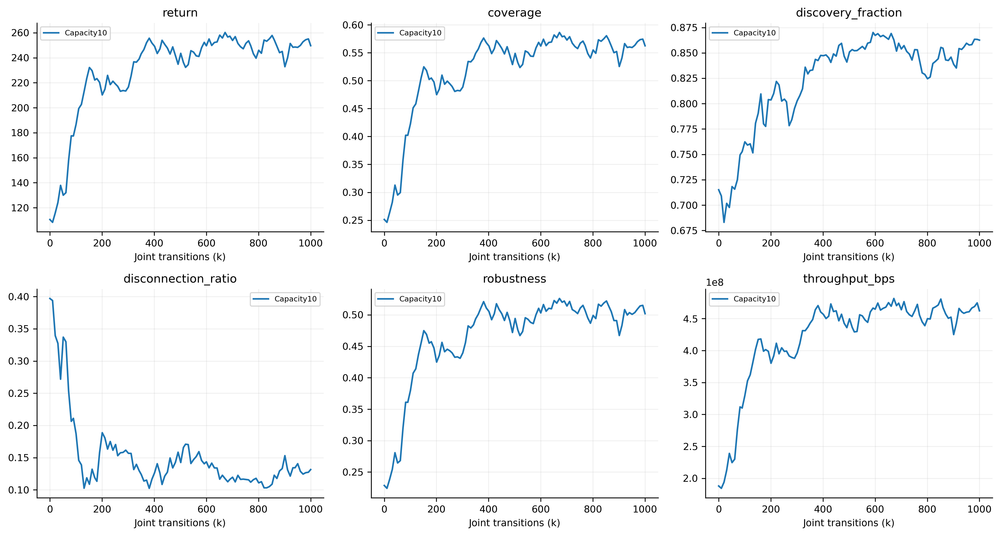
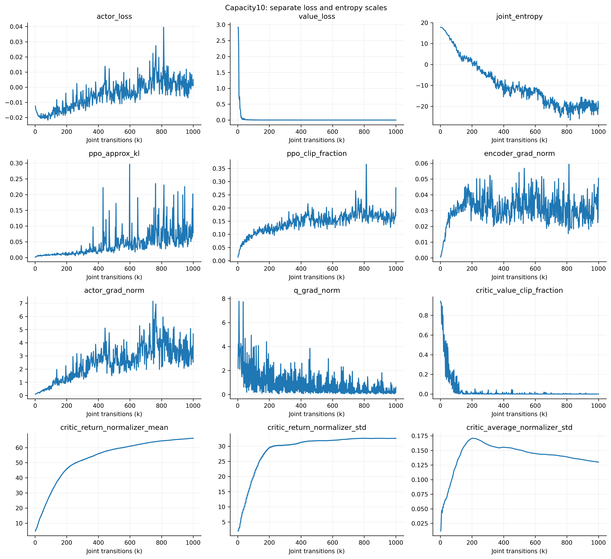
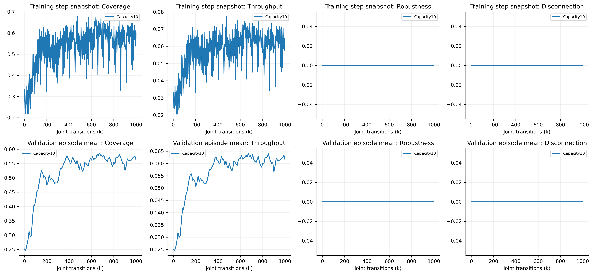
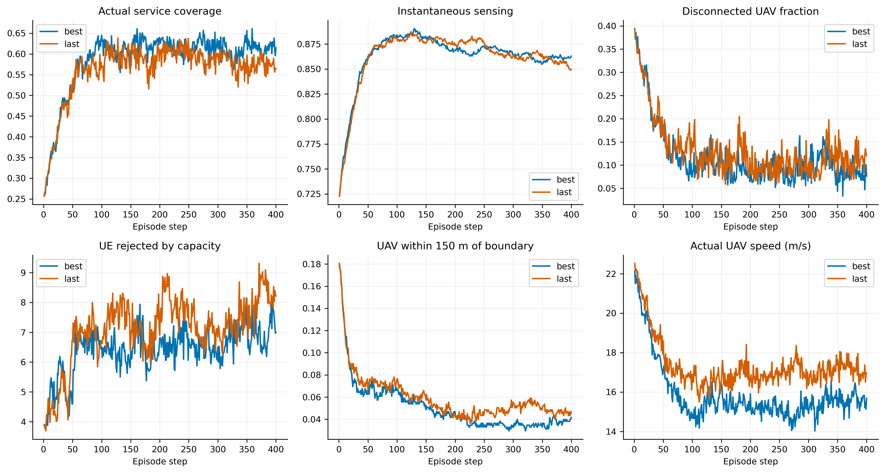
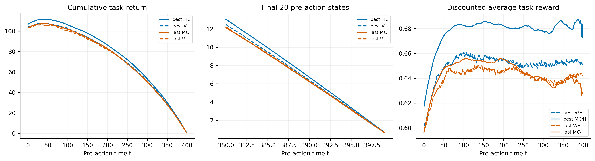
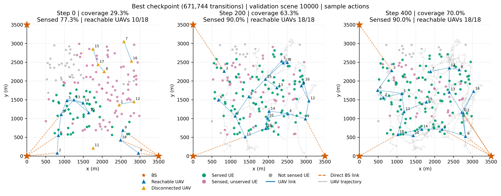
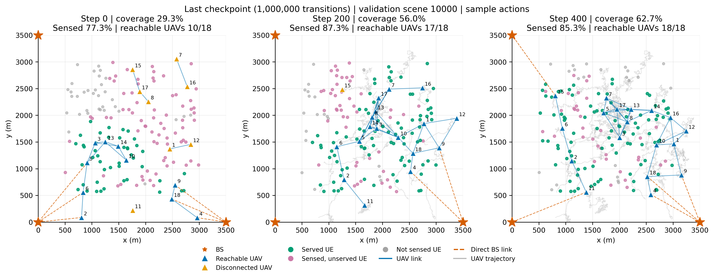
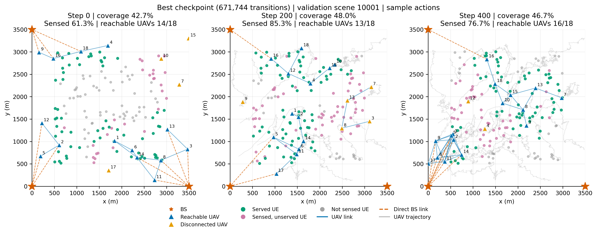
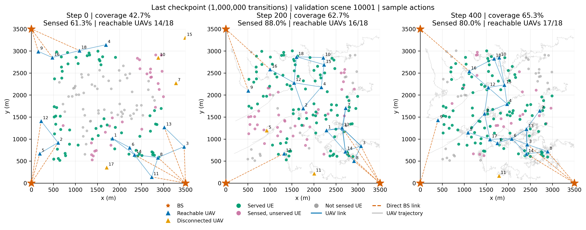

# 容量10：覆盖率＋数据率，1M MAPPO 验证

实际完成1,000,000条联合转移、489轮PPO，耗时57.67分钟，峰值RSS 1.289 GiB。共享连续actor、一步历史、时间因子critic；奖励严格为 $r=\rho+0.1\tau$。

本次重新执行best、last各32个完整验证回合；固定场景10000–10031、采样动作种子880001、批次16、400步。覆盖、回报与训练期记录逐项核对一致；没有训练新模型或使用保留测试集。MC审计的奖励序列与常规验证逐元素相同。源检查点、配置、训练日志哈希在验证前后不变。

| 模型 | 训练步数 | 平均覆盖 | 后100步覆盖 | 终态覆盖 | 吞吐Mbps | 回报 | 断联率 |
|---|---:|---:|---:|---:|---:|---:|---:|
| 初始 | 0 | 25.14% | — | — | 188.07 | 110.575 | 39.71% |
| best | 671,744 | 58.63% | 61.02% | 61.50% | 481.47 | 260.203 | 11.74% |
| last | 1,000,000 | 56.25% | 57.57% | 56.42% | 462.20 | 249.647 | 13.15% |

本轮已经学到有效服务：best和last相对初始平均覆盖分别提升33.50、31.11个百分点。但1M的last较best下降2.38个百分点；后期主要是波动和部分退化，不能据此判断延长训练一定继续改善。

## 部署维持与容量

- best：第51–150步覆盖59.78%，后100步61.02%，维持差+1.24个百分点。150m内靠边比例5.05%，反射比例0.42%，近邻小于100m比例5.57%。平均实际速度15.86m/s，近悬停概率0.47%，条件位移方差（两个轴方差之和）272.39m²。总容量利用率48.86%，满载UAV比例17.06%，零服务UAV比例21.43%。
- last：第51–150步覆盖57.91%，后100步57.57%，维持差-0.33个百分点。150m内靠边比例5.91%，反射比例0.47%，近邻小于100m比例4.00%。平均实际速度17.31m/s，近悬停概率0.40%，条件位移方差（两个轴方差之和）331.50m²。总容量利用率46.87%，满载UAV比例17.61%，零服务UAV比例24.78%。

容量总数180大于150，空闲本身不等于浪费。阶段性淘汰人数见逐回合CSV与图，并非通过改变单一条件就可全部恢复的因果收益。局部容量不足与其他UAV空闲可以同时发生。

固定场景10000中，best形成较分散的多跳拓扑，终态18架UAV均联网、覆盖70%；场景10001中，best仍有局部聚集和断联，终态覆盖46.67%。这两个预指定示例支持“已能展开，但不同场景仍存在明显差异”，不能用单图代替32场景统计。平均速度仍然较高，因此覆盖保持不等于学会了悬停或固定拓扑。

## 训练后期变化

best由完整回合覆盖＋数据率回报选择，不按终态覆盖选。以下是last减best的配对场景bootstrap区间；它是已用于选模的32个场景上的描述性诊断，不是独立测试，也不是训练种子置信区间。

- coverage：-0.0238208，95%场景区间[-0.0446618, -0.00347353]。
- last100_coverage：-0.0344792，95%场景区间[-0.0806751, +0.00896125]。
- final_coverage：-0.0508333，95%场景区间[-0.108755, +0.00645833]。
- maintenance：-0.0157062，95%场景区间[-0.0678835, +0.0386178]。
- train_return：-10.5562，95%场景区间[-19.9444, -1.35283]。
- all_throughput_bps：-1.92727e+07，95%场景区间[-3.93063e+07, +1.03576e+06]。
- all_disconnection_ratio：+0.0140885，95%场景区间[-0.00226389, +0.0309951]。

## Critic审计

| 模型 | 全程累计价值RMSE | RMSE/MC标准差 | 最后20步RMSE | 最后一步RMSE | 同时刻跨场景残差相关性 |
|---|---:|---:|---:|---:|---:|
| best | 10.2675 | 0.3021 | 1.3858 | 0.1341 | 0.4660 |
| last | 8.6308 | 0.2649 | 1.3255 | 0.1568 | 0.4292 |

MC使用各模型自身策略轨迹的两项环境奖励，不含actor熵项；一次轨迹回报含策略与UE运动噪声，不能当成精确期望价值。平滑的平均预测曲线不等于能判断相近部署的动作优劣。

两组累计价值平均曲线均能跟随剩余时长下降，但同时刻跨场景相关性只有约0.43–0.47，平均奖励尺度的RMSE约0.081–0.095，说明仍有明显的场景区分误差，不能称critic已完全正确。last的MC累计误差更小而策略覆盖更低，也说明不能仅凭价值loss或MC误差选择更好的部署策略。

## 与旧容量20结果的比较边界

本轮既减小容量又新增数据率奖励；容量20→10还将单用户带宽由1MHz改为2MHz，同一布局下合法链路速率翻倍，SINR不变，并改变服务人数与感知人数的观测归一化。因此不能把与旧纯覆盖模型的差异单独归因于容量或数据率，也不能宣称吞吐提升完全来自学到的部署。

## 图表与复现



















图表均有PDF/SVG/PNG；逐场景CSV、逐步奖励、拓扑与critic预测已保存。训练日志奖励是最后采集步的16环境均值，不能当成完整回合平均。

重建（不重新采样）：

```bash
.venv/bin/python scripts/report_mappo_capacity.py --rebuild
```
