# 连续MAPPO训练验证：实际1,000,000步

运行目录：/home/mixkle/uav_sac/runs/mappo_coverage_throughput_capacity10_1m_seed0。保存配置、完成状态和检查点显示实际预算1,000,000条联合转移、489轮PPO，正常完成，耗时57.67分钟。本次按保存配置验证，没有追加训练。

奖励：r=rho+0.1 tau+0 J−0 D。场景3500×3500 m、18 UAV、150 UE、3 BS；UU 650 m、UG三维1500 m、边界reflect。验证使用全部32个固定场景，sample动作，动作种子880001、批量16、完整400步。

| 模型 | 训练步数 | 平均回报 | 平均覆盖 | 平均感知 | 吞吐Mbps | 平均断联比例 | 终态覆盖 | 最后100步覆盖 |
|---|---:|---:|---:|---:|---:|---:|---:|---:|---:|
| best | 671744 | 260.2034 | 58.63% | 86.29% | 481.47 | 11.74% | 61.50% | 61.02% |
| last | 1000000 | 249.6472 | 56.25% | 86.26% | 462.20 | 13.15% | 56.42% | 57.57% |

| 模型 | 覆盖回报贡献 | 吞吐回报贡献 | 鲁棒回报贡献 | 断联扣分贡献 | 总回报 |
|---|---:|---:|---:|---:|---:|
| best | 234.5250 | 25.6784 | 0.0000 | -0.0000 | 260.2034 |
| last | 224.9967 | 24.6505 | 0.0000 | -0.0000 | 249.6472 |

训练前step0验证回报110.5750。best较初始回报变化+149.6284。last较初始回报变化+139.0722。使用回报绝对增量描述变化。复核返回、覆盖、吞吐和奖励分量均与训练期记录一致。

actor loss包含熵正则，value loss使用PopArt归一化；展示原始值和9个日志点的后向均值，Loss下降不能替代策略性能或critic校准证据。训练奖励/分项为日志时刻最后采集步的环境均值，验证训练进度图为完整回合贡献；两者时间尺度不同。回合展开曲线为全部32场景每步平均，代表拓扑另固定展示前两个验证场景，没有按表现挑选。单训练种子不绘制训练种子置信区间。

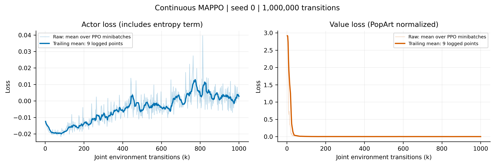

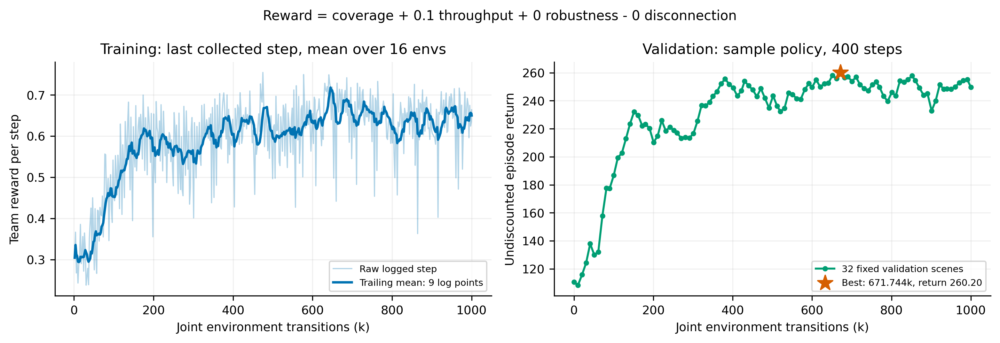

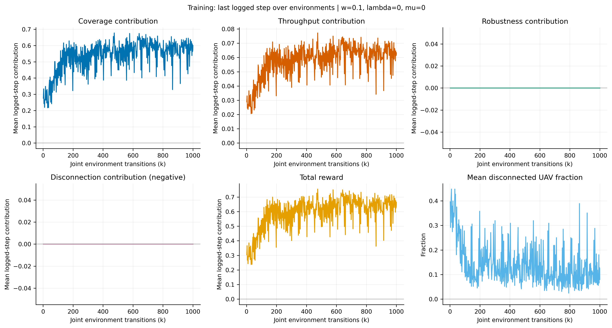

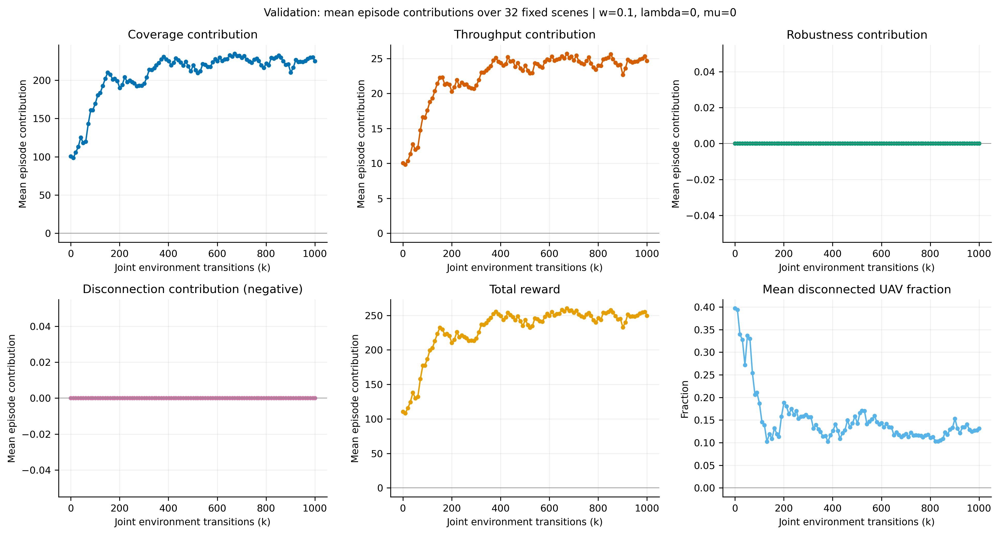

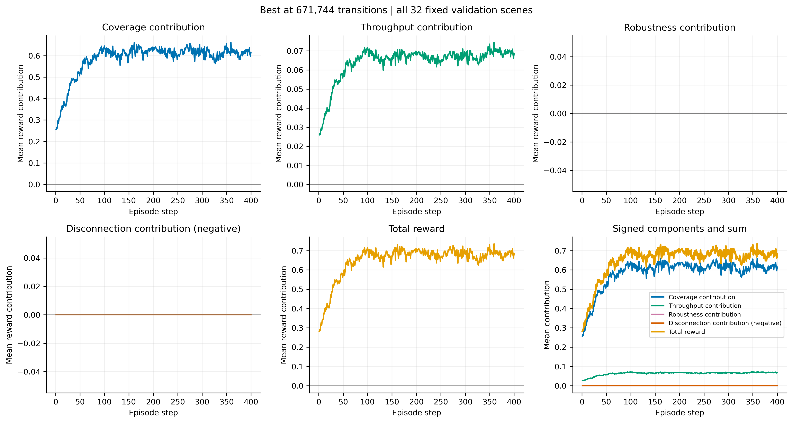

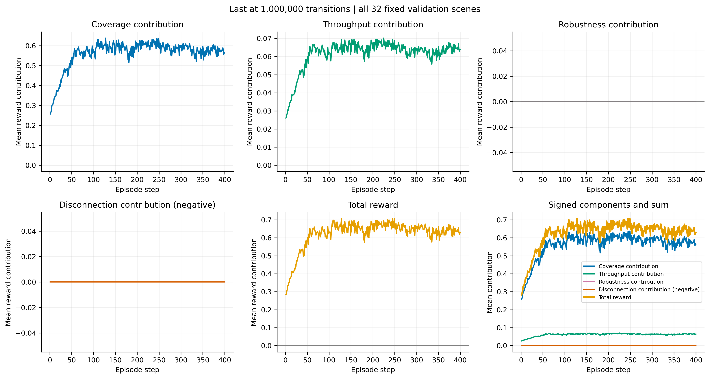

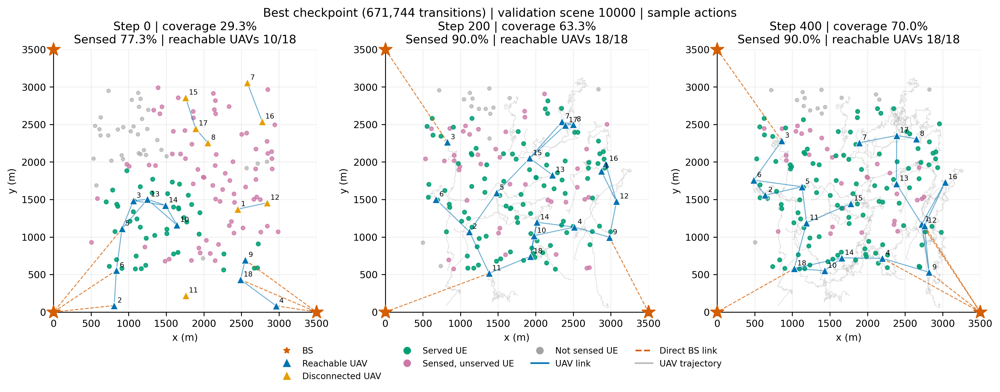

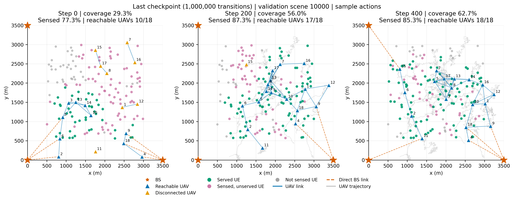

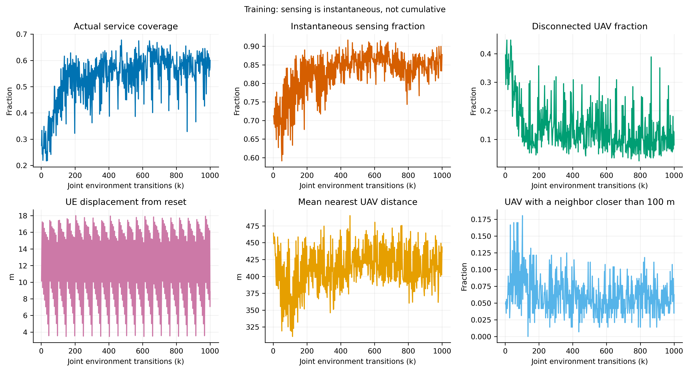

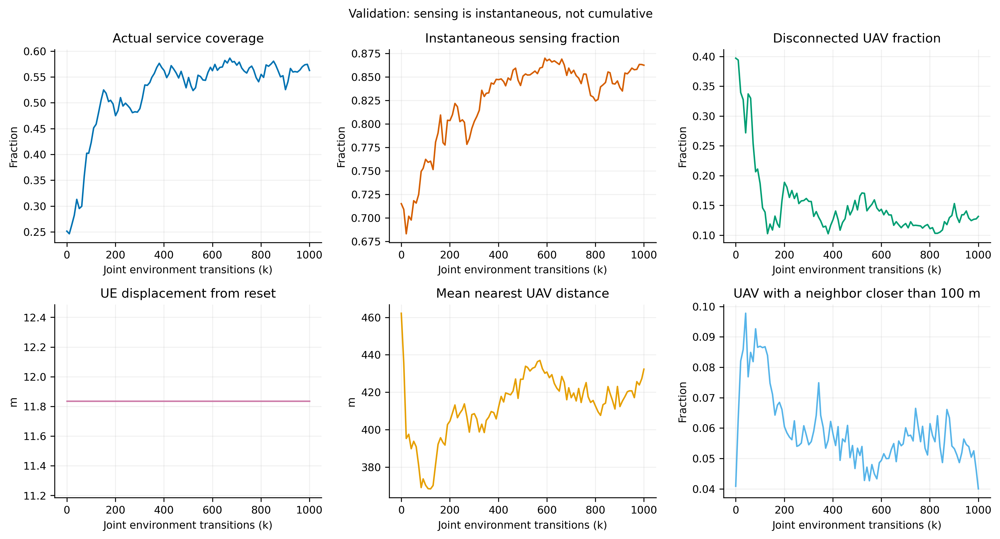

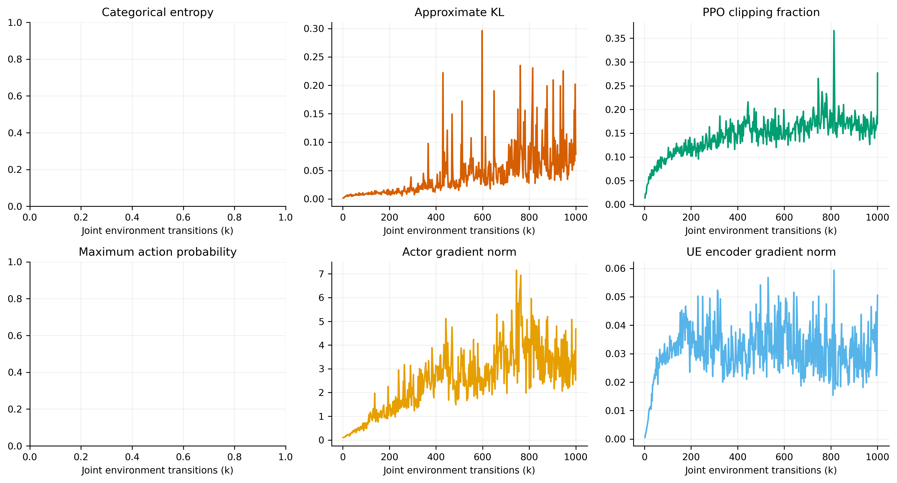

拓扑包含初始、中期、终态。蓝色UAV可达任一BS，橙色断联，绿色UE当前被服务，紫色仅感知，灰色未感知；蓝实线为UU链路、橙虚线为直接BS接入、灰线为轨迹，没有BS–BS转发边。图输出PNG/PDF/SVG，曲线另有CSV；validation_best/last保存逐场景结果、完整奖励曲线和代表轨迹。

最后一次PPO采集576条联合转移；最后日志近似KL 0.0789，clip比例27.66%。没有运行baseline、保留测试集或任何新训练。
