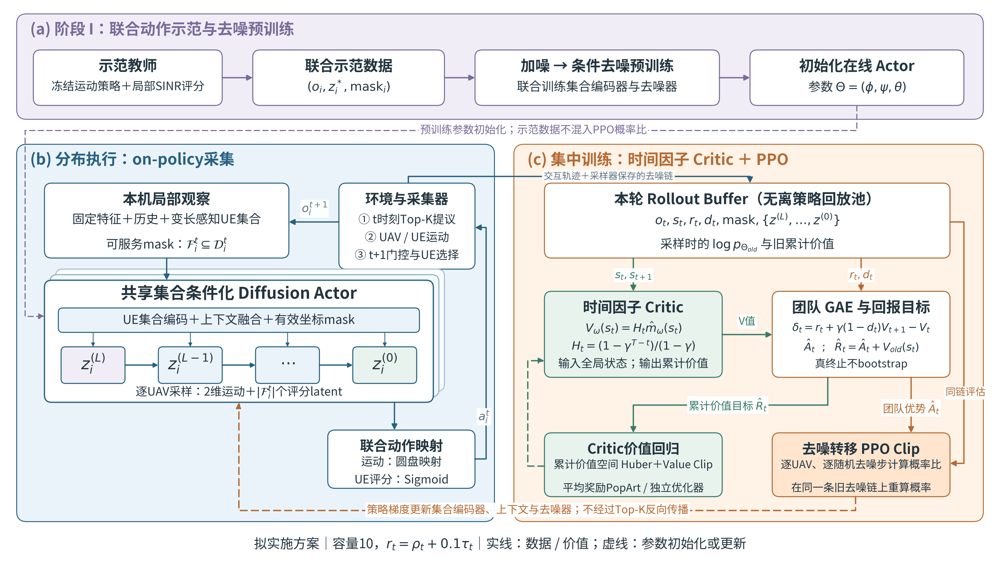
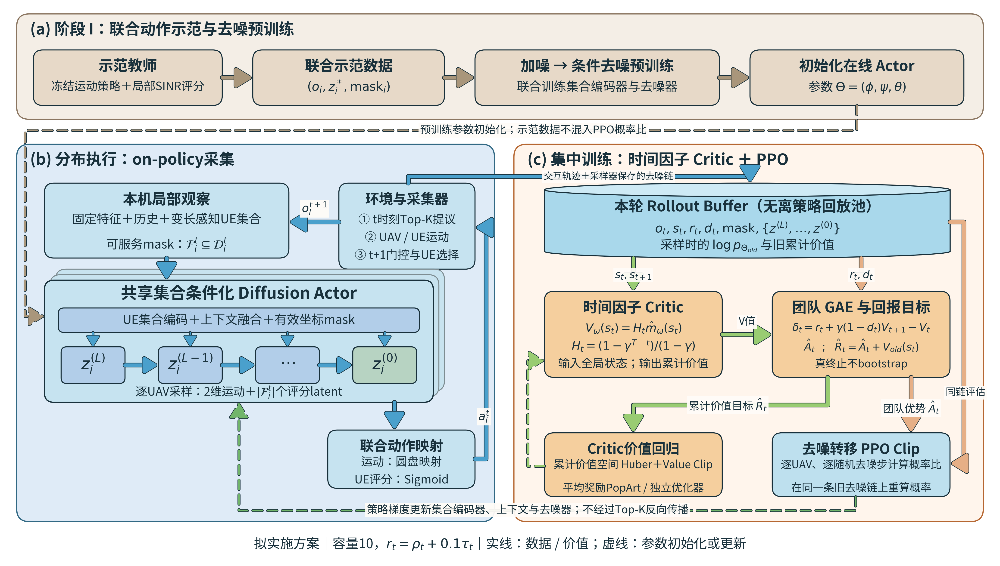
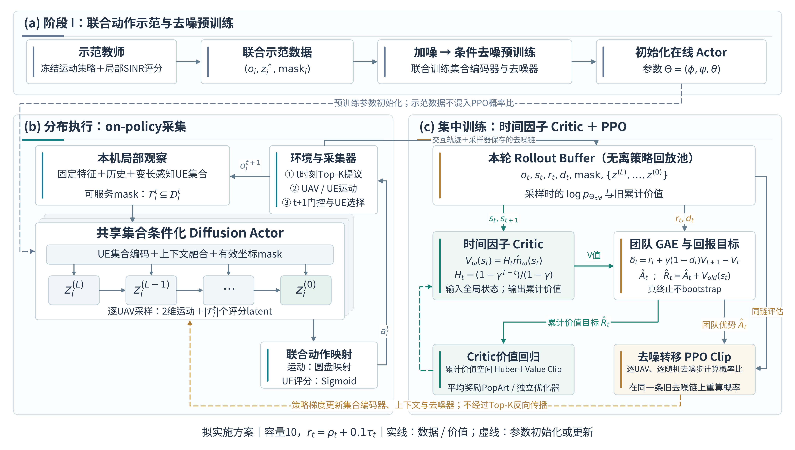

# 扩散训练算法图：三版视觉方案

三版的算法内容、公式与模块位置保持一致，仅改变视觉表达，方便选风格。

| 版本 | 视觉特点 | 预览 | 可编辑矢量 |
|---|---|---|---|
| V1 原版 | 浅蓝/浅橙/浅紫分区，细箭头 | [PNG](fig4_v1_original.png) | [SVG](fig4_v1_original.svg) |
| V2 参考图风格 | 接近参考图的蓝底/米橙底、青蓝/杏橙模块、深色描边、宽箭头、柱形Rollout Buffer | [PNG](fig4_v2_reference.png) | [SVG](fig4_v2_reference.svg) |
| V3 简洁编辑风格 | 白色卡片、深蓝文字、克制的青绿/琥珀强调、细连接线 | [PNG](fig4_v3_editorial.png) | [SVG](fig4_v3_editorial.svg) |

每版另有PDF，PNG为240dpi。V1为原文件逐字节复制；原PNG/SVG/PDF未覆盖。三版SVG文本逐元素核对一致。

## V1：原版

## V2：参考图风格

## V3：简洁编辑风格

仅借鉴参考图的视觉语言。仍是本项目拟实施的两阶段扩散/PPO方案：on-policy Rollout Buffer、时间因子critic、团队GAE、逐UAV和逐去噪步PPO；不加入参考论文的回放池、分布型critic、目标网络或熵ELBO。

重建：`.venv/bin/python scripts/build_diffusion_diagram_styles.py`。中文字体为Noto Sans CJK，未安装该字体时可直接使用PNG。
