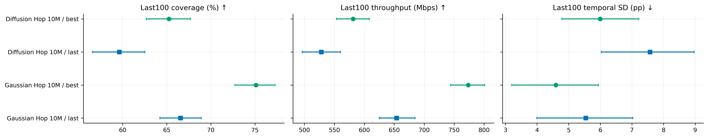
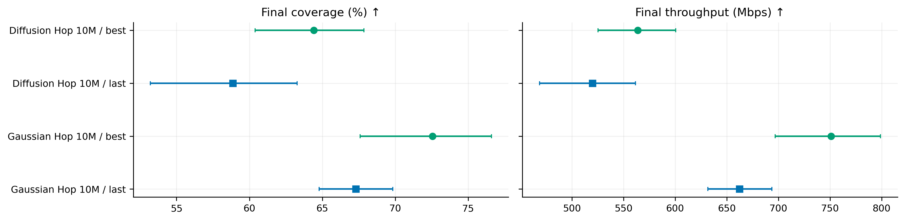
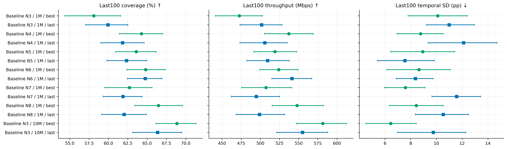
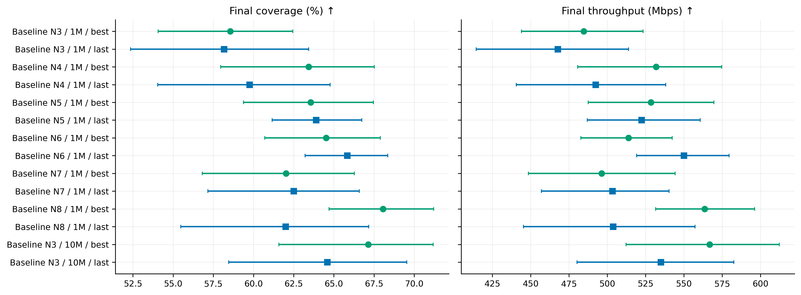
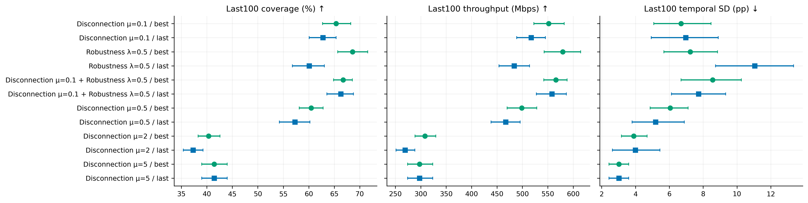
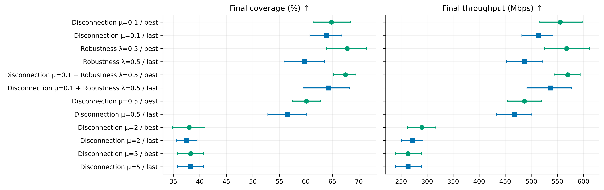
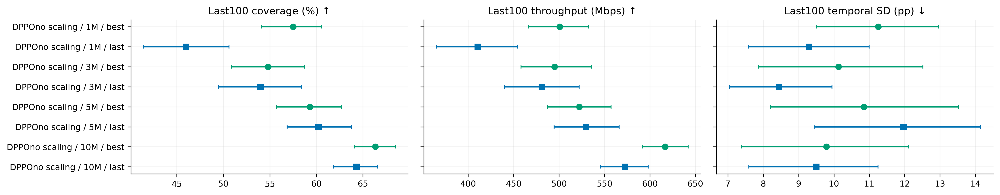
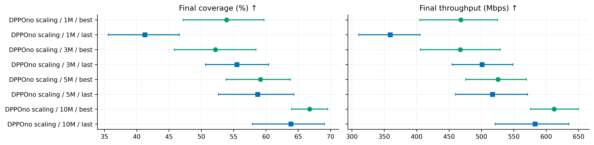
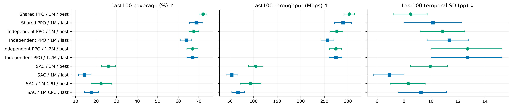
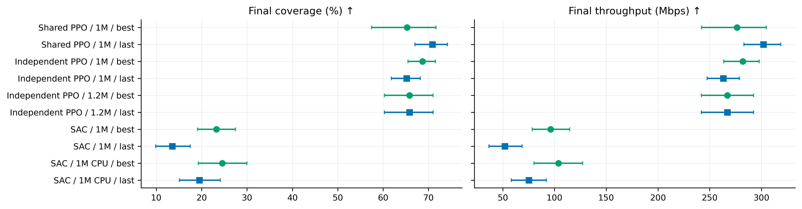

# 已完成实验：统一后100步与终态指标复评

本报告读取已有逐步验证数据；缺失完整数组的六份冻结模型另补CUDA验证，再补SAC best/last各三套CPU动作种子，共12次完整验证。未训练任何网络、未改奖励或历史best选择，旧报告及模型保持不变。

## 指标定义

1. 后100步平均覆盖：每条400步轨迹的第301–400步平均，再对场景平均。
2. 终态覆盖：第400步覆盖，再对场景平均。
3. 后100步平均吞吐：第301–400步系统总吞吐量平均，单位Mbps；非每UE速率。
4. 终态吞吐：第400步系统总吞吐量的场景平均。
5. 后100步覆盖时间标准差σ：先在每条轨迹内计算100步总体方差（ddof=0），再平均场景/动作重复的方差并开根号，单位百分点（pp）。该RMS标准差延续上轮报告5.995/4.594pp的口径。另在CSV保留“各场景标准差的算术平均”，两者不能混称。

$$\sigma_{100}=\sqrt{\frac1S\sum_s\frac1R\sum_r\frac1{100}\sum_{t=301}^{400}(100\rho_{s,r,t}-100\bar\rho_{s,r,100})^2}.$$

多个动作种子时，先逐轨迹求方差再平均，禁止先平均覆盖曲线来人为消除波动。也不把场景之间均值差异算入时间不稳定性。100步固定窗口不预设系统已达到最大覆盖或稳态。

共整理110条评估记录，读取189份数组；27处复用数据记为别名，不作为独立验证重复。
每张表保留模型实际保存步数。best仍按当时训练的原选模标准选择，未按本次后100步指标重新挑模型。各组预算、容量、奖励、关联、观察、CPU/CUDA或场景不同，不能合并做不加条件的算法排名。

完整机器可读结果：[summary.csv](summary.csv)，逐场景：[per_scene.csv](per_scene.csv)，场景级2000次bootstrap区间包含在CSV中，不是训练种子区间。原始文件与SHA256见manifest.json和provenance.json。

## 主要best结果速览

| 实验 | 模型 | 模型步数 | 后100步覆盖 % | 终态覆盖 % | 后100步吞吐 Mbps | 终态吞吐 Mbps | 后100步覆盖σ pp | 口径 |
|---|---|---:|---:|---:|---:|---:|---:|---|
| Baseline N3 / 1M | best | 671,744 | 58.107 | 58.562 | 472.639 | 484.742 | 10.099 | cuda:0; 32场景×1重复 |
| Baseline N3 / 10M | best | 3,821,568 | 68.841 | 67.146 | 581.508 | 566.803 | 6.448 | cuda:0; 32场景×1重复 |
| Baseline N8 / 1M | best | 890,880 | 66.461 | 68.062 | 547.967 | 563.650 | 8.435 | cuda:0; 32场景×1重复 |
| DPPO无缩放 / 10M | best | 9,550,656 | 66.338 | 66.771 | 616.788 | 612.357 | 9.783 | cuda:0; 32场景×1重复 |
| Diffusion Hop 10M | best | 7,501,824 | 65.243 | 64.417 | 581.242 | 563.799 | 5.995 | cuda:0; 32场景×1重复 |
| Gaussian Hop 10M | best | 970,752 | 75.104 | 72.562 | 773.526 | 751.186 | 4.594 | cuda:0; 32场景×1重复 |

新口径下，原邻居8 baseline的后100步覆盖66.461%，原无缩放DPPO 10M为66.338%；后者的后100步吞吐更高（616.788 vs 547.967 Mbps）。这说明覆盖与吞吐应分开判断，不能沿用全回合均值的名次推断后期覆盖优势。预算与关联机制等差异仍存在，这不是纯算法因果对照。
最新跳数缩放两组中，Gaussian best的后100步覆盖75.104%、σ4.594pp；Diffusion best为65.243%、σ5.995pp。改用后期指标后，两组的描述性排序没有反转。
高断联惩罚的低σ伴随低覆盖：μ=2、5的best后100步覆盖分别40.358%、41.445%，σ为3.900、3.020pp。应把“覆盖水平”和“时间波动”一起看，不能把较小标准差单独当作成功。

## 跳数缩放：Diffusion与Gaussian联合运动/评分，10M

| 实验 | 模型 | 模型步数 | 后100步覆盖 % | 终态覆盖 % | 后100步吞吐 Mbps | 终态吞吐 Mbps | 后100步覆盖σ pp | 口径 |
|---|---|---:|---:|---:|---:|---:|---:|---|
| Diffusion Hop 10M | best | 7,501,824 | 65.243 | 64.417 | 581.242 | 563.799 | 5.995 | cuda:0; 32场景×1重复 |
| Diffusion Hop 10M | last | 10,000,000 | 59.612 | 58.854 | 528.118 | 519.940 | 7.569 | cuda:0; 32场景×1重复 |
| Diffusion Hop 10M | step0 | 0 | 59.756 | 58.604 | 522.432 | 514.067 | 7.177 | cuda:0; 32场景×1重复 |
| Gaussian Hop 10M | best | 970,752 | 75.104 | 72.562 | 773.526 | 751.186 | 4.594 | cuda:0; 32场景×1重复 |
| Gaussian Hop 10M | last | 10,000,000 | 66.553 | 67.292 | 653.939 | 662.317 | 5.539 | cuda:0; 32场景×1重复 |
| Gaussian Hop 10M | step0 | 0 | 32.229 | 33.562 | 242.138 | 254.720 | 3.947 | cuda:0; 32场景×1重复 |





## 容量10 Gaussian MAPPO原baseline：邻居3–8与10M

| 实验 | 模型 | 模型步数 | 后100步覆盖 % | 终态覆盖 % | 后100步吞吐 Mbps | 终态吞吐 Mbps | 后100步覆盖σ pp | 口径 |
|---|---|---:|---:|---:|---:|---:|---:|---|
| Baseline N3 / 1M | best | 671,744 | 58.107 | 58.562 | 472.639 | 484.742 | 10.099 | cuda:0; 32场景×1重复 |
| Baseline N3 / 1M | last | 1,000,000 | 59.933 | 58.167 | 501.746 | 467.766 | 10.991 | cuda:0; 32场景×1重复 |
| Baseline N4 / 1M | best | 620,544 | 64.263 | 63.437 | 537.145 | 531.887 | 8.773 | cuda:0; 32场景×1重复 |
| Baseline N4 / 1M | last | 1,000,000 | 61.817 | 59.750 | 505.839 | 492.401 | 12.102 | cuda:0; 32场景×1重复 |
| Baseline N5 / 1M | best | 980,992 | 63.587 | 63.562 | 519.208 | 528.559 | 8.934 | cuda:0; 32场景×1重复 |
| Baseline N5 / 1M | last | 1,000,000 | 62.336 | 63.896 | 509.560 | 522.452 | 7.546 | cuda:0; 32场景×1重复 |
| Baseline N6 / 1M | best | 540,672 | 64.808 | 64.521 | 524.104 | 513.904 | 8.651 | cuda:0; 32场景×1重复 |
| Baseline N6 / 1M | last | 1,000,000 | 64.742 | 65.833 | 541.405 | 549.961 | 8.369 | cuda:0; 32场景×1重复 |
| Baseline N7 / 1M | best | 940,032 | 62.718 | 62.021 | 507.427 | 496.434 | 7.593 | cuda:0; 32场景×1重复 |
| Baseline N7 / 1M | last | 1,000,000 | 61.876 | 62.500 | 494.782 | 503.401 | 11.568 | cuda:0; 32场景×1重复 |
| Baseline N8 / 1M | best | 890,880 | 66.461 | 68.062 | 547.967 | 563.650 | 8.435 | cuda:0; 32场景×1重复 |
| Baseline N8 / 1M | last | 1,000,000 | 62.031 | 62.000 | 498.847 | 503.790 | 10.531 | cuda:0; 32场景×1重复 |
| Baseline N3 / 10M | best | 3,821,568 | 68.841 | 67.146 | 581.508 | 566.803 | 6.448 | cuda:0; 32场景×1重复 |
| Baseline N3 / 10M | last | 10,000,000 | 66.344 | 64.583 | 555.019 | 534.998 | 9.756 | cuda:0; 32场景×1重复 |





## 容量10 baseline奖励消融：断联与鲁棒性

| 实验 | 模型 | 模型步数 | 后100步覆盖 % | 终态覆盖 % | 后100步吞吐 Mbps | 终态吞吐 Mbps | 后100步覆盖σ pp | 口径 |
|---|---|---:|---:|---:|---:|---:|---:|---|
| 断联μ=0.1 | best | 620,544 | 65.338 | 64.833 | 551.624 | 555.506 | 6.696 | cuda:0; 32场景×1重复 |
| 断联μ=0.1 | last | 1,000,000 | 62.763 | 63.938 | 517.143 | 513.226 | 6.967 | cuda:0; 32场景×1重复 |
| 鲁棒λ=0.5 | best | 610,304 | 68.562 | 67.792 | 579.318 | 567.858 | 7.242 | cuda:0; 32场景×1重复 |
| 鲁棒λ=0.5 | last | 1,000,000 | 60.065 | 59.708 | 483.919 | 487.396 | 11.046 | cuda:0; 32场景×1重复 |
| 断联μ=0.1＋鲁棒λ=0.5 | best | 831,488 | 66.714 | 67.458 | 565.936 | 569.875 | 8.564 | cuda:0; 32场景×1重复 |
| 断联μ=0.1＋鲁棒λ=0.5 | last | 1,000,000 | 66.255 | 64.229 | 557.960 | 537.511 | 7.729 | cuda:0; 32场景×1重复 |
| 断联μ=0.5 | best | 911,360 | 60.447 | 60.104 | 498.927 | 487.029 | 6.053 | cuda:0; 32场景×1重复 |
| 断联μ=0.5 | last | 1,000,000 | 57.266 | 56.500 | 467.103 | 467.441 | 5.189 | cuda:0; 32场景×1重复 |
| 断联μ=2 | best | 821,248 | 40.358 | 38.000 | 308.452 | 290.052 | 3.900 | cuda:0; 32场景×1重复 |
| 断联μ=2 | last | 1,000,000 | 37.296 | 37.500 | 269.084 | 271.840 | 3.989 | cuda:0; 32场景×1重复 |
| 断联μ=5 | best | 1,000,000 | 41.445 | 38.292 | 297.736 | 263.494 | 3.020 | cuda:0; 32场景×1重复 |
| 断联μ=5 | last | 1,000,000 | 41.445 | 38.292 | 297.736 | 263.494 | 3.020 | cuda:0; 32场景×1重复 |





## 原无跳数缩放DPPO：1M/3M/5M/10M

| 实验 | 模型 | 模型步数 | 后100步覆盖 % | 终态覆盖 % | 后100步吞吐 Mbps | 终态吞吐 Mbps | 后100步覆盖σ pp | 口径 |
|---|---|---:|---:|---:|---:|---:|---:|---|
| DPPO无缩放 / 1M | best | 40,960 | 57.513 | 53.917 | 500.576 | 468.230 | 11.252 | cuda:0; 32场景×1重复 |
| DPPO无缩放 / 1M | last | 1,000,000 | 45.976 | 41.271 | 410.431 | 359.212 | 9.295 | cuda:0; 32场景×1重复 |
| DPPO无缩放 / 3M | best | 2,792,000 | 54.828 | 52.188 | 495.070 | 467.429 | 10.127 | cuda:0; 32场景×1重复 |
| DPPO无缩放 / 3M | last | 3,000,000 | 53.971 | 55.500 | 481.065 | 500.959 | 8.437 | cuda:0; 32场景×1重复 |
| DPPO无缩放 / 5M | best | 4,601,536 | 59.312 | 59.167 | 522.380 | 525.718 | 10.850 | cuda:0; 32场景×1重复 |
| DPPO无缩放 / 5M | last | 5,000,000 | 60.209 | 58.729 | 529.411 | 517.209 | 11.960 | cuda:0; 32场景×1重复 |
| DPPO无缩放 / 10M | best | 9,550,656 | 66.338 | 66.771 | 616.788 | 612.357 | 9.783 | cuda:0; 32场景×1重复 |
| DPPO无缩放 / 10M | last | 10,000,000 | 64.288 | 63.854 | 572.360 | 582.754 | 9.495 | cuda:0; 32场景×1重复 |
| DPPO无缩放：预训练后step0 | step0 | 0 | 54.151 | 53.396 | 471.396 | 466.224 | 11.914 | cuda:0; 32场景×1重复 |





## 容量20历史基准：共享/独立PPO与SAC，纯覆盖

| 实验 | 模型 | 模型步数 | 后100步覆盖 % | 终态覆盖 % | 后100步吞吐 Mbps | 终态吞吐 Mbps | 后100步覆盖σ pp | 口径 |
|---|---|---:|---:|---:|---:|---:|---:|---|
| Shared PPO / 1M | initial | 0 | 29.511 | 27.521 | 111.372 | 101.277 | 8.449 | cpu; 32场景×1重复 |
| Shared PPO / 1M | best | 561,792 | 72.104 | 65.271 | 303.118 | 276.263 | 8.503 | cpu; 32场景×1重复 |
| Shared PPO / 1M（三动作种子） | best | 561,792 | 69.544 | 67.312 | 288.633 | 279.097 | 9.023 | cpu; 32场景×3重复 |
| Shared PPO / 1M | last | 1,000,000 | 68.756 | 70.854 | 290.014 | 301.841 | 10.143 | cpu; 32场景×1重复 |
| Shared PPO / 1M（三动作种子） | last | 1,000,000 | 68.766 | 69.208 | 287.156 | 291.067 | 10.251 | cpu; 32场景×3重复 |
| Independent PPO / 1M | initial | 0 | 29.511 | 27.521 | 111.372 | 101.277 | 8.449 | cpu; 32场景×1重复 |
| Independent PPO / 1M | best | 981,632 | 67.598 | 68.708 | 276.565 | 281.936 | 10.871 | cpu; 32场景×1重复 |
| Independent PPO / 1M（三动作种子） | best | 981,632 | 66.143 | 67.875 | 272.909 | 282.771 | 11.277 | cpu; 32场景×3重复 |
| Independent PPO / 1M | last | 1,000,000 | 63.929 | 65.167 | 256.967 | 263.220 | 11.356 | cpu; 32场景×1重复 |
| Independent PPO / 1M（三动作种子） | last | 1,000,000 | 63.313 | 64.674 | 256.021 | 261.927 | 11.531 | cpu; 32场景×3重复 |
| Independent PPO / 1.2M | initial | 0 | 29.511 | 27.521 | 111.372 | 101.277 | 8.449 | cpu; 32场景×1重复 |
| Independent PPO / 1.2M | best | 1,200,000 | 66.984 | 65.812 | 274.564 | 267.021 | 12.705 | cpu; 32场景×1重复 |
| Independent PPO / 1.2M（三动作种子） | best | 1,200,000 | 67.550 | 67.035 | 277.764 | 275.187 | 11.579 | cpu; 32场景×3重复 |
| Independent PPO / 1.2M | last | 1,200,000 | 66.984 | 65.812 | 274.564 | 267.021 | 12.705 | cpu; 32场景×1重复 |
| Independent PPO / 1.2M（三动作种子） | last | 1,200,000 | 67.550 | 67.035 | 277.764 | 275.187 | 11.579 | cpu; 32场景×3重复 |
| SAC / 1M | best | 460,000 | 26.022 | 23.271 | 104.675 | 96.280 | 9.953 | cuda:0; 32场景×1重复 |
| SAC / 1M | last | 1,000,000 | 14.384 | 13.542 | 53.666 | 51.963 | 6.914 | cuda:0; 32场景×1重复 |
| SAC / 1M CPU | best | 460,000 | 22.413 | 24.542 | 93.334 | 103.829 | 8.323 | cpu; 32场景×1重复 |
| SAC / 1M CPU（三动作种子） | best | 460,000 | 20.983 | 21.208 | 83.867 | 84.477 | 8.135 | cpu; 32场景×3重复 |
| SAC / 1M CPU | last | 1,000,000 | 17.663 | 19.521 | 66.854 | 75.121 | 9.251 | cpu; 32场景×1重复 |
| SAC / 1M CPU（三动作种子） | last | 1,000,000 | 17.278 | 15.938 | 64.723 | 59.601 | 8.275 | cpu; 32场景×3重复 |

容量20纯覆盖PPO与SAC均提供CPU、动作种子880001/880002/880003的可比口径。SAC CUDA单独保留以复现原训练验证日志，不把CPU与CUDA采样轨迹混合平均。





## 冻结baseline教师＋Top-K关联

| 实验 | 模型 | 模型步数 | 后100步覆盖 % | 终态覆盖 % | 后100步吞吐 Mbps | 终态吞吐 Mbps | 后100步覆盖σ pp | 口径 |
|---|---|---:|---:|---:|---:|---:|---:|---|
| Baseline 1M教师＋Top-K | best | 671,744 | 55.918 | 48.708 | 487.773 | 417.738 | 11.541 | cpu; 32场景×1重复 |
| Baseline 10M教师＋Top-K | best | 3,821,568 | 65.839 | 65.021 | 581.808 | 574.860 | 6.605 | cuda:0; 32场景×1重复 |

## 冻结baseline：速度缩放与局部链路安全干预

| 实验 | 模型 | 模型步数 | 后100步覆盖 % | 终态覆盖 % | 后100步吞吐 Mbps | 终态吞吐 Mbps | 后100步覆盖σ pp | 口径 |
|---|---|---:|---:|---:|---:|---:|---:|---|
| 原始运动 | best | 671,744 | 61.021 | 61.500 | 511.734 | 514.040 | 10.642 | cpu; 32场景×1重复 |
| 跳数速度缩放 | best | 671,744 | 64.007 | 64.583 | 528.100 | 532.348 | 7.660 | cpu; 32场景×1重复 |
| 缩放＋5m局部链路约束 | best | 671,744 | 64.691 | 62.771 | 529.111 | 512.392 | 5.591 | cpu; 32场景×1重复 |

## 邻居3/4/5的UE/UAV数量泛化（64诊断场景）

| 实验 | 模型 | 模型步数 | 后100步覆盖 % | 终态覆盖 % | 后100步吞吐 Mbps | 终态吞吐 Mbps | 后100步覆盖σ pp | 口径 |
|---|---|---:|---:|---:|---:|---:|---:|---|
| N3 / 原场景 | best | 671,744 | 58.147 | 55.552 | 468.067 | 453.528 | 10.108 | cuda:0; 64场景×1重复 |
| N3 / UE60% | best | 671,744 | 60.310 | 60.139 | 295.402 | 293.416 | 10.298 | cuda:0; 64场景×1重复 |
| N3 / UE80% | best | 671,744 | 62.643 | 61.510 | 405.996 | 398.779 | 10.867 | cuda:0; 64场景×1重复 |
| N3 / 14 UAV | best | 671,744 | 50.942 | 48.521 | 421.321 | 396.008 | 13.296 | cuda:0; 64场景×1重复 |
| N3 / 10 UAV | best | 671,744 | 35.066 | 32.104 | 285.888 | 267.221 | 14.306 | cuda:0; 64场景×1重复 |
| N4 / 原场景 | best | 620,544 | 61.924 | 57.656 | 513.060 | 478.173 | 11.754 | cuda:0; 64场景×1重复 |
| N4 / UE60% | best | 620,544 | 62.256 | 65.469 | 306.898 | 323.347 | 12.811 | cuda:0; 64场景×1重复 |
| N4 / UE80% | best | 620,544 | 60.685 | 64.062 | 398.109 | 421.862 | 13.916 | cuda:0; 64场景×1重复 |
| N4 / 14 UAV | best | 620,544 | 51.752 | 52.312 | 430.103 | 432.457 | 12.638 | cuda:0; 64场景×1重复 |
| N4 / 10 UAV | best | 620,544 | 37.384 | 38.385 | 316.327 | 319.181 | 13.062 | cuda:0; 64场景×1重复 |
| N5 / 原场景 | best | 980,992 | 61.738 | 61.323 | 504.308 | 504.687 | 7.657 | cuda:0; 64场景×1重复 |
| N5 / UE60% | best | 980,992 | 64.719 | 62.535 | 315.614 | 302.490 | 9.899 | cuda:0; 64场景×1重复 |
| N5 / UE80% | best | 980,992 | 63.500 | 62.253 | 416.614 | 399.956 | 8.806 | cuda:0; 64场景×1重复 |
| N5 / 14 UAV | best | 980,992 | 53.952 | 52.698 | 438.659 | 426.642 | 10.711 | cuda:0; 64场景×1重复 |
| N5 / 10 UAV | best | 980,992 | 40.467 | 41.115 | 329.908 | 333.177 | 13.210 | cuda:0; 64场景×1重复 |

此组使用660000–660063，共64个诊断场景，UE减少时总吞吐会受总需求人数变化影响。冻结actor的UAV数量适配保持训练编号/跳数尺度，不能与32个原验证场景混排。

## 最新定位实验：噪声干预与200k微调

| 实验 | 模型 | 模型步数 | 后100步覆盖 % | 终态覆盖 % | 后100步吞吐 Mbps | 终态吞吐 Mbps | 后100步覆盖σ pp | 口径 |
|---|---|---:|---:|---:|---:|---:|---:|---|
| diffusion best，噪声×0.8 | best | 未记录 | 64.458 | 63.667 | 571.431 | 556.866 | 6.185 | unknown; 32场景×1重复 |
| gaussian best，噪声×0.8 | best | 未记录 | 74.698 | 74.542 | 774.014 | 774.702 | 4.486 | unknown; 32场景×1重复 |
| diffusion last，噪声×0.8 | last | 未记录 | 60.735 | 60.208 | 529.542 | 533.937 | 6.659 | unknown; 32场景×1重复 |
| gaussian last，噪声×0.8 | last | 未记录 | 66.937 | 67.958 | 661.865 | 668.136 | 4.972 | unknown; 32场景×1重复 |
| Diffusion best微调 / control | best | 0 | 65.243 | 64.417 | 581.242 | 563.799 | 5.995 | cuda:0; 32场景×1重复 |
| Diffusion best微调 / control | last | 200,000 | 64.795 | 64.688 | 569.867 | 565.905 | 5.274 | cuda:0; 32场景×1重复 |
| Diffusion best微调 / conservative | best | 0 | 65.243 | 64.417 | 581.242 | 563.799 | 5.995 | cuda:0; 32场景×1重复 |
| Diffusion best微调 / conservative | last | 200,000 | 62.136 | 61.562 | 566.732 | 557.866 | 9.048 | cuda:0; 32场景×1重复 |

## 其他完整评估与初始化参考

| 实验 | 模型 | 模型步数 | 后100步覆盖 % | 终态覆盖 % | 后100步吞吐 Mbps | 终态吞吐 Mbps | 后100步覆盖σ pp | 口径 |
|---|---|---:|---:|---:|---:|---:|---:|---|
| Baseline N3 / 1M（CPU复现） | best | 671,744 | 61.021 | 61.500 | 511.734 | 514.040 | 10.642 | cpu; 32场景×1重复 |
| Baseline N3 / 1M（CPU复现） | last | 1,000,000 | 57.573 | 56.417 | 474.252 | 478.806 | 10.767 | cpu; 32场景×1重复 |

## 固定布局影子关联：不属于闭环策略性能

| 实验 | 模型 | 模型步数 | 后100步覆盖 % | 终态覆盖 % | 后100步吞吐 Mbps | 终态吞吐 Mbps | 后100步覆盖σ pp | 口径 |
|---|---|---:|---:|---:|---:|---:|---:|---|
| DPPO 1M best：事后SINR评分 | shadow | 40,960 | 57.530 | 53.938 | 500.721 | 468.352 | 11.256 | cuda:0; 32场景×1重复 |
| DPPO 1M last：事后SINR评分 | shadow | 1,000,000 | 45.993 | 41.292 | 410.596 | 359.541 | 9.302 | cuda:0; 32场景×1重复 |
| topk_capacity10_shared_best_diagnostic / SINR教师/P0 | shadow | 未记录 | 64.245 | 58.896 | 574.832 | 531.913 | 9.198 | CPU shadow; 32场景×1重复 |
| topk_capacity10_shared_best_diagnostic / SINR教师/P1 | shadow | 未记录 | 64.303 | 58.938 | 574.951 | 531.995 | 9.211 | CPU shadow; 32场景×1重复 |
| topk_capacity10_shared_best_diagnostic / 常数/P0 | shadow | 未记录 | 63.824 | 58.333 | 545.219 | 500.126 | 9.130 | CPU shadow; 32场景×1重复 |
| topk_capacity10_shared_best_diagnostic / 常数/P1 | shadow | 未记录 | 64.274 | 58.812 | 549.055 | 504.388 | 9.204 | CPU shadow; 32场景×1重复 |
| topk_capacity10_shared_best_diagnostic / 随机20重复/P0 | shadow | 未记录 | 63.808 | 58.342 | 543.856 | 499.027 | 9.125 | CPU shadow; 32场景×20重复 |
| topk_capacity10_shared_best_diagnostic / 随机20重复/P1 | shadow | 未记录 | 64.229 | 58.775 | 547.394 | 502.745 | 9.197 | CPU shadow; 32场景×20重复 |
| topk_capacity10_shared_best_diagnostic / O1 known maximum | upper_bound | 未记录 | 64.368 | 58.958 | 不适用 | 不适用 | 9.228 | CPU shadow; 32场景×1重复 |
| topk_capacity10_shared_best_diagnostic / O2 full maximum | upper_bound | 未记录 | 67.130 | 60.688 | 不适用 | 不适用 | 7.765 | CPU shadow; 32场景×1重复 |
| topk_capacity10_coverage_throughput_best_diagnostic / SINR教师/P0 | shadow | 未记录 | 57.586 | 57.083 | 511.667 | 502.953 | 11.460 | CPU shadow; 32场景×1重复 |
| topk_capacity10_coverage_throughput_best_diagnostic / SINR教师/P1 | shadow | 未记录 | 57.644 | 57.104 | 511.785 | 502.990 | 11.478 | CPU shadow; 32场景×1重复 |
| topk_capacity10_coverage_throughput_best_diagnostic / 常数/P0 | shadow | 未记录 | 57.206 | 56.604 | 484.917 | 477.650 | 11.366 | CPU shadow; 32场景×1重复 |
| topk_capacity10_coverage_throughput_best_diagnostic / 常数/P1 | shadow | 未记录 | 57.585 | 57.188 | 488.164 | 482.595 | 11.462 | CPU shadow; 32场景×1重复 |
| topk_capacity10_coverage_throughput_best_diagnostic / 随机20重复/P0 | shadow | 未记录 | 57.207 | 56.603 | 484.324 | 475.926 | 11.370 | CPU shadow; 32场景×20重复 |
| topk_capacity10_coverage_throughput_best_diagnostic / 随机20重复/P1 | shadow | 未记录 | 57.586 | 57.146 | 487.540 | 480.843 | 11.463 | CPU shadow; 32场景×20重复 |
| topk_capacity10_coverage_throughput_best_diagnostic / O1 known maximum | upper_bound | 未记录 | 57.719 | 57.229 | 不适用 | 不适用 | 11.497 | CPU shadow; 32场景×1重复 |
| topk_capacity10_coverage_throughput_best_diagnostic / O2 full maximum | upper_bound | 未记录 | 61.022 | 61.500 | 不适用 | 不适用 | 10.642 | CPU shadow; 32场景×1重复 |

这些是教师真实轨迹上的影子关联，动作和下一状态仍由原教师决定。P1收益不是闭环补位策略的长期收益；O1/O2只报告覆盖上界，不虚构最优吞吐。历史容量20来源轨迹上的capacity10反事实与真正capacity10训练分开展示。

## 完整性与不能恢复的历史结果

保留的20个正式运行已逐一覆盖best/last；其中文件名100k并不代表实际预算。独立PPO的1M历史模型和1.2M模型分别来自各自保存的报告，不把当前1.2M权重冒充旧1M。最新两组跳数缩放10M和最新20万步诊断也单列。
此前已清理的250k/100k旧实验（例如最早A–F、早期critic实验）若没有逐步验证数据与对应检查点，不能从训练均值或代表场景图恢复这五项指标。已清理验收摘要也不能替代全场景验证；本报告不编造这些结果。SAC旧逐步报告缺失，已用保留best/last补评估。
清理过的旧实验路径见[历史删除清单](deleted_historical_results.json)，它们与本报告零缺口的“现存20个正式运行”是不同范围。
仅有两张代表拓扑轨迹、训练日志、均值曲线或短分叉的数据，不冒充完整32场景400步评估。单步动作干预/50步fork不是完整回合，不纳入本表。
数据缺口/无法解析项共0条，见[缺口清单](missing_or_unavailable.json)。

主报告中的数据重用别名只用于查找来源；完整别名映射见evaluation_aliases.csv。旧结果文件在计算前后核验SHA256，未写回任何旧结果或改变best。

## 重建命令

```bash
OPENBLAS_NUM_THREADS=1 OMP_NUM_THREADS=2 MKL_NUM_THREADS=2 \
.venv-dppo-compat/bin/python scripts/report_all_tail100.py
```

只读取已保存数据，不重新采样。所有新输出在本目录；本轮未自动上传GitHub。
