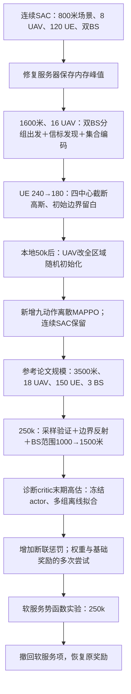

# 建模、实现与覆盖实验复盘（截至2026-10-19）

本复盘依据会话中的实施顺序、当前源码/配置、保存的训练配置与验证记录，以及现存分析报告。早期多批训练结果曾按用户要求清理；无法核实的早期覆盖数值不补写。明确日期采用Asia/Shanghai；不能确认具体日期的阶段只记录先后。没有为本复盘追加训练或验证。

## 1. 整条主线

这不是同一固定任务上只将SAC换成MAPPO：场景尺寸、节点数、初始化、局部观察、无线参数、奖励、动作和验证方式先后改变。不同阶段的绝对覆盖率不能直接作为算法优劣比较。

## 2. 阶段时间线：改了什么、为什么、得到了什么

### 阶段A：最早的连续SAC和双BS环境

最早明确的实施方案为800×800 m、8 UAV、120 UE、两个左侧角落BS。UU300 m、UG三维250 m，UAV高度100 m，10 m/步、300步回合。UAV初始化是分散部署并筛选：整体机间图连通、两个BS均有接入、存在多跳、初始覆盖非零。静止baseline保持这一初始部署。

主算法为参数共享的局部连续actor、集中式双Q critic、联合回放、联合熵；动作是二维高斯经过可逆径向映射得到的单位圆盘指令。奖励为rho+0.1tau+0.5J。MAPPO、MATD3及静止/随机/局部启发式作为对照或兼容路径准备，不能将其实现完成等同于已完成正式比较。

最初已经有利的联网部署，与后来明确的“从BS出发、探索并展开”设想不同。静止方法有较强的初始网络，是环境初始化赋予的能力。

### 阶段B：工程稳定性和服务器训练

先后完成代码审查修复、服务器迁移、结果目录调整和CPU/GPU效率检查。一次计划100万步的服务器训练在26万多步异常终止。用户提供的监控显示内存从约7GB升至约30GB，随后训练消失。

相应处理集中于保存机制与内存峰值：减少大回放复制，后续实现分块完整检查点、CPU分块恢复、原子发布、保留两份、轻量last保存及内存预算检查。物理计算采用批量NumPy/Numba，策略批量推理并限制CPU线程。

这一阶段解决的是可运行性、复现和成本，没有据此证明覆盖策略得到改善；旧监控和部分早期报告已清理。

### 阶段C：重做观察和任务——双BS分组出发

用户指出初始就形成网络不符合预期，于是改为1600×1600 m、16 UAV，先提出240 UE；每组8 UAV从所属BS附近100 m四分之一圆出发。不再要求两组互联、多跳或初始服务非零。时间扩为600步，UU400 m、UG350 m。

同时引入独立UE上行信标发现，断联UAV仍能发现用户；服务必须同时满足发现、下行SINR、回传可达和容量条件。actor从只依靠服务用户信息，扩为接收全部当前发现UE的变长集合，通过共享4→32→32编码器、均值聚合及人数特征处理。固定观察包括自身、BS坐标和三个最近直连邻居；无历史记忆。

SAC/MAPPO/MATD3、向量环境、回放、保存恢复和诊断都适配集合数据。SAC折扣起点改为0.995，回放50,000，新增发现/无线/回传/容量分阶段诊断。这是整套信息与数据流的改造，不是只改一个奖励系数。

### 阶段D：降低UE数量、调整初始化，再进行WSL 50k

UE由提出的240减为180，并从全区域均匀改成四中心截断高斯，初始离边界160 m；四个中心及具体方差是自定补充参数，不能当成参考论文原始数值。

本地50k结果分析后，用户认为UAV从BS附近出发的初始化不利于学习，进一步将UAV改为全区域独立均匀随机初始化，不按联网或覆盖筛选。连续SAC保留1600米、16 UAV、180 UE及双BS。同步进行了WSL CPU采集/更新效率优化。

这次取舍实际上暂时放下了“从BS起飞再展开”的任务，转为“从随机部署优化服务”。早期50k数值产物曾被清理，现存资料不足以精确量化这一改动的单独收益。

### 阶段E：新增离散MAPPO，连续版本并存

新增独立建模文档和配置，采用固定世界坐标的八方向＋悬停。最初沿用1600米场景、10 m移动步长、600步。斜向归一化，所有移动动作等速。

分类actor输出九个动作的概率，训练采样；共享UE编码器和局部actor，critic改为集中式团队V(s)。使用逐agent PPO概率比、团队GAE、优势及价值归一化；不再使用SAC回放、温度与双Q。

16环境×128向量步=2048条联合转移后更新，每轮10 epochs×4 minibatches。先运行本地短流程和50k；随后用户要求清理已有训练与分析，因此不能补造早期50k的性能表。

### 阶段F：参考论文规模，聚焦基本覆盖

因模型和参数过于复杂，离散MAPPO采用3500×3500 m、18 UAV、150 UE、三个角落BS（左下/左上/右下），UAV和UE全区域均匀随机初始化，30 m/步、400步、高度100 m。

用户明确选择保留下行满负载SINR和独立发现信标，没有照搬论文无干扰SNR模型。无线校准使用2.4 GHz、15 dB噪声系数、UE信标0.4 W/180 kHz/20 dB发现门槛，UU650 m；UG后续从1000扩大到1500 m。真实服务范围由发现、SINR、回传和容量共同决定，不能视为一个固定UE通信圆。

鲁棒性奖励权重置0，先优化覆盖与吞吐。训练预算由50k提升为250k。最早这版250k出现明显边界偏移、局部聚集和覆盖退化。

### 阶段G：修复执行方式与边界，放宽BS回传（2026-10-14已有记录）

用户曾提出actor直接输出确定性动作，随后确认继续保留标准MAPPO：内部概率训练，验证也按同一分类策略采样，环境接收整数动作。另将UAV边界裁剪改成超出位移反射，并将UG三维距离1000→1500 m。

改进版250k的best/last平均覆盖为38.16%/35.64%；训练前策略为34.82%。改动有用，但大部分30%以上的可服务性不能归因于学习。

已做过控制验证，结果并非只凭拓扑图判断：

| 同一最佳权重下的设置 | 全回合平均覆盖 |
|---|---:|
| sample、UG1500 | 38.16% |
| argmax、UG1500 | 28.61% |
| sample、UG1000 | 25.14% |

固定相同32个初始布局、不执行动作，仅将UG1000改1500，初始覆盖由16.08%升至32.67%。因此接入范围扩大和采样验证各自都有实质影响；不能相加推断三项修改对重训练效果的完整贡献。

联网改善同时伴随空间覆盖损失：32场景终态发现比例从初始67.65%降至best的52.94%；断网UAV从7.16降至3.69；100 m内有邻机比例从3.12%升至16.32%。反射避免越界卡死，但不会自动创造向内服务的策略。

依据：[改进版报告](../analysis/mappo_discrete_250k_seed0/report.md)、[控制验证与聚集诊断](../analysis/mappo_discrete_250k_seed0/diagnosis/report.md)。

### 阶段H：冻结actor，排查有限回合critic

检查发现：只剩最后一步时V(s)仍约49.19，实际奖励均值约0.366；状态已经含t/T，终止mask、reset前next_value和400步真正终止语义检查通过。

后续这些都是**离线critic拟合实验**，actor保持不变，因此不会直接改变UAV部署或覆盖率：

| 尝试 | 主要结果 |
|---|---|
| 完整400步实际折扣回报，取消value clipping，固定奖励 | 独立检查集末步V由48.38降至27.42，实际约0.339；仍严重高估 |
| 保留Adam / 重置Adam | 重置未解决末期误差 |
| 学习率1e-4 / 5e-4 / 5e-3，各60轮 | 较小学习率整体误差略改善；增大学习率没有解决问题 |
| 核对Huber数值及梯度、拟合曲线形状 | 没发现这组损失计算错误；网络在拟合集可以拟合曲线，跨场景差距明显 |
| 1e-4从60延至300轮，继承权重与Adam | 拟合RMSE 1.119→0.487；诊断RMSE 17.658→17.210；末步预测仍33.188，实际0.339 |

结论是这组数据下存在明显泛化/时间规律学习不足；不能只归因于训练轮数或Adam历史。没有证明唯一根因，也没有把校准critic用于正式在线训练。正式MAPPO仍保留原来的GAE、PopArt和value clipping；临时取消clipping仅发生在诊断实验。

依据：[初次校准](../analysis/mappo_discrete_250k_seed0/critic_calibration/report.md)、[Adam对照](../analysis/mappo_discrete_250k_seed0/critic_optimizer_controls/report.md)、[学习率对照](../analysis/mappo_discrete_250k_seed0/critic_learning_rate_comparison/report.md)、[延长300轮](../analysis/mappo_discrete_250k_seed0/critic_1e4_extended_300/report.md)。

### 阶段I：增加断联惩罚（2026-10-14起）

共享环境的奖励改为rho+w tau+lambda J−mu D，SAC和MAPPO均支持。D是当前无法到达任一BS的UAV比例，包括不服务用户的断联节点；多个子网分别接入BS合法。配置暴露mu，历史缺失字段按0复现。

首次保留的惩罚训练目录名含250k，但实际只完成100k；运行权重为w=0.5、mu=2。best平均覆盖35.89%、断联18.41%；last覆盖33.12%、断联20.62%。与未训练策略相比，best回报增量约97.6%来自少扣断联分，覆盖只增加约1.07个百分点。

随后明确只研究覆盖和断联。现存2026-10-16的另一运行采用w=0、mu=0.5，完成250k；日志中的best/last覆盖37.43%/37.27%，断联17.95%/18.39%。本次复盘读取了32场景训练期验证日志，没有重新推理核验该运行。它是一个此前总结未充分纳入的已完成实验。

同日还有连续SAC补充尝试：1600米旧场景，w=lambda=0、mu=0.5。计划250k，在61,040步因signal停止并保存；不能推断是谁发出的信号，也不能当成250k完成。最近一次验证在50k：覆盖从未训练15.00%降到9.50%，断联75.68%降到42.37%，回报却由−137.03提高至−70.13，再次说明“回报改善”可能主要来自联网而非覆盖。该SAC与离散MAPPO场景不同，不能作算法公平对照；本次只读取日志。

依据：[首次惩罚报告](../analysis/discrete_mappo_250k_seed0/report.md)、[mu=0.5的验证日志](../runs/discrete_mappo_0.5_disconnection_250k_seed0/validation.csv)、[SAC运行状态](../runs/sac_continuous_250k_seed0/manifest.json)。

### 阶段J：奖励平台、局部信息和中继分工讨论

分析提出：断联节点靠近网络前存在即时反馈平台；actor只能看通信范围内最近3个邻居，不能知道远处联网节点位置；团队奖励和共享优势不易区分中继贡献与服务贡献。

用户选择保留局部信息假设，希望断联UAV朝已知BS返回、途中接入向外延伸的网络。讨论过按最短跳数分配中继/覆盖职责、军团蚁搭桥启发、节点移除后的下游服务损失K_i等。

**这些角色机制没有实现。** 跳数更低不一定是必要中继；直接奖励关键性可能鼓励制造单点依赖；没有采用按跳数加权覆盖或个人角色奖励。当前仍是共享actor、团队奖励和团队优势。

### 阶段K：软服务势差实验与撤回（2026-10-19）

实现实验性奖励 r_train=r_task+beta[gamma Phi(s_next)−Phi(s)]，基础r_task=rho−0.3D，beta=1、gamma=.995。软质量对下行SINR做宽度3 dB的sigmoid，通过容量受限匹配避免用户重复计分；只允许已联网且发现用户的UAV参与。真正终止势值置0。

新模块采用独立配置、默认关闭开关，训练奖励与任务回报分开记录；验证用任务回报选模型。测试、恢复一致性与完整回合折扣恒等式通过。实验确实生效，末步负塑形符合定义。

250k的best平均覆盖38.41%、断联18.63%；last覆盖35.61%、断联25.54%。最佳策略前20步覆盖35.79%，中段100—199步40.72%，最后100步34.73%。有短期改善，未形成持续稳定覆盖，后期训练退化。

用户据此决定撤回，已删除实验代码、配置、文档和测试，恢复原奖励；已有runs/analysis保留。回退后121项测试通过。

严格结论是这次设置没有展示足够明确、稳定的收益；与mu=0.5的无塑形实验相比，基础权重仍不同，尚不能证明所有势函数塑形均无效。

依据：[软服务验证与诊断](../analysis/discrete_mappo_soft_service_250k_seed0/diagnosis.md)。历史塑形配置含已撤回字段，当前代码不会将它静默解释为原奖励继续训练；保留图表和审计数据用于追溯。

## 3. 可核实的离散MAPPO结果汇总

以下均为32个验证场景的全回合平均指标；best按各运行自己的奖励选中。不同w/mu/预算的回报不能直接排名。表中初始未训练策略覆盖均为34.82%，对应同一参考场景和采样协议。

| 运行 | 实际步数 | w | mu | 塑形 | best覆盖 | last覆盖 | 证据 |
|---|---:|---:|---:|---|---:|---:|---|
| 改进版论文场景 | 250k | 0.1 | 0 | 无 | 38.16% | 35.64% | 已复评 |
| 首次断联惩罚 | **100k** | 0.5 | 2.0 | 无 | 35.89% | 33.12% | 已复评 |
| mu=0.5覆盖/断联 | 250k | 0 | 0.5 | 无 | 37.43% | 37.27% | 本次读取训练期验证日志 |
| 软服务实验 | 250k | 0 | 0.3 | 有 | 38.41% | 35.61% | 已复评，代码已撤回 |

最显著且有控制证据的改进来自BS接入范围和验证采样方式。后续学习通常带来少量覆盖增长及较大联网改善，但尚无稳定的持续展开证据，也没有完成多训练种子、同任务SAC/MAPPO或正式baseline优势验证。

## 4. 当前代码实际保留什么

- 连续SAC仍存在：1600² m、16 UAV、180 UE、双BS；UAV全区域均匀，UE四中心截断高斯；连续圆盘动作，UAV边界clip。
- 当前离散MAPPO：3500² m、18 UAV、150 UE、3 BS；UAV/UE全区域均匀；九动作、30 m/步、400步、边界reflect；默认验证sample。
- UU650 m、UG三维1500 m；独立信标发现、满负载SINR、贪心容量关联、任意BS回传与固定关联故障诊断保留。
- UE始终在移动：每秒独立高斯幅度（sigma=1，截断±3 m/s）、均匀方向、反射边界；没有惯性，UAV悬停不冻结UE。
- 奖励回到rho+w tau+lambda J−mu D。覆盖/断联配置 `discrete_mappo_no_robustness.yaml` 当前w=lambda=0、mu=.5、250k。主MAPPO配置w=.1、mu=.1、1M；WSL命名50k的配置当前w=0、mu=.1、100k。预算以YAML实际值为准。
- 仍为共享局部actor和集中团队V(s)，已有t/T输入；没有专门时间分支、角色奖励或经过证实有效的critic结构修复。
- 软服务塑形已撤回；critic离线拟合仍是诊断历史，不能当作在线策略改进结果。

## 5. 这段历程真正排除了什么、仍未解决什么

已确认：采样验证会实质影响结果；UG范围改变会实质改变任务难度；原critic有限时域估计严重失准；单纯重置Adam、改变学习率或延长同数据拟合没有解决末期泛化；新增断联惩罚会显著偏向联网改善；本次软服务实验没有展示稳定的覆盖增益。

尚未确认：共享团队优势、局部观测信息、集合均值压缩、critic时间规律学习分别造成多少部署退化；中继与覆盖如何形成可持续分工；相同基础目标下塑形的独立贡献。过去多个阶段同时改变场景和算法，因此没有证据把整个过程归结为“SAC不行、MAPPO更好”或某一个唯一根因。
