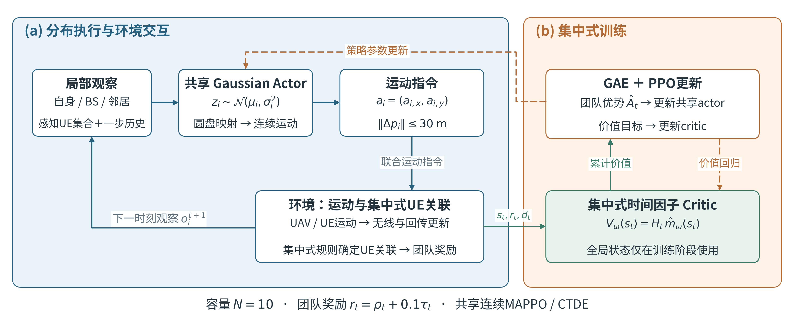
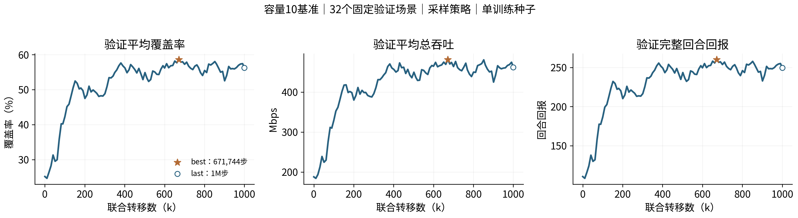
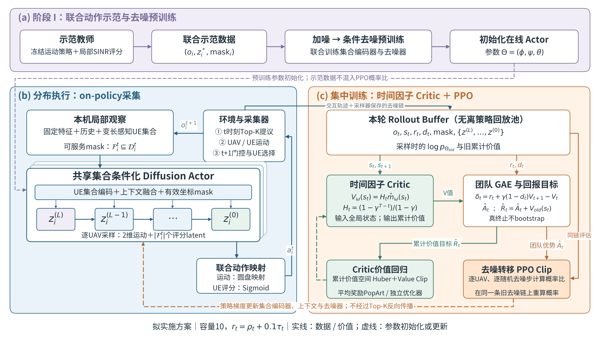

# 阶段进展汇报：从部署优化到运动—UE服务关联联合优化

按最新确定的5页结构整理。汇报起点统一为**已完成1M训练的容量10、覆盖＋数据率baseline**；不再以容量20四项奖励配置作为首页。建议总时长6–8分钟，不另设封面。

当前可确认的进度：baseline训练及验证已完成；新方法的观察、联合动作、关联和DPPO训练结构已建模；固定布局关联诊断已完成；最新扩散DPPO方案尚未实现或训练。资源分配目前特指**有限服务名额选择与UE关联**，尚不优化带宽、功率或资源块。

两张主要流程图均已生成，视觉参考本地论文《Diffusing to Coordinate: Efficient Online Multi-Agent Diffusion Policies》的Figure 1（PDF第5页）的蓝橙分区、模块和箭头组织。仅参考视觉风格，算法仍为本项目的on-policy PPO＋时间因子critic，不采用该论文的离策略回放、目标回报分布critic或熵ELBO算法。

全部图形、CSV表格及本提纲可从[素材压缩包](../analysis/progress_presentation_20261103/ppt_figures_and_tables.zip)集中取得；本轮交付的是内容与图形素材，未生成PPTX文件。

## 第1页｜研究起点：容量10、覆盖＋数据率的1M已训练baseline

### 可直接放入PPT的正文

- **场景：** 3500×3500 m，18 UAV、150移动UE、3个BS；UE在中心2500×2500 m内初始化，UAV全场均匀初始化。
- **策略：** 所有UAV共享Gaussian MAPPO actor，仅根据本机局部观察输出连续运动；最大30 m/步，反射边界。
- **训练：** 集中式时间因子critic，分布执行；一步历史观察，已完成1,000,000条联合转移。
- **关联：** UAV部署由策略学习，UE服务关联仍由环境中的集中式规则决定。
- **目标：** $r_t=\rho_t+0.1\tau_t$，其中 $\tau_t=\text{总吞吐}/(150\times5\mathrm{Mbps})$。

**本页收束句：** 当前baseline已能学习部署；下一步将把“服务哪些UE”也纳入actor的决策。

### 版式与配图

上半页：左侧放实际多跳拓扑，右侧放上述场景与方法要点。下半页：横向铺开baseline流程图，避免将两张完整大图并排压缩。

- 已生成的[baseline流程图 SVG](../analysis/progress_presentation_20261103/fig1_baseline_framework.svg)、[PDF](../analysis/progress_presentation_20261103/fig1_baseline_framework.pdf)、[PNG](../analysis/progress_presentation_20261103/fig1_baseline_framework.png)。
- 新增与训练算法V2一致的参考风格：[SVG](../analysis/progress_presentation_20261103/fig1_baseline_framework_v2_reference.svg)、[PDF](../analysis/progress_presentation_20261103/fig1_baseline_framework_v2_reference.pdf)、[PNG](../analysis/progress_presentation_20261103/fig1_baseline_framework_v2_reference.png)。内容和结构不变，原图保留。
- 已生成的[单帧实际拓扑 SVG](../analysis/progress_presentation_20261103/fig1_baseline_topology_scene10000_t400.svg)、[PNG](../analysis/progress_presentation_20261103/fig1_baseline_topology_scene10000_t400.png)。来自新baseline best、固定场景10000、t=400，18架UAV均联网、该帧覆盖70%。这是一个预指定场景示例，不是32场景平均覆盖。
- 原始完整拓扑可用 `analysis/mappo_coverage_throughput_capacity10_1m_seed0/figures/topology_best_10000.svg`，包含初始/200/400步；首页建议用新生成的单帧版本。



流程图内容：局部观察→共享Gaussian actor→圆盘运动→位置/无线/回传更新与集中式UE关联→下一观察；右侧独立显示全局状态→时间因子critic→GAE/PPO，虚线表示参数更新。

### 讲述提示

“这一阶段策略只负责运动，关联还是集中式规则。已完成的1M运行提供了后续联合控制的性能参照与运动教师。”

## 第2页｜Baseline结果：覆盖与吞吐得到提升，后期仍有波动

### 建议主图

优先使用本次从保存数据重绘的[三面板验证进度图 SVG](../analysis/progress_presentation_20261103/fig2_baseline_validation_progress.svg)、[PNG](../analysis/progress_presentation_20261103/fig2_baseline_validation_progress.png)：验证平均覆盖率、验证平均总吞吐、验证回合回报，标出best和last。



若需要说明“部署是否保持”，可选用本次生成的[回合内维持曲线 SVG](../analysis/progress_presentation_20261103/fig2_episode_maintenance.svg)、[PNG](../analysis/progress_presentation_20261103/fig2_episode_maintenance.png)，显示best/last的覆盖及断联随400步变化。版面紧张时，将该图放讲述备份，不必同时堆放全部图。

### 可直接使用的验证表

| 模型 | 训练步数 | 平均覆盖率 | 后100步覆盖率 | 平均吞吐Mbps | 回合回报 |
|---|---:|---:|---:|---:|---:|
| 未训练step0策略 | 0 | 25.14% | — | 188.07 | 110.57 |
| best | 671,744 | **58.63%** | **61.02%** | **481.47** | **260.20** |
| last | 1,000,000 | 56.25% | 57.57% | 462.20 | 249.65 |

可编辑数值表：`analysis/progress_presentation_20261103/table2_baseline_results.csv`。

### 配套分析，保留三句即可

1. best相对step0，平均覆盖提高**33.50个百分点**，平均吞吐由188.07提高至481.47 Mbps，说明该基准已学到有效部署。
2. best后100步覆盖为61.02%，未出现早期试验中那种明显的后期覆盖崩塌，但UAV仍持续移动，不能称为已经学会稳定悬停。
3. last覆盖比best低2.38个百分点，后期仍有波动，汇报同时列best和last。

### 可用的原有analysis素材

| 原有文件 | 内容 | 使用建议 |
|---|---|---|
| `analysis/mappo_coverage_throughput_capacity10_1m_seed0/figures/validation_progress.png` | 验证回报、覆盖、感知、断联、鲁棒性、吞吐的6面板图 | 取覆盖/吞吐/回报面板；本次精简图已用同一日志重绘 |
| 同目录 `deployment_and_capacity.png` | 回合内覆盖、感知、断联、容量排除、靠边、速度 | 重点选覆盖面板，解释部署维持 |
| 同目录 `reward_curves.png` | 训练日志奖励与完整回合验证回报 | 若展示，必须区分训练末采集步快照与验证全回合统计 |
| 同目录 `loss_curves.png` | actor/value loss | 可作备份，主报告优先展示任务表现 |
| `analysis/mappo_coverage_throughput_capacity10_1m_seed0/analysis_report.md` | 已核对的指标与解释 | 表格和分析的数据来源 |
| `analysis/mappo_coverage_throughput_capacity10_1m_seed0/validation_best/episodes.csv`、`validation_last/episodes.csv` | 逐场景验证数值 | 若需要自行制作表格，从这里取值 |

页脚口径：32个固定验证场景10000–10031、400步、采样动作种子880001、单训练种子0。step0是未训练策略的完整回合表现，不是静止初始部署的覆盖率。

## 第3页｜方法扩展：局部集合观察、联合动作与UE服务关联

### 左侧：观察建模

固定局部信息保留本机、BS相对位置、最近3个直连邻居和一步历史。UE部分采用**变长集合**：

\[
\mathcal D_i^t=\{m:\mathrm{SNR}^{UL}_{im}\geq\Gamma_{\rm sense}\}.
\]

每个被感知UE的特征建议按最新联合控制建模写为：

\[
e_{im}^t=\left[
\frac{x_m-x_i}{L_x},\frac{y_m-y_i}{L_y},
\frac{\mathrm{SNR}^{UL}_{im}}{30},
\frac{\mathrm{SINR}^{DL}_{im}}{30},
\mathbf1\{m\text{由本机服务}\}
\right].
\]

区别于当前baseline四维UE特征，新方案加入下行SINR。它属于待实现的局部反馈假设，不应描述为当前已训练baseline的输入。

感知集合用于观察和运动；评分仅针对本机**当前可服务集合**：

\[
\mathcal F_i^t=\{m\in\mathcal D_i^t:
\mathrm{SINR}^{DL}_{im}\geq\Gamma_{DL},\ \min_g b_{i,g}\leq U\}.
\]

共享逐UE编码＋集合聚合提供固定上下文，同时保留逐UE表示；mask区分padding与真实候选，UE编号只用于评分对齐。

### 右侧：服务关联执行流程

1. **Actor评分：** 联合输出连续运动指令，以及当前可服务UE的评分 \(q_{i,m}\in(0,1)\)。
2. **UAV提议：** 各UAV向评分最高的至多**10个UE**发出服务提议。
3. **移动后过滤：** 执行UAV与UE运动，剔除感知、下行或回传条件失效的提议。
4. **UE接入：** 每个UE选择有效提议中评分最高的UAV，建立唯一服务连接；平局按编号处理。

本轮采用一轮提议、不补位；移动后新增且未评分的候选等待下一步。

**建议排版：** 两栏。左栏放“固定观察＋UE特征行→集合编码”，右栏用四步竖向流程“Actor评分→UAV提议→移动后过滤→UE接入”。可用一个小例子表现两架UAV同时提议同一UE，UE择优后另一机存在空位，连接第5页的诊断动机。

**本页收束句：** 将部署与服务名额选择联合建模，同时用集合编码处理局部观察下不固定的动作维度。

注意：本页是最新方法的结构设计，不能用当前baseline的验证图说明这些新增机制已经学会工作。

## 第4页｜新方法训练：示范预训练＋去噪转移PPO

本页以完整流程图为主体，不再重复大段文字。

已生成[训练算法图 SVG](../analysis/progress_presentation_20261103/fig4_diffusion_training_pipeline.svg)、[PDF](../analysis/progress_presentation_20261103/fig4_diffusion_training_pipeline.pdf)、[PNG](../analysis/progress_presentation_20261103/fig4_diffusion_training_pipeline.png)。

算法图另提供三版风格供选择，内容与模块结构相同：

| 版本 | 特点 | 预览 | 矢量 |
|---|---|---|---|
| V1 原版 | 原有浅蓝/橙/紫分区，细线箭头 | [PNG](../analysis/progress_presentation_20261103/fig4_style_variants/fig4_v1_original.png) | [SVG](../analysis/progress_presentation_20261103/fig4_style_variants/fig4_v1_original.svg) |
| V2 参考风格 | 青蓝/杏橙模块、深色描边宽箭头、柱形Rollout Buffer | [PNG](../analysis/progress_presentation_20261103/fig4_style_variants/fig4_v2_reference.png) | [SVG](../analysis/progress_presentation_20261103/fig4_style_variants/fig4_v2_reference.svg) |
| V3 简洁风格 | 白色卡片、深蓝文字、青绿/琥珀强调、细线连接 | [PNG](../analysis/progress_presentation_20261103/fig4_style_variants/fig4_v3_editorial.png) | [SVG](../analysis/progress_presentation_20261103/fig4_style_variants/fig4_v3_editorial.svg) |

[三版素材包（含PDF）](../analysis/progress_presentation_20261103/fig4_style_variants/fig4_three_styles.zip)。尚未替换正文中的原版，等待选定风格。



### 图中的三个区域

- **上方紫色：阶段I预训练。** 冻结运动教师＋局部SINR评分教师→联合示范数据→加噪、条件去噪预训练→初始化集合编码器、上下文与扩散网络。
- **左侧蓝色：分布执行和采集。** 本机局部观察→集合条件扩散actor→多步随机去噪→运动与评分映射→Top-K、运动、有效性过滤及UE选择；采样器保存原观察、mask、去噪链和旧概率。
- **右侧橙色：集中训练。** 本轮on-policy rollout＋全局状态→时间因子critic→团队GAE与回报目标；逐UAV、逐去噪转移计算PPO比率并更新actor，critic单独回归累计价值。

### 讲述时用四句话串起来

1. “先用现有运动策略和局部SINR教师构造运动—评分示范，预训练扩散actor。”
2. “在线阶段每台UAV只读本机观察，通过去噪生成连续运动和候选UE评分。”
3. “保存同一条去噪链及旧log概率；PPO更新时重算这条旧链的概率，使用团队GAE优势。”
4. “critic仍预测环境奖励的累计价值；全局信息只用于训练，不提供给执行actor。”

### 算法口径，留作讲述备忘

\[
r_{t,i,\ell}=\exp\big(\log p_\Theta^{t,i,\ell}-\log p_{\Theta_{old}}^{t,i,\ell}\big),
\qquad V_\omega(s_t)=H_t\hat m_\omega(s_t).
\]

log-prob在有效动作坐标上求和，padding不参与，不对UE数平均冒充联合密度；不把18架UAV的概率比相乘。Top-K不可微，但策略梯度作用在随机去噪转移的概率上，不需要穿过匹配规则。示范数据不混入PPO旧概率分母。本轮沿用当前时间因子、GAE、Huber/Value Clip及PopArt设计；新的DPPO部分为拟实施方案。

图中为**Rollout Buffer，不是离策略Replay Buffer**；没有目标Q或参考论文的回报分布critic。布局参考论文Figure 1，训练算法没有照搬。图脚已注明拟实施方案和当前两项奖励，避免被误解为新的扩散训练已经完成。

## 第5页｜固定布局关联诊断：评分、Top-K损失与补位

### 实验目的

- 服务评分能否改变实际覆盖与吞吐？
- 一轮Top-K损失多少服务机会？
- 简单补位能够恢复多少，剩余缺口属于协议还是信息时序？

### 方法，一行设置＋四个定义

冻结当前baseline best，采集**32场景×400步**；每个转移共用同一物理布局，比较SINR、常数和20次随机评分；影子结果不反馈真实环境。

- **P0：** 动作前Top-K，动作后过滤，UE择优。
- **P1：** 保留有效服务，空闲UAV迭代申请未尝试候选，补位至无新申请。
- **O1：** 动作前后均合法、已经评分的候选图上的最大覆盖。
- **O2：** 全部动作后合法候选图上的最大覆盖。

### PPT结果表

| 评分 | P0覆盖 | P1覆盖 | O1覆盖上界 | O2覆盖上界 | P0吞吐Mbps |
|---|---:|---:|---:|---:|---:|
| SINR | **55.18%** | **55.24%** | 55.32% | 58.63% | **480.98** |
| 常数 | 54.79% | 55.19% | 55.32% | 58.63% | 455.04 |
| 随机，20次均值 | 54.79% | 55.18% | 55.32% | 58.63% | 455.27 |

可编辑数值表：`analysis/progress_presentation_20261103/table5_topk_results.csv`。

### 分析结论，突出三个数字

- **评分有收益：** SINR相对随机评分覆盖高0.39个百分点、吞吐高**25.70 Mbps（约5.65%）**。这说明评分有决策价值，不等于学习评分已优于SINR教师。
- **补位绝对收益有限：** SINR评分P1比P0只高**0.060个百分点**；随机评分则高0.382个百分点，补位对较差评分更有兜底作用。
- **时序缺口更大：** `O2-O1=3.31个百分点`，大于SINR评分下`O1-P0=0.135个百分点`。移动后新增的合法候选没有旧评分，需要等待下一步，这是当前协议的主要关联机会损失。

页脚：O1/O2只最大化服务人数，不是两项任务回报的最优上界；单训练种子、已用于选模的验证场景；本轮没有训练评分网络、没有闭环补位反馈。

### 图表素材与选择

| 原有素材 | 展示内容 | 推荐用途 |
|---|---|---|
| `analysis/topk_capacity10_coverage_throughput_best_diagnostic/report.md` | 总表、配对场景区间、缺口解释 | PPT表格与结论的直接来源 |
| 同目录 `summary.json`、`statistics.csv`、`per_scene.csv` | 全部精确数值 | 制作可编辑表格或摘要图 |
| 同目录 `figures/coverage_and_upper_bounds.png` | 三种评分随时间的P0/P1/O1/O2 | 想强调时序缺口时选用，避免与大表同时挤满一页 |
| 同目录 `figures/task_metrics_and_refill.png` | 吞吐、鲁棒性诊断、两项任务奖励 | 想强调评分对数据率作用时选吞吐面板 |
| 同目录 `figures/protocol_loss_and_scoring_effects.png` | 协议损失分布、回收及评分敏感性 | 备份，解释“归属变化多但人数变化有限” |
| 同目录 `figures/topology_selected_worst_protocol_loss.png` | 挑选的8人损失案例，补位91→99人 | 仅作备份示例，不能替代总体均值 |

本次另生成[PPT诊断摘要图 SVG](../analysis/progress_presentation_20261103/fig5_topk_summary.svg)、[PNG](../analysis/progress_presentation_20261103/fig5_topk_summary.png)，左侧是SINR下四种覆盖，右侧是三种评分的吞吐。主PPT建议优先采用“结果表＋三条结论”；摘要图作替代版，不必同时堆放。

## 图形使用、重建与已完成边界

所有新图位于 `analysis/progress_presentation_20261103/`。图1和图4为自主绘制矢量流程图；其余新图直接读取既有CSV/NPZ/JSON重绘，没有重新采样、加载策略或启动训练，原始结果不变。

- **SVG：** 推荐插入PPT，可缩放并在支持的软件中转为形状编辑；文本保留为SVG文本。
- **PDF：** 适合论文与矢量归档，已嵌入字体。
- **PNG：** 240 dpi高清版本，跨设备显示最稳妥。
- 图中中文使用Noto Sans CJK；若Windows未安装该字体，优先使用PNG，或安装同名字体后使用SVG。

重建全部素材：

```bash
OPENBLAS_NUM_THREADS=1 MKL_NUM_THREADS=8 OMP_NUM_THREADS=8 \
.venv/bin/python scripts/build_progress_presentation_assets.py
```

图表来源哈希和是否重采样记录在 `analysis/progress_presentation_20261103/assets_manifest.json`。参考论文Figure 1位于PDF第5页；仅借鉴视觉分区，未复制原图内容。

最新扩散建模文件中仍保留容量20与四项奖励的旧参数段。本PPT和训练示意图按当前确定的容量10、覆盖＋数据率基准组织；这是汇报方案约定，不表示已自动修改最新建模文档或实现新的DPPO训练代码。
